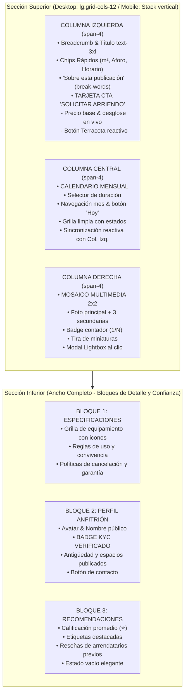

# Plan Maestro: Flujo de Arriendo y Modernización UX/UI del Marketplace (AWS Emulator & PostgreSQL 18)

> [!IMPORTANT]
> **Liberación de límites locales y Modernización UX/UI**: En el repositorio anterior (`espaciGo`), el arriendo estaba aislado en una simulación efímera en memoria y la vista pública de los espacios era estática, omitía la mayoría de los atributos y no permitía solicitar arriendos. En **`espacigo-aws`**, unificamos la persistencia en PostgreSQL 18, integramos AWS Emulator (S3 y SES) y rediseñamos la vista pública con una **arquitectura visual moderna en 3 columnas superiores y bloques inferiores**.

---

## 1. Arquitectura Visual de la Ficha Pública (`/espacios/[id]`)

---

## 2. Auditoría de Atributos y Datos Públicos

| Atributo | Fuente en PostgreSQL 18 | Estado Anterior en Ficha | Ajuste en la Ficha Rediseñada |
|---|---|---|---|
| **Aforo / Capacidad** | `espacio.capacidad_maxima` | Omitido | Chip rápido destacado (`👥 Hasta X personas`). |
| **Superficie** | `espacio.superficie_m2` | Texto simple | Chip rápido destacado (`📐 XX m²`). |
| **Equipamiento / Amenities** | `espacio_caracteristicas.valores` | Solo booleanos parciales | Grilla completa con iconos (electricidad, seguridad, montacargas, etc.). |
| **Reglas de Uso** | `espacio.reglas_uso` | Desbordaba textos largos | Contenedor con `break-words` y `overflow-wrap: anywhere`. |
| **Descripción** | `espacio.descripcion` | Texto continuo plano | Resumen truncado a 4 líneas con botón interactivo `"Ver más"`. |
| **Perfil del Anfitrión** | `usuario` + `perfil_usuario` | Omitido | Tarjeta de anfitrión con avatar, nombre público y fecha de registro. |
| **Insignia KYC Anfitrión** | `elegibilidad_verificacion_local` | No visible | Escudo verde destacado `Identidad Verificada por EspaciGo`. |
| **Garantía y Políticas** | `tarifa_espacio` + `reserva_garantia` | Omitido | Monto de garantía visible (`$50.000 CLP fija`) y política de cancelación. |
| **Evaluaciones** | `resena_ensayo_local` | Omitido | Módulo de reseñas con estrellas, tags destacados y fallback elegante. |

---

## 3. Comportamiento Reactivo: Calendario Central $\leftrightarrow$ Botón "Solicitar Arriendo"

1. **Estado Inicial (Sin fecha seleccionada)**:
   - La tarjeta de la **Columna Izquierda** muestra la tarifa base (`$XX.XXX / día`).
   - El botón terracota indica *"Selecciona fechas en el calendario"*. Al hacer clic, ejecuta un foco suave en el calendario central.
2. **Selección en Calendario Central**:
   - El usuario hace clic en un rango disponible (ej. `15 Nov - 18 Nov, 3 días`).
   - El calendario actualiza visualmente las celdas con el estilo terracota seleccionado.
   - De forma reactiva e instantánea, la tarjeta izquierda actualiza su resumen:
     - Fechas: `15 al 18 de Noviembre de 2026 (3 días)`.
     - Subtotal estimado: `$75.000 CLP`.
   - El botón terracota pasa a estado activo de alto contraste:
     - Texto: **`Solicitar Arriendo — $75.000 CLP`**.
3. **Conversión y Checkout**:
   - Al pulsar el botón activo, se genera la cotización vía `POST /api/v1/spaces/{id}/quotes` y se redirige a `/reservas/nueva?quoteId=...` con los parámetros pre-cargados.

---

## 4. Versión Móvil y Barra Inferior Fija Flotante

- En pantallas móviles (`< lg`), las 3 columnas se organizan verticalmente:
  1. Galería multimedia con carrusel deslizable.
  2. Título, chips de resumen y descripción ("Ver más").
  3. Calendario mensual interactivo.
  4. Bloques de especificaciones, anfitrión y reseñas.
- **Barra Inferior Fija (`sticky bottom-0`)**:
  - Permanece anclada en el fondo del viewport mostrando el precio actual y el botón terracota **`Solicitar Arriendo`**, permitiendo al usuario avanzar en cualquier punto de la navegación sin tener que subir al inicio.

---

## 5. Hoja de Ruta de Implementación

### Fase 1: Extensión del DTO en Backend Go
- [x] Ampliar `internal/publiccatalog` para incluir `capacidad_maxima`, atributos completos de `espacio_caracteristicas`, datos públicos del anfitrión y badge KYC.
- [x] Verificar `GET /api/v1/public/spaces/{id}` en Go.

### Fase 2: Implementación de la Sección Superior en 3 Columnas
- [x] Reestructurar [frontend/src/app/(marketplace)/espacios/[id]/page.tsx](file:///home/nandev/Documentos/projects/espacigo-aws/frontend/src/app/(marketplace)/espacios/[id]/page.tsx) con grid de 12 columnas (`lg:grid-cols-12 gap-6`).
- [x] Construir la Columna Izquierda con chips, descripción con `break-words` y tarjeta CTA de arriendo.
- [x] Conectar reactivamente el componente `MonthCalendar` de la Columna Central con la tarjeta de la Columna Izquierda.
- [x] Ubicar la galería de imágenes en la Columna Derecha con mosaico 2x2 y lightbox.

### Fase 3: Bloques Inferiores y Experiencia Móvil
- [x] Crear el Bloque 1 (Equipamiento, servicios y reglas de uso con iconos).
- [x] Crear el Bloque 2 (Tarjeta del anfitrión con sello KYC verificado).
- [x] Crear el Bloque 3 (Reseñas, calificaciones y estado vacío).
- [x] Incorporar la barra inferior fija de reserva para dispositivos móviles.

### Fase 4: Conexión con Checkout y Validación de Tipos
- [x] Conectar la acción del botón al flujo de arriendo y cotización en backend (`/reservas/nueva`).
- [x] Pre-poblar `<BookingQuoteCard>` con los parámetros del marketplace (`spaceId`, `defaultRateUnit`, `initialStartDate`, `initialDurationUnits`).
- [x] Ejecutar `pnpm typecheck`, `pnpm test` (654 tests unitarios pasados) y suites de Playwright (`8/8` en `marketplace-phase1`, `1/1` en `public-rental-commercial`).

### Fase 5: Ciclo de Vida Completo de Reserva, Pagos y Contratos (Validado End-to-End)
- [x] **Cotización Real y Snapshot Inmutable**: `POST /api/v1/local/booking-trial/quotes` calcula precio unitario y desglose con TTL de 15 minutos en `cotizacion_reserva_ensayo`.
- [x] **Reserva y Bloqueo Atómico de Ocupación**: `POST /api/v1/local/booking-trial/reservations` bloquea el rango con índice GiST en `public.ocupacion` impidiendo solapamientos.
- [x] **Simulación de Pago y Notificaciones**: `POST /.../payment` con `outcome: "exito"` transiciona a `pagada` y despacha correos automáticos tanto a arrendatario como a anfitrión a través de SES emulado a Mailpit (`:8025`).
- [x] **Garantía y Aprobación de Anfitrión**: `POST /.../guarantee` autoriza el monto de garantía y `POST /.../decision` con `decision: "aprobar"` transiciona el estado a `aprobada_host`.
- [x] **Contratos Sintéticos y Doble Firma**: Generación automática de contrato, firma digital de ambas partes (`POST /.../contracts/{id}/sign`), pasando a `firmado` y la reserva a `lista_para_checkin`.
- [x] **Descarga de PDF y Mensajería**: Generación y descarga directa de `contrato-ensayo-sintetico.pdf` (`GET /.../contracts/{id}/document`) y comunicación bidireccional en `/messages` auditada en PostgreSQL 18.

### Fase 6: Ciclo Operativo Post-Firma, Cierre Financiero y Reputacional (100% Validado)
- [x] **Check-in Operacional**: `POST /api/v1/local/booking-trial/reservations/{id}/check-in` validado por el arrendatario, generando evidencia fotográfica sintética en S3 y transicionando la reserva a `en_curso`, con notificación SES a Mailpit.
- [x] **Check-out de Arrendatario**: `POST /api/v1/local/booking-trial/reservations/{id}/check-out` con ventana límite de reclamo de 24 horas (`claim_deadline_at`), transicionando a `finalizada`.
- [x] **Recepción Conforme de Anfitrión**: `POST /api/v1/local/booking-trial/reservations/{id}/reception` ejecutada por el anfitrión, desactivando atómicamente el bloqueo en `public.ocupacion` y liberando el calendario para nuevos arriendos.
- [x] **Liberación Soberana de Garantía**: `POST /api/v1/local/booking-trial/reservations/{id}/guarantee` con `kind: "liberacion"`, liberando íntegramente los $50.000 CLP en `public.reserva_garantia_ensayo_local` (`estado: "liberada"`).
- [x] **Liquidación Financiera al Anfitrión**: `POST /api/v1/local/booking-trial/reservations/{id}/settlement` ejecutada bajo política `liquidacion_local_0pct_v1` por $140.000 CLP netos transferidos al anfitrión, cerrando la reserva a `cerrada`.
- [x] **Evaluaciones Mutuas y Visualización en Ficha Pública**: Publicación de calificación y comentarios recíprocos de 5 estrellas (`POST /.../reviews`), renderizados en tiempo real en el Bloque 3 del Marketplace (`/espacios/[id]`) con promedio, contador y tags de calidad.
- [x] **Script de Bootstrap Reproducible**: Creación de [scripts/seed-rental-lifecycle.sh](file:///home/nandev/Documentos/projects/espacigo-aws/scripts/seed-rental-lifecycle.sh) para poblar y reparar de forma autónoma cuentas con KYC aprobado y el espacio comercial en segundos.

### Fase 7 (Fase A): Reclamos de Daño, Disputas y Arbitraje de Garantías (100% Validado)
- [x] **Apertura de Reclamo de Daño**: `POST /api/v1/local/booking-trial/reservations/{id}/damage-claim` ejecutado por el anfitrión post check-out, transicionando la reserva a `en_disputa` e iniciando el reclamo en estado `abierto`.
- [x] **Descargo Formal del Arrendatario**: `POST /api/v1/local/booking-trial/reservations/{id}/damage-claim/defense` registrando la justificación del arrendatario contra el cobro.
- [x] **Carga de Evidencia Fotográfica de Defensa**: `POST /api/v1/local/booking-trial/reservations/{id}/damage-claim/defense/evidence` almacenando evidencia sintética cifrada en S3 local (`espacigo-evidence-local`).
- [x] **Cola y Auditoría Administrativa**: `GET /api/v1/admin/local/damage-claims` y descarga de imagen probatoria (`GET /.../evidence/{evidenceId}`) por el rol `administrador`.
- [x] **Dictamen Arbitral del Administrador**: `POST /api/v1/admin/local/damage-claims/{claimID}/resolution` con `outcome: "acogido"` y `reason_code: "evidencia_suficiente"`, resolviendo el reclamo a `resuelta` y devolviendo la reserva a `finalizada`.
- [x] **Decisión Financiera**: Registro de `public.reserva_decision_financiera_ensayo_local` por deducción parcial acreditada ($12.000 CLP de $50.000 CLP autorizados).
- [x] **Captura Parcial y Liberación de Saldo de Garantía**: `POST /.../guarantee` con `kind: "captura"` ($12.000 CLP $\rightarrow$ `parcialmente_capturada`), seguida de `kind: "liberacion"` ($38.000 CLP restantes $\rightarrow$ `liberada`).
- [x] **Recepción y Liquidación Final Post-Disputa**: Anfitrión confirma recepción (`POST /.../reception`), liberando el calendario GiST en `public.ocupacion`, y ejecuta liquidación final (`POST /.../settlement`) transicionando la reserva a `cerrada`.
- [x] **Verificación UI Frontend**: Renderizado reactivo verificado en `BookingDisputesPanel` (`/reservas/{id}` y `/anfitrion/reservas/{id}`) y en el panel global `/administracion/disputas`.

### Fase 8 (Fase B): Cancelaciones de Arriendo, Devoluciones y Desbloqueo de Calendario (100% Validado)
- [x] **Consulta de Previsualización de Reembolso (`cancellation-preview`)**: `GET /api/v1/local/booking-trial/reservations/{id}/cancellation-preview` validando elegibilidad (`eligible: true`), fecha límite (`deadline`), política (`local_flexible_v1`) y monto total de reembolso a favor del arrendatario ($70.000 CLP).
- [x] **Cancelación Post-Pago por Arrendatario**: `POST /api/v1/local/booking-trial/reservations/{id}/cancel` con motivo formal, transicionando a `cancelada_arrendatario`, cerrando garantías, cancelando contratos y liberando atómicamente la ocupación en `public.ocupacion` (`activo = false`).
- [x] **Gestión y Simulación de Devolución Soberana**: Generación de `public.reserva_devolucion_ensayo` en `pendiente`, seguida por su ejecución exitosa (`POST /.../refund`) transicionando a `completada` y despachando alertas transaccionales SES a Mailpit (`:8025`).
- [x] **Rechazo / Cancelación por el Anfitrión**: `POST /api/v1/local/booking-trial/reservations/{id}/decision` con `decision: "rechazar"`, transicionando a `rechazada_arrendador`, registrando devolución simulada en `public.reserva_pago_ensayo` y desactivando de inmediato la reserva en `public.ocupacion`.
- [x] **Cancelación Pre-Pago**: Cancelación antes de transferir fondos, liberando la retención de calendario de inmediato sin generar deuda ni reembolsos (`refund_state: "no_aplica"`).
- [x] **Integración y Panel UI**: Visualización verificada en `ReservationLifecyclePanel` (`/reservas/{id}`) con botones de "Consultar Política de Reembolso", desglose de penalización/devolución y "Simular Devolución Exitosa".

### Roadmap de Siguientes Fases
- [ ] **Fase C: Gestión Multimedia de Espacios (Host Space Wizard)**:
  - Creación y edición de espacios comerciales desde la interfaz de anfitrión (`/anfitrion/espacios/nuevo` y `/anfitrion/espacios/{id}/editar`).
  - Subida directa y procesamiento WebP de fotografías hacia el bucket local `espacigo-media-local` vía adaptador `s3storage.MediaStore`.
- [ ] **Fase D: Despliegue de Infraestructura Cloud en AWS (Ohio us-east-2)**:
  - Validación de módulos OpenTofu/Terraform en `infra/terraform/environments/aws-main`.
  - Configuración del Free Tier en AWS (RDS PostgreSQL 18 `db.t4g.micro`, S3, SES, ECS Fargate).

