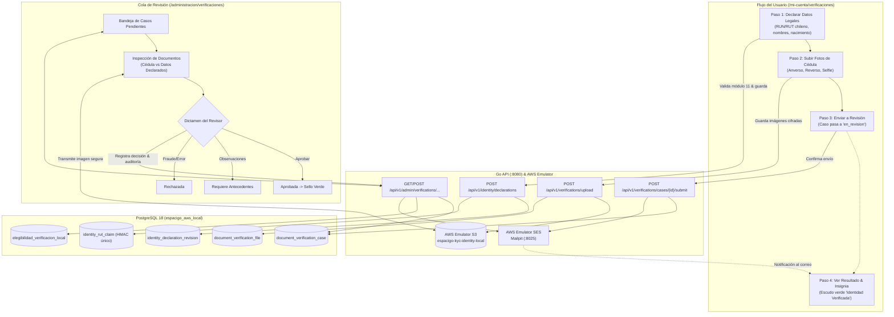

# Plan Maestro: Verificación de Identidad KYC Soberana (AWS Emulator & PostgreSQL 18)

> [!IMPORTANT]
> **Evolución Estratégica**: En el proyecto original (`espaciGo`), se descartó la integración externa con Didit debido a altos costos en dólares, límites estrictos de cuota mensual y la incapacidad de recibir webhooks HTTPS en localhost. Se optó por una **verificación documental propia y soberana** (cédula física chilena + selfie + cola de revisión humana). En **`espacigo-aws`**, liberamos este sistema para que funcione de punta a punta con PostgreSQL 18, S3 y SES locales.

---

## 1. Arquitectura del Flujo KYC End-to-End

---

## 2. Comparativa: Lo que faltó en espaciGo vs. Lo que se habilita en espacigo-aws

| Aspecto | Bloqueo Anterior en `espaciGo` (GCP) | Implementación Adaptada en `espacigo-aws` (Local) |
|---|---|---|
| **Proveedor KYC** | Didit en la nube requería pagos por intento y webhooks públicos inaccesibles en `localhost`. | **Sistema propio soberano**: Validación nativa de RUN/RUT chileno + subida de documentos + panel de revisores. |
| **Almacenamiento de Archivos** | Adaptador atado a Google Cloud Storage (`gcs`), fallando en local sin buckets reales. | **Almacenamiento en S3 local**: Bucket `espacigo-kyc-identity-local` en `aws-emulator:9297`. |
| **Prevención de RUT Duplicado** | Migración `V89` sin conectar al endpoint de registro. | **`identity_rut_claim` activado**: Unicidad garantizada con fingerprint criptográfico HMAC del RUT. |
| **Cola de Revisores** | Pantalla desconectada de la descarga de imágenes reales. | **Visor de evidencias integrado** en `/administracion/verificaciones` con streaming seguro desde S3. |
| **Notificación de Estado** | Ausente o logs en consola. | **AWS SES emulado con entrega instantánea a Mailpit** ([http://127.0.0.1:8025](http://127.0.0.1:8025)). |
| **Modo Rápido para Pruebas** | Inexistente: requería cambiar roles manualmente en la base de datos para simular verificaciones. | **Acción de desarrollo local**: Endpoint para verificar la cuenta actual con un clic y probar publicaciones y arriendos. |

---

## 3. Modelo de Datos en PostgreSQL 18

Las tablas ya están disponibles en `espacigo_aws_local`:
- **`identity_declaration_revision`**: Snapshot inmutable de los datos civiles declarados por el usuario (nombres, apellidos, nacimiento y RUN/RUT).
- **`identity_rut_claim`**: Registro exclusivo del hash HMAC del RUT para prevenir duplicados entre usuarios.
- **`document_verification_case`**: Ciclo de vida del caso (`borrador` $\to$ `enviada` $\to$ `en_revision` $\to$ `aprobada` / `requiere_antecedentes` / `rechazada`).
- **`document_verification_file`**: Metadatos, hashes SHA256 y rutas en S3 de los 3 archivos: `identity_front`, `identity_back` y `identity_selfie`.
- **`identity_reviewer_observation_audit`**: Trazabilidad y notas de auditoría de cada decisión del revisor.
- **`elegibilidad_verificacion_local`**: Registro de validez de identidad que desbloquea la publicación y arriendo de espacios.

---

## 4. Hoja de Ruta de Implementación (Roadmap Completado y Verificado)

### Fase 1: Declaración Legal y Subida a S3 (Completada)
- [x] Conectar `POST /api/v1/identity/declarations` a `identity_declaration_revision` y `identity_rut_claim` con validación módulo 11.
- [x] Habilitar la subida multipart de fotos en Go hacia el bucket S3 local `espacigo-kyc-identity-local` (AWS Emulator).
- [x] Validar el formulario de usuario en [frontend/src/app/(workspace)/mi-cuenta/verificaciones/page.tsx](file:///home/nandev/Documentos/projects/espacigo-aws/frontend/src/app/(workspace)/mi-cuenta/verificaciones/page.tsx) con cookies de sesión y sin fuga de credenciales.

### Fase 2: Envío del Caso y Notificación Inicial (Completada)
- [x] Endpoint `POST /api/v1/document-verification/cases/{id}/submit` que valide la existencia de las 3 fotos limpias (`identity_front`, `identity_back`, `identity_selfie`) y pase a estado `en_revision`.
- [x] Control estricto de concurrencia optimista con ETag `If-Match: "{revision}"`.
- [x] Emisión de correo informativo de confirmación de recepción hacia Mailpit.

### Fase 3: Cola de Revisión Administrativa (Completada)
- [x] Habilitar listado de solicitudes en `/administracion/verificaciones` y `/mi-cuenta/revisiones` (`reviewer-queue`).
- [x] Integrar visualizador seguro de imágenes con streaming directo desde el bucket S3 emulado.
- [x] Formulario de decisión: Aprobar, Pedir Antecedentes o Rechazar con notas inmutables en `identity_reviewer_observation_audit`.
- [x] Activación automática de `public.elegibilidad_verificacion_local` con tipo `kyc` y estado `elegible`.

### Fase 4: Desbloqueo y Sello de Identidad en la Plataforma (Completada)
- [x] Proyección de la insignia verde «Identidad Verificada» en `/mi-cuenta`, navbar y catálogo público (`/espacios/[id]`).
- [x] Cumplimiento de regla de negocio crítica: vigencia de verificación acotada a un máximo estricto de 24 meses (`verified_until <= verified_at + 24 months`).
- [x] Desbloqueo del motor comercial de arriendos: la API de reservas valida que ambas partes (arrendatario y anfitrión) cuenten con KYC vigente antes de confirmar cotizaciones y contratos.
- [x] **21/21 tests Playwright en verde**: `identity-declaration.spec.ts`, `identity-evidence-upload.spec.ts`, `phase-f6-document-verification.spec.ts`, `reviewer-queue.spec.ts`.
