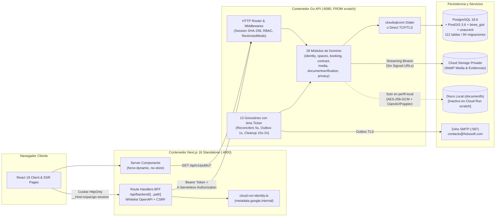
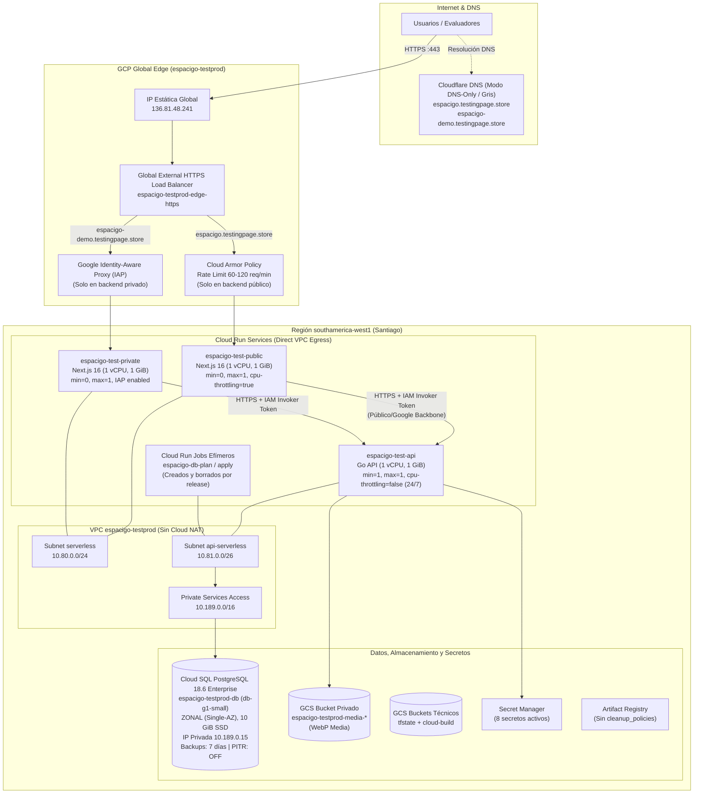

# 01 — Auditoría del Estado Actual (Software, Infraestructura GCP, Base de Datos y CI/CD)

**Fecha de auditoría:** 15 de noviembre de 2026  
**Alcance:** Inspección estática de solo lectura sobre `/home/nandev/Documentos/projects/espaciGo` (checkout local `19dabb1` y rama `main` `7b01a47`) y `/home/nandev/Documentos/projects/Proyectotitulo`.  

> [!IMPORTANT]
> **Reconciliación de Ramas y Estado Real:**
> Durante la auditoría se verificó que el checkout principal de `espaciGo` apunta a `19dabb1` (31-oct-2026, con documentos de arquitectura agregados el 11-nov-2026), mientras que la rama `main` (`7b01a47`, del 14-nov-2026) contiene la evolución `FLUJO-01..07` y la migración `V000084` **efectivamente desplegadas en GCP**. Este informe audita y reconcilia ambos estados, distinguiendo lo **[VERIFICADO EN CÓDIGO/GCP]** de lo **[DOCUMENTADO/SIMULADO]**.

---

## 1. Auditoría de Arquitectura de Software

### 1.1 Estructura del Monorepo
EspaciGo es un **monorepo híbrido** que aloja el backend en Go en la raíz (`github.com/HernanEspinozaDev/espaciGo`, `go 1.27.1` en `go.mod:1-3`) y el frontend/BFF en `frontend/` (`Next.js 16.4.3`, `React 19.3.0`, `Node >=24.21.0`, `pnpm@12.15.0` en `frontend/package.json:1-35`).

#### Diagrama de Arquitectura Lógica de Software (Estado Actual)

### 1.2 Frontend Next.js (`frontend/`) — Hallazgos Técnicos
1. **Renderizado 100% Dinámico (`force-dynamic`) [VERIFICADO]:**
   - No existe uso de SSG (`generateStaticParams`) ni ISR (`revalidate`) en `frontend/src/`.
   - Todas las rutas públicas en `src/app/(marketplace)/` y `src/app/(auth)/` exportan `dynamic = "force-dynamic"` y consultan al backend con `fetch(..., { cache: "no-store" })` (`src/features/public-catalog/infrastructure/go-public-catalog-adapter.ts:34-43`).
2. **Patrón BFF Same-Origin con Lista Blanca OpenAPI [VERIFICADO]:**
   - No existe ninguna variable `NEXT_PUBLIC_*` en el código fuente ni middleware CORS en el backend Go.
   - El navegador se comunica exclusivamente con `/api/backend/*`. El gateway `src/app/api/backend/[...path]/route.ts:1-439` valida cada ruta, método y query param contra `gateway-operations.ts` (autogenerado desde OpenAPI), verifica cabeceras CSRF (`Sec-Fetch-Site` y `Origin` con `https:`), lee la cookie `HttpOnly` `__Host-espacigo-session` e inyecta `Authorization: Bearer <token>` hacia el backend Go.
3. **Incompatibilidad Directa con Cloudflare Workers / Pages Estático [VERIFICADO]:**
   - Los 4 Route Handlers del BFF declaran `export const runtime = "nodejs"`.
   - `src/lib/api/cloud-run-identity.ts:20-28` invoca `http://metadata.google.internal/computeMetadata/v1/instance/service-accounts/default/identity` para adjuntar `X-Serverless-Authorization` hacia Cloud Run.
   - `src/app/api/backend/[...path]/route.ts:13, 292-316` almacena en un `Uint8Array` en memoria payloads multipart de hasta **50 MiB** (`MAX_PROXY_BODY_BYTES`).
   - `src/app/api/health/route.ts:8` usa `process.uptime()` y `auth-facade.ts:380` usa `NodeJS.Timeout.unref()`.

### 1.3 Backend Go (`cmd/`, `internal/`) — Hallazgos Técnicos
1. **Autenticación y Sesiones en Base de Datos [VERIFICADO]:**
   - A pesar de que existe un secreto llamado `espacigo-test-jwt-secret` en GCP, **el dominio de usuarios no usa JWTs sin estado**: genera tokens opacos aleatorios, guarda su hash `SHA-256` en la tabla `sesion` (`internal/identity/auth_service.go:770-849`) con expiración absoluta de **8 horas** e inactividad de **30 minutos**, y en cada petición autenticada ejecuta una transacción con bloqueo de cuenta (`WithLockedAccount`) y actualiza `LastActivityAt` (`TouchSession`).
2. **13 Workers en Memoria que Impiden Escalar a Cero [VERIFICADO]:**
   - `cmd/api/main.go:575-701` lanza **13 goroutines con `time.Ticker`** dentro del mismo proceso HTTP:
     - Cada `1s`: `credential-notices`, `notice-delivery` (envío de correos transaccionales vía Outbox).
     - Cada `5s`: `payment-reconciler`, `guarantee-reconciler`, `settlement-reconciler`, `contract-lifecycle`.
     - Cada `10s`: `privacy-suppression-replay-export`.
     - Cada `15s`: `operation-cleanup`, `retired-photo-cleanup`, `gallery-retention`.
     - Cada `1m`: `media-cleanup`.
     - Cada `1h`: `notice-purge`, `local-privacy-retention`.
   - Esta decisión arquitectónica es la razón por la que `espacigo-test-api` en Cloud Run tiene `minScale=1` y `cpu-throttling=false` (pagando 1 vCPU y 1 GiB las 730 horas del mes).
3. **Almacenamiento de Archivos sin URLs Firmadas y Brecha en `documentverification` [VERIFICADO]:**
   - **Cero Signed URLs:** Todos los archivos en GCS (`internal/adapters/cloudstorage/`) son privados y se transmiten haciendo streaming binario completo a través de Go $\rightarrow$ Next.js BFF $\rightarrow$ Navegador.
   - **Contratos PDF en PostgreSQL (`bytea`):** Los contratos generados en `internal/adapters/postgres/contracts/repository.go:118-165` se cifran con AES-256-GCM (`LOCAL_CONTRACT_ENCRYPTION_KEY_FILE`) y se almacenan directamente como `bytea` dentro de PostgreSQL (con marca de agua `"ENSAYO SINTETICO LOCAL - SIN VALIDEZ JURIDICA"`).
   - **Verificación Documental (`internal/documentverification`) rota en Cloud Run:** El adaptador `internal/adapters/documentfs/store.go` **solo implementa disco local** (`DOCUMENT_VERIFICATION_STORAGE_ROOT`), y el inspector (`internal/documentverification/inspection/inspector.go`) invoca los binarios externos `/usr/bin/pdfinfo` y `/usr/bin/pdfdetach` (Poppler) más un socket TCP a **ClamAV (`clamd`)**. Como la imagen de producción de `cmd/api` en `Dockerfile:16-23` usa `FROM scratch` (sin Poppler ni ClamAV ni adaptador GCS para `documentfs`), este módulo no puede operar en el contenedor actual de Cloud Run.
4. **Integraciones Externas: Realidad vs. Documentación [VERIFICADO]:**
   - **MercadoPago Checkout Pro / Split 1:1:** **100% simulado** en `internal/adapters/fakebooking/payment.go`.
   - **Didit KYC / SimpleFirma:** **100% simulado** (`local-fixture-v1` en `internal/verification/service.go:77-92`), aunque en `V000084` se prepararon las tablas `identity_verification_attempts` y `didit_webhook_inbox`.
   - **SMTP Zoho:** **Real**, pero con el remitente `contacto@hotusoft.com` y regex `^(smtp|smtppro)\.(zoho)\....$` **hardcodeados en el código fuente** (`internal/adapters/zohoauth/mailer.go:64-67`), lo que impide usar Amazon SES u otro dominio sin modificar esas líneas.

---

## 2. Auditoría de Infraestructura Actual en GCP (`espacigo-testprod`)

### 2.1 Diagrama de Arquitectura Actual Observada en GCP

### 2.2 Inventario Verificado de Recursos GCP y Costos Reales
De acuerdo con el corte de facturación real (`docs/presupuesto_gcp_espacigo.md`) y el inventario vivo (`planning/flujo_entornos/evidence/flujo01_inventory_20261106.json`):

| Recurso GCP | Configuración Real Observada | Costo Mensual Real (`testprod`) | Problemas / Discrepancias Detectadas |
| :--- | :--- | :---: | :--- |
| **Cloud SQL (`espacigo-testprod-db`)** | PostgreSQL 18.6 Enterprise, `db-g1-small` (1 vCPU compartida, 1.7 GB RAM), 10 GiB SSD, **ZONAL** (`southamerica-west1-b`), IP privada `10.189.0.15`. | **~$41 – $45 USD/mes** (47% del total) | **Sin HA (Single-AZ)**, **PITR desactivado**, **Deletion Protection desactivado**, retirado de `main.tf` (drift de Terraform). Además figura un registro fantasma `espacigo-testprod-db-master`. |
| **Global HTTPS Load Balancer + Cloud Armor** | `EXTERNAL_MANAGED`, IP fija `136.81.48.241`, 2 Serverless NEGs (`public` y `private`), 1 política Cloud Armor (solo 2 reglas de rate limit). | **~$22 – $25 USD/mes** (26% del total) | Costo fijo por hora elevado para un entorno de pruebas/MVP, cuando Cloudflare DNS ya está en frente pero con el proxy apagado (`proxied=false`). |
| **Cloud Run (`espacigo-test-api`)** | 1 vCPU, 1 GiB RAM, `minScale: 1`, `maxScale: 1`, `cpu-throttling: false` (always-on). | **~$19 – $22 USD/mes** (24% del total) | En `presupuesto_gcp_espacigo.md` se declaró `Min: 0`, pero en GCP corre con `minScale: 1` y CPU 24/7 para sostener los 13 tickers en memoria. |
| **Cloud Run (`public` y `private`)** | Dos despliegues idénticos de la misma imagen Next.js (`espacigo-web`), 1 vCPU, 1 GiB, `minScale: 0`, `cpu-throttling: true`. | **~$0 – $2 USD/mes** | Duplicación de servicios solo para proteger el subdominio `demo` con Google IAP. |
| **Artifact Registry, GCS y Secret Manager** | 1 repo Docker (3 imágenes), 3 buckets activos (`tfstate`, `cloud-build`, `media`), 8 secretos. | **~$2.20 USD/mes** | Artifact Registry **no tiene `cleanup_policies`**, acumulando imágenes en cada push a `main`. El env `CLOUD_STORAGE_BUCKET` apunta a un bucket eliminado (`404`). |
| **TOTAL ACTUAL (`espacigo-testprod`)** | **Burn rate real: ~$2.95 USD/día** | **~$88.50 USD/mes** (~$80.000 CLP/mes) | Cubierto temporalmente por $173.60 USD restantes de Free Trial (se agota en **~58 días**, enero 2027). |

---

## 3. Auditoría de Base de Datos PostgreSQL y Migraciones

1. **Esquema y Objetos:**
   - **84 archivos de migración** (`V000001` a `V000084`), **112 tablas de negocio** (+ `schema_migrations`), **56 funciones PL/pgSQL y SQL** (incluyendo 4 funciones `SECURITY DEFINER` en el esquema privado `document_verification_private`), **37 triggers**, **3 restricciones/índices GiST** (`ocupacion` con `tstzrange`, `espacio_horario_semanal_tramo` con `int4range`, `reserva_ensayo_local_ubicacion_sintetica` con `geography(Point, 4326)`), **3 índices GIN** (`tsvector` y `jsonb`) y **0 tipos `ENUM`**.
   - **Extensiones usadas:** Únicamente `btree_gist`, `postgis` y `unaccent`.
2. **Mecanismo de Migración (`cmd/dbmigrate`):**
   - Usa bloqueo de sesión `pg_advisory_lock(0x45535047, 0x4d494752)`, transacciones por archivo, verificación de secuencia contigua y validación de SHA-256 de cada archivo `.sql` más `runner_checksum` del binario.
3. **Lecciones de los Incidentes `GCP-03`, `GCP-04` y `V000084`:**
   - En GCP, haber importado las tablas iniciales con owner `postgres` y luego exigir en `V000081`–`V000083` el rol `espacigo_schema_owner` sin permisos `CREATE` en `public` ni `REFERENCES` en `public.usuario` provocó bloqueos repetidos que requirieron scripts manuales de reparación (`db/repair/prepare_spaces_cloudsql_v81.sql`, `v82`, `finalize_v83`) y un lease administrativo de emergencia para `V000084` (`planning/gcp/v84_recovery_operation.md`).
   - Además, `V000081` aborta si el usuario maestro del motor administrado (`postgres` / `rds_superuser`) conserva membresía automática en `pg_auth_members` sobre `espacigo_schema_owner`, `espacigo_document_verification_fn` o `espacigo_runtime`.

---

## 4. Auditoría de CI/CD y Operaciones

1. **Pipeline Activo en `main` (`FLUJO-01..07`):**
   - `cloudbuild.yaml` invoca `scripts/gcp/quality_gate.py` (tests Go + Next.js + migraciones) y `scripts/gcp/release_main.py --execute`.
   - Adquiere un lock optimista en GCS (`if-generation-match`), clasifica el alcance (`docs`, `web`, `full`), dispara un backup `ON_DEMAND` en Cloud SQL si hay migraciones pendientes, provisiona y ejecuta **Cloud Run Jobs efímeros** (`espacigo-db-plan-*` y `espacigo-db-apply-*`) sin bastión SSH, despliega las revisiones de Cloud Run con `--no-traffic`, verifica `/health/ready` y `/healthz`, y promueve el tráfico con rollback automático de revisión si falla.
2. **Deuda Técnica en el Repositorio:**
   - Existen **12 Dockerfiles obsoletos (`Dockerfile.gcp03*`, `gcp04*`, `gcp06*`)** en la raíz (dos de ellos con espacios en el nombre de archivo: `Dockerfile.gcp03- inspect` y `Dockerfile.gcp04-app- smoke`), **17 binarios one-shot en `cmd/gcp*`** y **11 paquetes en `internal/gcp*`** que ya no se usan pero ensucian el árbol de compilación.

---

## 5. Clasificación Consolidada del Diagnóstico

### 🔴 Problemas Críticos
1. **Módulo `documentverification` inoperante en la imagen de producción (`FROM scratch`):** No tiene adaptador de almacenamiento en la nube (usa `documentfs` local) ni binarios de Poppler/ClamAV dentro del contenedor `api`.
2. **PITR (Point-in-Time Recovery) y Deletion Protection desactivados en Cloud SQL:** Incumple directamente el requisito `RNF-010` (RPO ≤ 15 minutos) de la Memoria de Título y expone a pérdida de hasta 24 horas de datos o borrado accidental.
3. **Remitente y host SMTP hardcodeados en código (`internal/adapters/zohoauth/mailer.go:64-67`):** Bloquea el uso de Amazon SES o del dominio propio de EspaciGo sin modificar y recompilar el código Go.

### 🟠 Riesgos de Seguridad y Cumplimiento (Ley 21.719)
1. **Almacenamiento de contratos PDF dentro de PostgreSQL (`bytea`):** Infla el tamaño de la base de datos transaccional, sus backups y el uso de memoria de `pgxpool`, en lugar de usar almacenamiento de objetos cifrado con KMS y retención inmutable (Object Lock).
2. **Falta de separación física de buckets por clase de datos (`enable_data_class_buckets = false`):** Los buckets dedicados para KYC y contratos definidos en Terraform nunca se activaron.
3. **Guards frágiles de roles en PostgreSQL (`V000081`) y propiedad dividida (`postgres` vs `espacigo_schema_owner`):** Riesgo alto de fallo en cualquier restauración o migración si no se estandariza el script de bootstrap de roles antes de aplicar el esquema.

### 🟡 Ineficiencias de Costos (FinOps)
1. **Instancia `espacigo-test-api` encendida 24/7 con 1 vCPU / 1 GiB (`cpu-throttling: false`):** Paga capacidad dedicada completa todo el mes únicamente por mantener 13 `time.Ticker` en memoria en un entorno sin tráfico comercial.
2. **Global External HTTPS Load Balancer + Cloud Armor (~$23–$25 USD/mes fijos):** Piso fijo desproporcionado cuando Cloudflare ya administra el DNS y ofrece proxy CDN, SSL, DDoS y reglas WAF/Rate-Limiting en el borde de Santiago sin costo por hora de balanceador.
3. **Ausencia de `cleanup_policies` en el registro de contenedores:** Crecimiento indefinido de imágenes en cada commit a `main`.

### 🔵 Complejidad Innecesaria y Deuda Técnica
1. **Doble servicio Cloud Run para el mismo frontend (`espacigo-test-public` y `espacigo-test-private`):** Solo existe para aplicar Google IAP sobre el subdominio `demo`.
2. **28 artefactos históricos de migración GCP (`12 Dockerfile.gcp*`, `17 cmd/gcp*`, `11 internal/gcp*`)** y divergencia entre la rama local `19dabb1` y `main` (`7b01a47`).
3. **Streaming doble de imágenes públicas (GCS $\rightarrow$ Go API $\rightarrow$ Next.js BFF $\rightarrow$ Cliente):** En lugar de servir las variantes públicas WebP directamente desde un CDN (CloudFront / Cloudflare) con caché en el borde.
