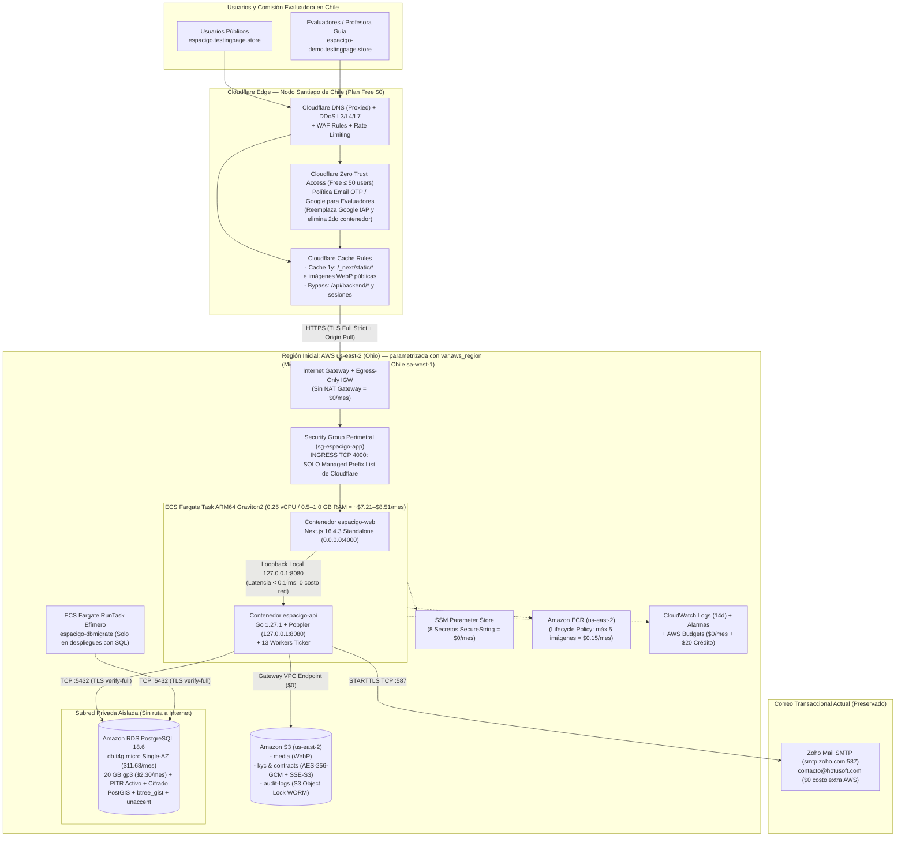

# 03 — Evaluación de Alternativas, Cloudflare Zero Trust y Comparativa Next.js 16: Contenedor vs. Cloudflare Workers

**Fecha de actualización:** 15 de noviembre de 2026  

---

## 1. Resumen de las Alternativas Evaluadas para `us-east-2` (con Evolución a AWS Chile)

1. **Alternativa A — Solo AWS (`us-east-2`):** CloudFront + ECS Fargate + RDS PostgreSQL 18 Single-AZ + S3. Prescinde de las capacidades perimetrales avanzadas de Cloudflare o duplica costos si se activa AWS WAF ($5/mes + $1/regla) y no resuelve gratuitamente el reemplazo de Google IAP para evaluadores.
2. **Alternativa B — AWS Producción Multi-AZ Completo desde el Día 1 (`us-east-2`):** CloudFront + AWS WAF + ALB Multi-AZ + ECS Fargate Multi-AZ + RDS Multi-AZ. Cumple SLA de 99,95% desde el primer minuto, pero su costo fijo (**~$112 a $128 USD/mes**) supera en casi 4 veces el objetivo de **< $30 USD/mes** post-créditos en una etapa donde aún no existen ingresos comerciales.
3. **Alternativa C (Seleccionada y Adaptada a `us-east-2`) — Híbrida Cloudflare Edge + Contenedores en AWS ECS Fargate + RDS PostgreSQL 18 Single-AZ (con Ruta a Multi-AZ y AWS Chile):**
   - Combina el borde de **Cloudflare en Santiago de Chile** (DNS, Proxy CDN, DDoS, WAF, Cache Rules y **Cloudflare Zero Trust Access** gratuito para evaluadores) con **1 Task de ECS Fargate ARM64 (`web` + `api` co-ubicados)** y **RDS PostgreSQL 18 (`db.t4g.micro` Single-AZ con PITR)** en **`us-east-2` (Ohio)**, logrando un costo post-créditos de **$25.11 a $26.41 USD/mes**.

---

## 2. Comparativa Rigurosa Solicitada: Next.js 16 en Contenedor (AWS ECS) vs. Cloudflare Workers (`@opennextjs/cloudflare`)

A petición expresa del propietario, se evalúa técnica, económica y operativamente qué ocurre si desplegamos el frontend actual (**Next.js `16.4.3` + React `19.3.0`**) en **Contenedor Node.js en AWS (`us-east-2`)** frente a desplegarlo en **Cloudflare Workers**:

| Dimensión | Opción 1 (Confirmada): Next.js 16 en Contenedor (`ECS Fargate us-east-2`) detrás de Cloudflare CDN | Opción 2 (Alternativa Evaluada): Next.js 16 en Cloudflare Workers (`@opennextjs/cloudflare` / `vinext`) |
| :--- | :--- | :--- |
| **1. Compatibilidad con el código actual de `espaciGo/frontend` (`Next.js 16.4.3`)** | **100% Compatible hoy mismo sin reescribir el BFF:** - Usa el `frontend/Dockerfile` actual (`node:24.21.0-alpine`, `output: "standalone"`). - Soporta sin cambios los 4 Route Handlers con `export const runtime = "nodejs"`, `process.uptime()`, timers de Node (`unref()`) y buffers en memoria de hasta **50 MiB** (`MAX_PROXY_BODY_BYTES` en `[...path]/route.ts:13`). | **Incompatible sin refactorizar el BFF y las subidas de archivos:** 1. `@opennextjs/cloudflare` corre sobre el runtime `workerd` (no es un proceso Node.js completo) y `vinext` aún es experimental. 2. El límite de memoria de un Worker (128 MB compartidos por aislamiento) y los límites de body en planes gratuitos/básicos hacen riesgoso almacenar buffers multipart de **50 MiB en `Uint8Array`** como hace hoy `[...path]/route.ts:292-316`. Obligaría a reescribir la subida de galería y documentos KYC a **S3 Presigned URLs**. 3. Requiere reemplazar `next/image` por Cloudflare Images (de pago) o `unoptimized: true`. |
| **2. Rendimiento y Latencia Real (El efecto "Ping-Pong" entre Chile y `us-east-2` Ohio)** | **Superior para páginas SSR y BFF con llamadas múltiples:** - Como el contenedor `espacigo-web` (Next.js) y `espacigo-api` (Go) corren **dentro de la misma Task de ECS Fargate en `us-east-2`**, se comunican por `http://127.0.0.1:8080` con **latencia `< 0.1 ms`**. - Cuando un usuario en Chile solicita una página dinámica o hace login (donde `login/route.ts` ejecuta 2 llamadas secuenciales a Go: `POST /api/v1/auth/login` + `GET /api/v1/auth/session`), **solo existe 1 viaje de ida y vuelta (RTT ~130 ms) entre Santiago y Ohio**. - Los assets `/_next/static/*` e imágenes públicas se sirven desde el caché de Cloudflare en Santiago en **~5–10 ms**. | **Penalización severa de latencia mientras el backend esté en `us-east-2` (Ohio):** - El Worker de Cloudflare se ejecuta en el PoP más cercano al usuario (**Santiago de Chile**), pero la API Go y RDS PostgreSQL 18 están en **`us-east-2` (Ohio, ~130 ms RTT)**. - Por cada llamada HTTP que un Server Component o Route Handler del BFF haga hacia la API Go, la petición debe viajar de **Santiago a Ohio y volver (~130 ms + handshake TLS)**. - En el flujo de login (`login/route.ts`), las 2 llamadas secuenciales desde el Worker en Chile hacia Go en Ohio suman **2 × 130 ms = ~260–300 ms extra de pura red transcontinental**. |
| **3. Costos Mensuales Reales** | **Incluido dentro de la misma Task de ECS Fargate (`$7.21 – $8.51 USD/mes` por `web` + `api` juntos):** - Al co-ubicar `espacigo-web` y `espacigo-api` en la misma tarea Fargate (`0.25 vCPU / 0.5–1 GB RAM`), **el costo marginal de alojar Next.js en el contenedor es prácticamente $0 a $1.30 USD/mes** porque de todas formas necesitamos esa tarea encendida para `espacigo-api` y sus 13 tickers. | **Requiere Cloudflare Workers Paid ($5.00 USD/mes adicionales):** - Un bundle de Next.js 16 compilado con OpenNext supera con facilidad el límite de **3 MB** de tamaño de script del plan gratuito de Cloudflare Workers (que admite máx. 3 MB comprimidos, frente a 10 MB en Workers Paid), y el límite de **10 ms de CPU por request** del plan Free falla en SSR complejo. - Por tanto, obligaría a pagar **$5.00 USD/mes** en Cloudflare Workers Paid **además** de seguir pagando la tarea Fargate de Go en AWS. |
| **4. Seguridad de la Comunicación BFF $\rightarrow$ API Go** | **Máxima seguridad por aislamiento local (`127.0.0.1`):** - En la Task co-ubicada de ECS Fargate, el contenedor Go API escucha únicamente en `127.0.0.1:8080`. **El puerto 8080 ni siquiera está expuesto a la VPC ni a Internet.** Solo el proceso local de Next.js puede hablar con Go. | **Requiere exponer la API Go a Internet hacia Cloudflare:** - Como el Worker corre fuera de AWS, el endpoint de la API Go en `us-east-2` tiene que ser alcanzable públicamente desde los rangos IP de Cloudflare, exigiendo configurar y mantener mTLS (Authenticated Origin Pulls) + validación de secreto compartido (`ESPACIGO_BFF_SIGNING_SECRET`) en tránsito externo. |
| **5. Complejidad Operacional y Depuración** | **Baja y 100% homogénea:** - Un único flujo de despliegue en ECS Fargate con imágenes Docker idénticas a las que corren en Docker Compose local (`compose.yaml`). - Todos los logs de SSR, BFF y API Go quedan correlacionados en CloudWatch Logs. | **Alta (Dos plataformas de cómputo y dos pipelines):** - Obliga a mantener `wrangler deploy` + adaptador OpenNext en Cloudflare por un lado y `ecs update-service` en AWS por otro, con diferencias sutiles entre Node 24 real en local y `workerd` en producción. |

> [!IMPORTANT]
> **Veredicto de la Comparativa Next.js 16 (Contenedor vs. Cloudflare Workers):**
> Mantener **Next.js 16 en contenedor dentro de la misma Task de ECS Fargate que la API Go en `us-east-2`** con **Cloudflare delante como CDN/WAF/Zero Trust** es **más barato** (ahorra los $5 USD/mes de Workers Paid), **más rápido** (comunicación BFF$\rightarrow$API en `< 0.1 ms` por loopback en vez de ~130 ms por salto entre Chile y Ohio), **más seguro** (la API Go no se expone fuera del contenedor) y **requiere cero reescritura del BFF**.

---

## 3. Evaluación de Cloudflare Zero Trust Access (Sustitución de Google IAP para Evaluadores)

### 3.1 Qué hace actualmente Google IAP en GCP y por qué duplica recursos
En GCP (`espacigo-testprod`), para proteger el portal de evaluación (`espacigo-demo.testingpage.store`), se despliega un **segundo servicio Cloud Run completo (`espacigo-test-private`)** con la misma imagen `espacigo-web` y la anotación `run.googleapis.com/iap-enabled: true`.

### 3.2 Cómo funciona Cloudflare Zero Trust Access (Plan Free: $0.00 hasta 50 usuarios)
**Cloudflare Zero Trust (Cloudflare One)** incluye en su **plan gratuito permanente hasta 50 usuarios activos** la funcionalidad **Cloudflare Access** para aplicaciones auto-alojadas (*Self-Hosted Applications*):
1. **Unificación a 1 solo contenedor Next.js:** Ya no es necesario desplegar un contenedor `private` separado. Tanto `espacigo.testingpage.store` como `espacigo-demo.testingpage.store` (o una ruta específica de evaluación) pueden apuntar al mismo origen (o eliminarse por completo el segundo contenedor cuando solo se quiera restringir el acceso a evaluadores).
2. **Flujo de Autenticación Perimetral en Santiago:**
   - Cuando un evaluador (ej. profesora guía o comisión de INACAP) ingresa a `https://espacigo-demo.testingpage.store`, el borde de Cloudflare en Santiago intercepta la petición **antes de que viaje a `us-east-2` (Ohio)**.
   - Cloudflare presenta una pantalla de acceso donde el evaluador ingresa su correo institucional/autorizado (declarado en una Access Policy por lista de correos o dominio `@inacapmail.cl` / `@gmail.com`) y recibe un código **One-Time Pin (OTP)** instantáneo por correo (o inicia sesión con Google OAuth si se vincula un cliente OAuth gratuito).
   - Una vez validado, Cloudflare emite el JWT firmado `CF-Authorization` y permite el paso hacia el contenedor en AWS.
3. **Validación Criptográfica en el Origen (Prevención de Bypass):**
   - Además de restringir el Security Group de AWS exclusivamente al Managed Prefix List de Cloudflare, el contenedor puede validar la cabecera `Cf-Access-Jwt-Assertion` contra el endpoint JWKS público de tu equipo en Cloudflare (`https://<team-name>.cloudflareaccess.com/cdn-cgi/access/certs`), exactamente igual a como hoy valida `x-goog-iap-jwt-assertion` en `infra/terraform/environments/testprod/gcp/main.tf:1032-1046`.
4. **Costo y Gestión como Código:**
   - **Costo:** **$0.00 USD/mes** (hasta 50 usuarios).
   - **Terraform:** Se administra declarativamente con los recursos `cloudflare_zero_trust_access_application` y `cloudflare_zero_trust_access_policy` del proveedor oficial de Cloudflare.

---

## 4. Diagrama de la Arquitectura Adaptada a `us-east-2` (Ohio) con Ruta de Migración a AWS Chile

