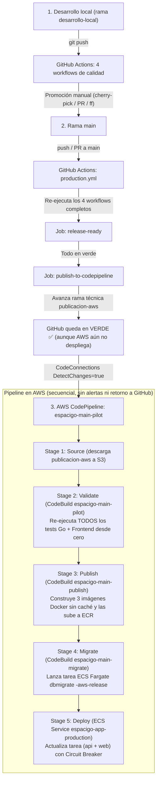

# Flujo actual de despliegue a AWS y plan de mejoras

Este documento explica cómo funciona hoy el despliegue de EspaciGo desde el entorno local hasta producción en AWS, identifica por qué tarda demasiado y por qué los errores se detectan tarde, y propone un plan por fases para optimizarlo.

---

## 1. Flujo actual completo (Local → GitHub → AWS)

### Etapa 1: Desarrollo local (`desarrollo-local`)
- Se trabaja y prueba localmente con `scripts/local-dev.sh` (AWS Emulator, PostgreSQL 18, Mailpit).
- Al hacer `git push` a `desarrollo-local`, GitHub Actions ejecuta automáticamente:
  - [`application-quality.yml`](../../.github/workflows/application-quality.yml): `go test ./...`, `go vet ./...`, `go build ./...` + construcción completa de las 3 imágenes OCI (`api`, `web`, `dbmigrate`) sin push y sin caché.
  - [`database-quality.yml`](../../.github/workflows/database-quality.yml): pruebas de migraciones en PostgreSQL aislado y verificación de inventario/evidencia.
  - [`frontend-quality.yml`](../../.github/workflows/frontend-quality.yml): `pnpm format:check`, `lint`, `typecheck`, `test` y verificación de aislamiento de red.
  - [`iac-quality.yml`](../../.github/workflows/iac-quality.yml): `cfn-lint` sobre `infra/cloudformation/*.yaml`.

### Etapa 2: Promoción a `main` y disparo desde GitHub
- Cuando los cambios están listos, se promueven a `main`.
- El workflow [`production.yml`](../../.github/workflows/production.yml) se dispara y **vuelve a ejecutar los 4 workflows completos** desde cero sobre `main`.
- El job `release-ready` verifica que los 4 hayan terminado en `success`.
- Si todo pasa, el job `publish-to-codepipeline` avanza la rama técnica `publicacion-aws` al SHA exacto de `main`.
- **Nota:** El job `deploy` directo por OIDC desde GitHub Actions existe en `production.yml`, pero permanece desactivado (`AWS_DEPLOY_ENABLED=false`) porque una SCP de la cuenta AWS bloquea la creación/consulta de proveedores IAM OIDC.
- En este punto, **GitHub Actions termina y muestra un check verde ✅**, aunque el despliegue real en AWS recién está por comenzar.

### Etapa 3: Pipeline en AWS (`espacigo-main-pilot`)
AWS CodeConnections detecta el avance de `publicacion-aws` y ejecuta 5 etapas estrictamente secuenciales:

1. **`Source`**: Descarga el código fuente de `publicacion-aws` y lo guarda como artefacto en S3.
2. **`Validate`** (CodeBuild `espacigo-main-pilot`, [`infra/codepipeline/validate-buildspec.yml`](../../infra/codepipeline/validate-buildspec.yml)):
   - Instala `poppler-utils`, descarga módulos Go, instala `pnpm` globalmente e instala `node_modules` del frontend desde cero.
   - Verifica el SHA y **vuelve a ejecutar por tercera vez** `go test ./...`, `go vet ./...`, `go build ./...`, `pnpm typecheck` y `pnpm test`.
3. **`Publish`** (CodeBuild `espacigo-main-publish`, [`infra/codepipeline/publish-buildspec.yml`](../../infra/codepipeline/publish-buildspec.yml)):
   - Construye desde cero (sin caché de capas Docker) las 3 imágenes `linux/amd64`: `espacigo-api`, `espacigo-web` y `espacigo-dbmigrate`.
   - Verifica el inventario de migraciones (`-inventory-only`), sube las 3 imágenes a ECR con tag `<sha>-cb<build_number>` y genera `imagedefinitions.json` y `release.json`.
4. **`Migrate`** (CodeBuild `espacigo-main-migrate`, [`infra/codepipeline/run-migrations.sh`](../../infra/codepipeline/run-migrations.sh)):
   - Toma la definición de tarea `MigratorTaskDefinition`, inyecta la imagen `espacigo-dbmigrate` recién publicada y ejecuta una tarea Fargate efímera (`-aws-release`) en la subred privada.
   - Espera con `aws ecs wait tasks-stopped` y falla si `exitCode != 0`.
5. **`Deploy`** (ECS Service `espacigo-app-production`, [`infra/cloudformation/app-and-cicd.yaml`](../../infra/cloudformation/app-and-cicd.yaml)):
   - Actualiza el servicio ECS con `imagedefinitions.json` (`MinimumHealthyPercent: 100`, `MaximumPercent: 200`, `HealthCheckGracePeriodSeconds: 60`).
   - Tiene `DeploymentCircuitBreaker` habilitado con `Rollback: true`.

---

## 2. Diagnóstico: ¿por qué tarda tanto y por qué no avisa a tiempo?

### Causas de lentitud
1. **Triple ejecución de pruebas**: Los mismos tests de Go y Frontend se ejecutan en `desarrollo-local`, luego otra vez en `main` (GitHub Actions), y una **tercera vez** en la etapa `Validate` de CodeBuild.
2. **Triple compilación Docker sin caché**: Las imágenes (`api`, `web` Next.js y `dbmigrate`) se compilan en `application-quality.yml` (sin caché), se vuelven a compilar en `production.yml` (sin caché), y se vuelven a compilar desde cero en `Publish` de CodeBuild (sin caché de capas).
3. **CodeBuild `Validate` parte en frío**: Cada ejecución instala paquetes APT (`poppler-utils`), `pnpm` y dependencias de Go/Node desde internet sin caché.
4. **Circuit Breaker lento en ECS**: Si la nueva versión falla al arrancar o no pasa `/api/ready`, ECS intenta levantar varias tareas de reemplazo y espera el `HealthCheckGracePeriodSeconds` (60 s) + reintentos antes de que el Circuit Breaker aborte y haga rollback, pudiendo tardar 5–15 minutos extra en fallar.

### Causas de "ceguera" ante errores
1. **Falso verde en GitHub**: Cuando `publish-to-codepipeline` mueve `publicacion-aws`, GitHub marca todo como exitoso. Todo lo que pase después en AWS (`Validate`, `Publish`, `Migrate`, `Deploy`) es invisible desde GitHub.
2. **Sin notificaciones de pipeline/ECS**: En `app-and-cicd.yaml` solo existen alertas de presupuesto (`AWS::Budgets::Budget`). No hay reglas de **EventBridge + SNS** para fallos de CodePipeline, CodeBuild o ECS.
3. **Errores opacos en `Migrate` (`run-migrations.sh`)**: Cuando la tarea Fargate de migración falla (`exitCode != 0`), el script solo imprime `stopCode` y `stoppedReason` de ECS, pero **no muestra los logs de CloudWatch** del contenedor `dbmigrate`. Hay que entrar manualmente a la consola de CloudWatch.

---

## 3. Plan de mejoras propuesto

### Fase 1: Visibilidad inmediata y detección temprana de errores (Prioridad Alta)
Objetivo: **Enterarse en segundos cuando algo falla en AWS y ver el motivo exacto sin buscar manualmente en la consola.**

1. **Alertas automáticas con EventBridge + SNS** (en `infra/cloudformation/app-and-cicd.yaml`):
   - Crear un tópico SNS (`DeployNotificationsTopic`) con suscripción por email (y opcionalmente webhook a Slack/Discord/Telegram).
   - Agregar reglas de EventBridge para:
     - `CodePipeline Pipeline Execution State Change` cuando `state` sea `FAILED` o `SUCCEEDED`.
     - `CodeBuild Build State Change` cuando `build-status` sea `FAILED` (detecta fallos en `Validate`, `Publish` o `Migrate` al instante).
     - `ECS Deployment State Change` / `ECS Task State Change` cuando una tarea de `espacigo-app-production` se detenga con error o se active el `DeploymentCircuitBreaker`.
2. **Logs automáticos al fallar `Migrate`**:
   - Actualizar `infra/codepipeline/run-migrations.sh` para que, si `exitCode != 0`, consulte automáticamente los últimos eventos del log stream de CloudWatch de esa tarea (`aws logs get-log-events`) y los imprima en la salida de CodeBuild.
3. **Comando local de seguimiento en vivo (`scripts/watch-deploy.sh`)**:
   - Script usando `aws codepipeline get-pipeline-state` y `aws ecs describe-services` (con perfil `espacigo-prod`) que muestre en terminal el avance etapa por etapa, detecte fallos inmediatamente y verifique `PRODUCTION_HEALTH_URL` (`/api/ready`) al terminar.

### Fase 2: Reducir el tiempo total de despliegue a menos de la mitad (Prioridad Alta)
Objetivo: **Eliminar trabajo duplicado y activar caché de compilación.**

1. **Eliminar la duplicación de tests en `Validate` (CodeBuild)**:
   - Dado que `production.yml` en GitHub Actions ya valida exactamente el mismo SHA antes de avanzar `publicacion-aws`, dejar en `validate-buildspec.yml` únicamente la verificación de SHA e integridad (o eliminar la etapa `Validate` de CodeBuild una vez estabilizado), evitando instalar `apt`/`pnpm`/Go y correr 681+ tests por tercera vez.
   - *Ahorro estimado:* ~8 a 15 minutos por despliegue.
2. **Activar caché de capas Docker**:
   - En `production.yml` / `application-quality.yml`: agregar caché de Buildx (`cache-from: type=gha` / `cache-to: type=gha`) o evitar reconstruir las 3 imágenes completas en `production.yml` si el siguiente paso en AWS las va a construir y subir a ECR de todas formas.
   - En `publish-buildspec.yml` (CodeBuild): habilitar `Cache` (S3 o `LOCAL_DOCKER_LAYER_CACHE`) en el proyecto `espacigo-main-publish` y usar `--cache-from` desde la última imagen en ECR para que solo se recompilen las capas que cambiaron.
   - *Ahorro estimado:* ~5 a 10 minutos por despliegue.

### Fase 3: Feedback directo en GitHub y fallo rápido en ECS (Prioridad Media)
Objetivo: **Que GitHub refleje el estado real de AWS y ECS aborte rápido si un contenedor nace roto.**

1. **Reportar estado de AWS de vuelta a GitHub**:
   - Agregar una función Lambda ligera disparada por EventBridge (estados de `CodePipeline`) que envíe un *Commit Status* a la API de GitHub (`pending` al iniciar `Source`, `success` al completar `Deploy`, `failure` si falla cualquier etapa con enlace directo a la ejecución en AWS).
2. **Acelerar detección de fallos en ECS**:
   - Revisar el `HealthCheck` del contenedor y del `WebTargetGroup` en `app-and-cicd.yaml` para que un contenedor que crashea o no responde `/api/ready` falle rápido y dispare el rollback en pocos minutos en lugar de esperar múltiples ciclos largos.
