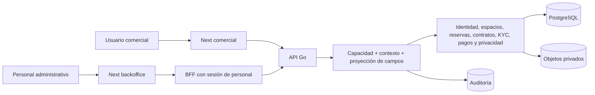
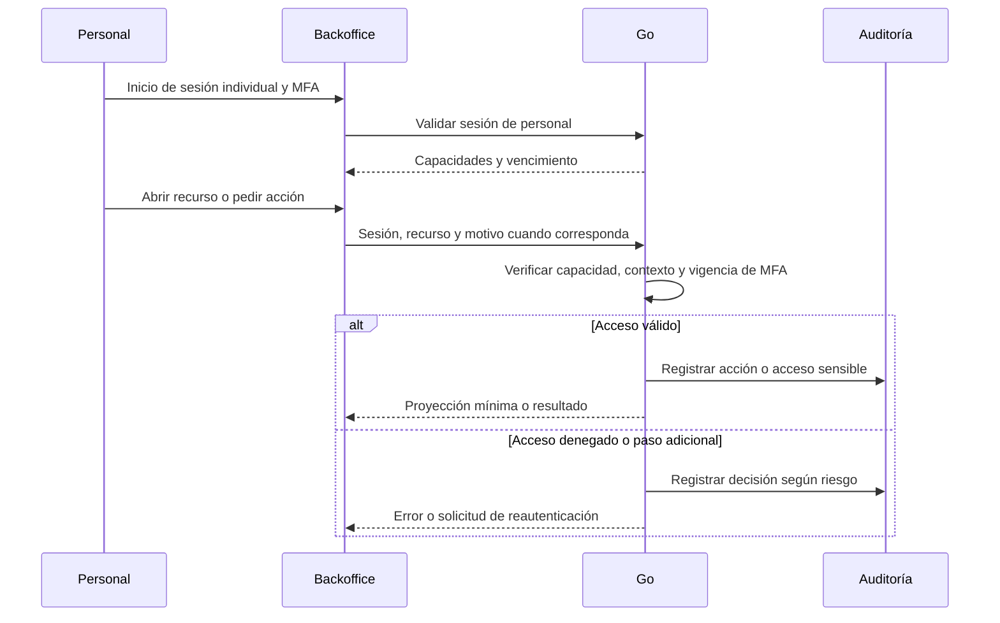
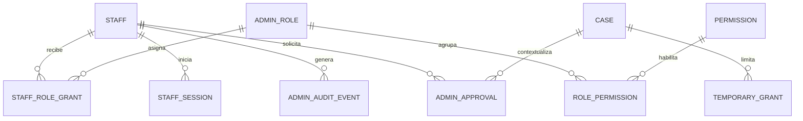

# Plan del administrador global de EspaciGo

**Corte del repositorio:** worktree `contratos`, rama `codex/marketplace/feature/contratos-1-modulo-contratos`, revisado el 24 de noviembre de 2026. El diagnóstico se basa en código, contrato, montajes y pruebas locales. El usuario inició el desarrollo local y priorizó la ficha 360. Las promociones siguen sujetas al flujo de ramas de EspaciGo.

## 1. Estado actual

El administrador global ya tiene frontend Next.js, cliente OpenAPI, handlers Go y consultas PostgreSQL. El grado de integración depende del módulo y del entorno. Los directorios `adminlocal` y `adminglobal` conviven con interfaces de clientes y de revisores.

| Área | Existe hoy | Brecha de administración |
| --- | --- | --- |
| Identidad y acceso | `administrador_global` y `administrador` son roles distintos. Go deriva capacidades de la sesión vigente y el servicio global vuelve a verificar la pertenencia al rol para operaciones de datos. Hay bootstrap registrado, revocación y reautenticación en ciertas mutaciones. | La entrada de la UI va a `/acceso` y comparte la sesión comercial. El mapa de capacidades vive en Go y el global hereda `legacy.administration`. Diseñar personal, sesiones y permisos granulares antes de ampliar acceso. |
| Inicio y métricas | Inicio conectado a `/admin/global/overview` y `/kpis`. Hay agregados para cuentas, publicaciones y actividad. | Mostrar procedencia, fecha y alcance operacional. Separar historial de ensayo, pruebas Mercado Pago y dinero real. |
| Cuentas | Directorio, detalle, edición, cambio de roles, bloqueo y revocación en el handler global local. Correo enmascarado por defecto. Lectura de reservas e incidentes por cuenta disponible en el backend. | La revelación de correo usa el mismo permiso `accounts.read` y una query. Debe tener permiso independiente, motivo, reautenticación y auditoría de la revelación. El adaptador administrativo no consume todavía las rutas de recursos por cuenta. |
| Publicaciones | Lista, contenido, moderación, retiro, horario y galería en Go. La pantalla estándar enlaza lista, estado y retiro. | Conectar los casos restantes sólo después de confirmar montaje, permiso y semántica de edición. Auditoría y control de concurrencia son obligatorios en cambios. Mantener la visibilidad de ubicación exacta/aproximada. |
| KYC y revisión | Flujos de verificación heredados y cola documental con revisión, revocación y entrega de evidencia privada. | Reutilizar el dominio documental. Exponer estado primero, evidencia sólo en un caso asignado. El permiso heredado amplio no debe ser el acceso de KYC en el backoffice. |
| Reservas y contratos | Existen reservas comerciales, retenciones, solicitudes contractuales, firmas, eventos y PDFs. El directorio agrega reservas/ensayos de una cuenta. | Falta consulta operativa comercial transversal e historial de contrato, firma y pago para el equipo. No reutilizar el ensayo como dato comercial. |
| Pagos y liquidaciones | Checkout, OAuth de vendedor, preferencias, recibos firmados, worker y liquidaciones de anfitrión. Los reportes financieros heredados son otro circuito. | Falta vista administrativa de conciliación. Diferenciar cotización, intento, pago verificado, comisión, abono e importe desconocido. Webhooks e idempotencia deben seguir en sus servicios actuales. El cierre del pago real queda fuera de esta planificación. |
| Disputas, reclamos y moderación | Pantalla conectada a disputas y casos/avisos heredados, con acciones según el entorno. | No asumir que toda disputa del flujo comercial tenga la misma persistencia o semántica que local. Clasificar por flujo y definir transiciones por dominio. |
| Auditoría y privacidad | Bitácora PostgreSQL, consultas y exportación administrativa, mecanismos de supresión, exportación y retención existentes, auditoría de acciones y correlación en servicios. | Consolidar lectura sensible, decisiones relacionadas con casos y segregación de escritura. Diseñar centro de solicitudes por titular y políticas de conservación antes de habilitar exportación amplia. |
| Seguridad y comunicación | Sesiones, llaves de acceso/TOTP y medios de verificación en identidad. Notificaciones in-app y outbox de correo en dominios existentes. | La sesión administrativa necesita MFA propio, revocación y alertas. Una consola de entrega no debe mostrar cuerpos de mensajes, OTP ni credenciales. |
| Soporte, configuración e incidentes técnicos | Hay evidencias, eventos y avisos específicos. | No se identificó una bandeja transversal de tickets, administración de personal granular, configuración general editable ni gestión global de incidentes. Aprobar el dominio y estado de cada capacidad futura antes de exponer rutas. |

**Montaje en la rama.** El desarrollo con identidad local monta la familia global completa. El registro explícito de producción de `/admin/global/` en este worktree incluye cuatro lecturas: `me`, `overview`, listado y detalle de cuentas. Producción registra por separado algunas familias heredadas en `/admin/local/`. El prefijo `local` en un nombre no acredita por sí solo el montaje ni el tipo de datos. Verificar ruta, autenticación, implementación y dataset en cada caso. Este análisis describe los perfiles de la rama y no certifica el despliegue remoto actual.

**Fuentes en el repositorio:** [montaje Go](../../cmd/api/main.go), [montajes de producción](../../cmd/api/production.go), [roles y capacidades](../../internal/identity/domain.go), [handler global](../../internal/adminglobal/transport/http/handler.go), [recursos de cuenta](../../internal/adminglobal/resources.go), [adaptador del panel](../../frontend/src/features/admin/infrastructure/admin-openapi-adapter.ts), [directorio y bootstrap](../../db/migrations/V000058__gadm_01_global_administrator.sql), [contrato comercial](../../db/migrations/V000126__commercial_agreement_signatures.sql), [recepción de pagos](../../db/migrations/V000112__mercadopago_payment_webhook_inbox.sql).

## 2. Contrato API y visibilidad

Pagos introdujo Scalar en el commit `e6b3411` con la proyección de Mercado Pago. Contratos ya contenía esa base y el contrato OpenAPI 3.1. El visor ampliado usa el contrato de contratos en tres vistas. La entrada predeterminada abarca los módulos de identidad, seguridad, cuentas, catálogo, destinos, espacios, agenda, arriendos, contratos, pagos, verificación, comunicaciones, reputación, privacidad y administración. Cada operación tiene una categoría de navegación y las vistas filtradas reutilizan el mismo contrato. El inventario generado registra propósito, método, parámetros/respuestas en el contrato, autorización declarada y evidencia de montaje. La comparación automática revisa los registros literales de rutas versionadas en `cmd/api` y diferencia los handlers de despacho dinámico. La existencia de un esquema o de un prefijo registrado no acredita que una operación esté habilitada para un rol o entorno.

| Vista local | URL |
| --- | --- |
| API completa | http://127.0.0.1:8080/docs |
| Administración y revisión | http://127.0.0.1:8080/docs?scope=admin |
| Pagos, OAuth y liquidaciones | http://127.0.0.1:8080/docs?scope=mercadopago |
| Contrato completo | http://127.0.0.1:8080/openapi.yaml |

El contrato fuente [OpenAPI](../../planning/openapi.yaml), el [inventario generado](../../planning/frontend_next/evidence/matriz-operaciones-api-fase3.md) y el visor se versionan en Git. El repositorio puede seguir privado. La especificación lleva nombres, reglas y esquemas, nunca contraseñas, claves reales ni datos de usuarios. La API pública puede publicar un artefacto separado con una lista explícita de rutas públicas y ejemplos sintéticos cuando se autorice. Mantener el contrato interno y sus tipos fuera de esa distribución. La UI pública seguirá necesitando conocer sus rutas de consumo. La protección real se aplica en Go mediante sesión, capacidad y alcance de recurso.

**Resultado del corte:** 312 operaciones declaradas y 38 registros literales versionados comprobados contra OpenAPI. La matriz clasifica 57 operaciones como evidencia directa, 119 por familia y 136 pendientes de verificación en su handler o perfil. Las rutas Didit encontradas en la comparación inversa devuelven la respuesta de proveedor retirado y conservan sus pruebas de exclusión. El preflight CORS explícito se valida como comportamiento del transporte. La API de módulos vive en `/api/v1`. Las rutas propias de Next y de operación quedan fuera de ese contrato de negocio. En Next, `/api/backend/[...path]` y `/api/rental-demo/[...path]` son transportes hacia Go. Login, sesión y logout del BFF adaptan la autenticación al navegador. El callback de vendedor y el webhook público reenvían las operaciones documentadas de Mercado Pago. Los endpoints `/api/health`, `/api/ready`, `/api/runtime-config`, `/health/live`, `/health/ready`, `/docs` y `/openapi.*` son operativos. El backoffice consume el BFF y los contratos de negocio según sus permisos. Las tres vistas se verificaron con pruebas del handler, incluidas solicitudes con host público, origen directo ajeno a loopback y marcas de proxy.

El visor actualizado sólo atiende solicitudes directas a loopback en desarrollo. Rechaza hosts públicos y marcas de proxy. Scalar presenta las operaciones como referencia y oculta la ejecución de peticiones. Para uso interno compartido, diseñar un despliegue separado con acceso de personal, recurso estático versionado y sin tokens persistidos. En CI, mantener `pnpm api:check` y pruebas de contrato. Después de cada fase, alinear el contrato, los tipos, la lista del BFF y el inventario con las pruebas de rutas y autorización.

## 3. Arquitectura y flujos

Un solo backoffice Next.js con navegación por capacidades. Primera salida local bajo el workspace existente. En producción, un host administrativo separado puede compartir la misma aplicación Go y PostgreSQL. El host definitivo depende del dominio disponible y la aprobación de infraestructura. El backoffice nunca accede a PostgreSQL o S3 directamente. Para evidencias privadas, Go autoriza el caso y emite acceso acotado u ofrece descarga autenticada mediante el BFF.

**Regla de autorización:** personal activo + sesión administrativa vigente + capacidad + contexto del recurso + controles de sensibilidad. Ausencia de asignación implica denegación. Para mutaciones sensibles, comprobar capacidad y registrar auditoría dentro de la transacción o con outbox transaccional. MFA reciente es distinto de una sesión válida. Usar cookies host-only, acotadas a la consola, con CSRF en mutaciones, expiración por inactividad y revocación. Reutilizar primitivas de identidad que sirvan, con audiencia y sesiones separadas. El borde puede añadir Cloudflare Access después de validar origen, recuperación y acceso directo, y Go sigue verificando cada operación.

### Matriz inicial de capacidades

**L** lectura mínima, **G** gestión operativa, **C** acceso condicionado a caso y permiso específico, **A** aprobar una solicitud de otro agente, **—** denegado. Los grupos son partidas del diseño. Cada acción real requiere capacidad atómica. Primera salida sólo con administrador global y auditoría operable, seguida de roles especializados.

| Rol | Cuentas | Espacios/reservas | Contratos | KYC | Finanzas | Soporte | Privacidad | Personal/sesiones | Auditoría |
| --- | --- | --- | --- | --- | --- | --- | --- | --- | --- |
| Administrador global | G/C | G | L/C | L | L/C | G | L/C | G/A | L |
| Operaciones | L | G | L/C | L | L | G | — | — | — |
| Soporte supervisor | L/C | L/C | L/C | L | L | G/A | — | — | L acotada |
| Soporte L1 | L | L | L de estado | L de estado | L de estado | G asignado | — | — | — |
| Soporte L2 | L/C | L/C | L/C | L de estado | L/C | G asignado | — | — | — |
| Finanzas | L | L | L de estado | — | G/A | L asignado | — | — | L financiera |
| Analista KYC | L/C | — | — | G/C | — | L asignado | — | — | L acotada |
| Moderación | L | G de publicación | — | L de estado | — | L asignado | — | — | L acotada |
| Privacidad | L/C | L de metadatos | L/C | L de estado | L de metadatos | L asignado | G/A | — | L de privacidad |
| Seguridad | L de identidad | — | — | L de estado | — | L asignado | — | G/A | L de seguridad |
| Auditor | L de metadatos | L de metadatos | L de metadatos | L de estado | L acotada | — | L de metadatos | L de eventos | L |

Capacidades propuestas: `accounts.read`, `accounts.block`, `accounts.pii.reveal`, `accounts.sessions.revoke`, `publications.moderate`, `reservations.read`, `reservations.cancel.request`, `contracts.read`, `contracts.document.read`, `kyc.case.read`, `kyc.evidence.read`, `kyc.review`, `payments.read`, `payments.reconcile`, `payments.refund.request`, `payments.refund.approve`, `privacy.requests.manage`, `privacy.export.approve`, `staff.roles.manage`, `staff.sessions.revoke`, `audit.read` y `audit.export`. Una persona no puede aprobar su propia solicitud. Validar por separado política comercial, estado del recurso, idempotencia y operación permitida por el proveedor.

### Acceso por campo

| Datos | Proyección habitual | Acceso excepcional |
| --- | --- | --- |
| Cuenta, nombre operativo, estado, roles, fecha y verificación | IDs estables y estado según recurso. Correo, teléfono, RUT y cuenta de abono enmascarados en Go. | Correo/teléfono por caso y motivo, permiso explícito, autenticación reciente y auditoría. RUT/abono sólo en función justificada y acotada. |
| Dirección privada, documentos de identidad y evidencia | Estado, referencia, fecha y expediente. | Analista asignado, evidencia mínima necesaria, acceso temporal y registro. Validar alcance legal de biometría. |
| Reservas, contratos y pagos | Metadatos, moneda, estados, monto cuando proceda y referencia interna/proveedor. | PDF contractual o evidencia sólo por caso, finalidad y permiso de descarga. |
| Conversaciones y soporte | IDs, participantes enmascarados, estado y asignación. | Contenido sólo por expediente justificado y alcance expreso. |
| Secretos | Sin proyección. | Contraseñas, OTP, tokens de Mercado Pago, claves, PAN completo y CVV quedan fuera de la consola. |

### Modelo de datos propuesto

Inventariar las tablas existentes antes de fijar DDL. Reutilizar identidad, recursos comerciales y el ledger de auditoría donde sus controles lo permitan. Si se amplía la bitácora, separar roles de escritura, lectura y purga. El runtime operativo no obtiene UPDATE/DELETE arbitrarios sobre auditoría. Preferir registro apendicular con hora UTC, actor, capacidad, recurso, tipo de acción, propósito, resultado, correlación, ticket y códigos de cambio. Conservar diffs mínimos sin valores de identidad ni secretos.

## 4. Plan por fases y dependencias

El tablero es la secuencia vigente. Las lecturas de la ficha se adelantan mientras se construye la sesión independiente. La vista asistida necesita el núcleo de seguridad antes de abrir datos privados adicionales.

| Hito | S1 | S2 | S3 | S4 | S5 | S6 | S7 | S8 |
| --- | --- | --- | --- | --- | --- | --- | --- | --- |
| F0 · Línea base | ● | | | | | | | |
| F1 · Seguridad y piloto 360 | ● | ● | ● | | | | | |
| F2 · Consola operativa | | | ● | ● | ● | | | |
| F3 · Vista del cliente | | | | ● | ● | ● | | |
| F4 · Operación especializada | | | | | | ● | ● | |
| F5 · Validación y entrega | | | | | | | ● | ● |

La estimación es indicativa. Las reglas de reembolso, KYC y el alcance jurídico pueden requerir coordinación externa.

### Prioridad del primer corte · ficha 360

La ficha es la entrada al trabajo con una cuenta. El agente abre **Abrir ficha 360** desde el directorio y conserva una cabecera con nombre, estado, identificador y señales operativas. Se usa una consola visual propia, con navegación de trabajo, superficies neutras, un color de acción, contraste explícito y tablas que pasan a filas legibles en móvil. La jerarquía pone nombre, estado y datos imprescindibles arriba. Los recursos se consultan por pestaña y las acciones sensibles tienen un espacio propio con permisos, validación y confirmación.

| Zona | Contenido e interacción | Dependencia |
| --- | --- | --- |
| Cabecera de cliente | Cuenta, correo enmascarado, roles, estado y conteos. Reservas e incidentes se identifican como datos de ensayo hasta conectar las proyecciones comerciales. Enlace al directorio. | Detalle global y autorización en Go. |
| Espacios | Listado por propietario, estados y paginación real. Evoluciona a una vista del espacio y su horario en modo administrativo. | Reusar listado global. Las mutaciones se delegan a acciones autorizadas del módulo. |
| Actividad comercial | Reservas, contratos y pagos con línea temporal, origen del dato y relación entre IDs. | Proyecciones comerciales por participante y tipo. Separar ensayo de datos comerciales. |
| Seguridad, KYC y soporte | Estado, sesiones, expedientes, incidencias y solicitudes según capacidades. | Carga bajo demanda y proyecciones de datos mínimos. |
| Vista del cliente · solo lectura | Abrir un caso autorizado, seleccionar arrendador o arrendatario cuando aplique, navegar por proyecciones equivalentes a sus pantallas y cerrar la vista. Barra persistente con cuenta, agente, caso y vencimiento. | Sesión de personal, ticket o caso válido, concesión con TTL, autorización por recurso y auditoría. No se emite token comercial del cliente. |

En la vista asistida, cualquier acción operativa pertenece a la consola administrativa con la identidad del agente. Pagos, firmas, cambios de contraseña, ediciones de cuenta bancaria y cambios de identidad quedan excluidos. La ficha 360 útil puede salir primero con sus lecturas auditadas. Una sesión asistida se introduce cuando sus límites sean verificables desde Go.

### Tablero de ejecución

| Fase | Tareas en orden | Estado |
| --- | --- | --- |
| **0 · Línea base** | **0.1** Registrar rutas globales, perfiles, capacidades y brechas. **0.2** Verificar OpenAPI, BFF y rechazo anónimo en las rutas iniciales. **0.3** Clasificar la ficha piloto como cuenta + espacios de propietario o contadores ya disponibles. | Primer corte levantado. El despliegue de producción no se usó para esta comprobación. |
| **1 · Seguridad y piloto 360** | **1.1** Separar la revelación del correo del permiso de lectura y registrar el evento específico. **1.2** Implementar tarjeta y pestaña Espacios usando el contrato real. **1.3** Introducir audiencia de personal, MFA, revocación, y autenticación reciente. **1.4** Incorporar motivo, caso y alcance a accesos sensibles. | Implementada y verificada (1.1–1.4) en `contratos`: `V000139`, `/admin/session/*`, `sensitive-access`, BFF `espacigo_admin_session`, UI con MFA/step-up, pruebas de integración PostgreSQL y suite Playwright `phase9-admin` (7/7). |
| **2 · Consola operativa** | **2.1** Consolidar shell administrativo responsive con navegación por permisos. **2.2** Incorporar proyecciones comerciales de reservas, contratos, pagos e incidentes a la ficha 360. **2.3** Integrar auditoría por cuenta y acciones operativas con el dominio propietario. | Implementada y verificada (`2.1`–`2.3`): shell responsive con indicador MFA, ficha 360 con proyecciones comerciales (`commercial_reservations`, `commercial_contracts`, `commercial_payments`), auditoría por cuenta y acciones operativas. |
| **3 · Vista del cliente** | **3.1** Definir caso, contexto, vencimiento y revocación. **3.2** Implementar proyecciones de solo lectura por rol. **3.3** Mostrar contexto persistente y cerrar con evento de auditoría. **3.4** Probar que ninguna ruta comercial o mutante acepta el contexto asistido. | Implementada y verificada (`3.1`–`3.4`): `V000140` (`vista_asistida_administrativa`), `/assisted-view`, banner persistente, proyecciones por rol en `/administracion/cuentas/[id]/vista-asistida`, matriz negativa Go (`cmd/api` + `405`) y E2E Playwright. |
| **4 · Operación especializada** | **4.1** Extender KYC y privacidad. **4.2** Conciliación y liquidaciones de lectura. **4.3** Roles de soporte y ticket. **4.4** Reembolsos y doble aprobación cuando se defina la política. | Implementada y verificada (`4.1`–`4.4`): `V000141`, capacidades granulares, `/admin/global/{payments,reservations,contracts,kyc-cases,privacy-requests,support-tickets,approvals}`, vistas `/administracion/{finanzas,privacidad,aprobaciones}` y doble control (`solicitante != aprobador`). |
| **5 · Validación y entrega** | **5.1** Pruebas de contratos, aislamiento, E2E y accesibilidad. **5.2** Validar desempeño, auditoría y recuperación. **5.3** Preparar promoción y acceso perimetral con autorización explícita. | Validada (`5.1`–`5.2`): alineación Go ↔ OpenAPI (331 operaciones) ↔ Frontend, `migrate-plan` sin pendientes (`141` migraciones), Go + PostgreSQL integración, `pnpm build` (54/54) y Playwright + Axe (9/9). Promoción a `desarrollo-local`/`main` y Cloudflare Access pendientes de autorización explícita. |

**Aceptación del piloto.** El directorio abre una cuenta real por ID, el correo se mantiene enmascarado en la ficha, Espacios solicita solamente el propietario seleccionado y las respuestas incompletas o no disponibles tienen estado explícito. Un agente sin el permiso de revelación, o con autenticación vencida, recibe un rechazo sin correo en claro. Verificar separación del actor y de la cuenta objetivo en futuras vistas asistidas.

**Evidencia del piloto.** En el backend local, `me`, `overview`, listado y detalle de cuentas, publicaciones, auditoría y KPIs devolvieron 401 al solicitarse sin sesión. Los tests de Go cubren el rechazo de revelación sin permiso de lectura, sin permiso de revelación o con autenticación vencida. Chromium recorrió la ficha con datos sintéticos y verificó la consulta por propietario, el correo enmascarado y la exclusión de un espacio ajeno. La suite administrativa pasó sus seis pruebas de Chromium, incluida la revisión Axe en escritorio y móvil. Pasaron la compilación de Next con TypeScript, ESLint dirigido y `pnpm api:check`. El JSON servido por Scalar incluyó el permiso de revelación y la respuesta HTTP 428. Queda pendiente repetir las verificaciones de acceso y auditoría contra PostgreSQL desechable con cuentas sintéticas.

### Diseño de endpoints y pantallas

Borrador para Fases 1–4. Los nombres futuros se aprueban al implementarlos y luego entran al OpenAPI principal.

| Superficie propuesta | Flujo | Restricciones del contrato |
| --- | --- | --- |
| `POST /admin/session/start`, `POST /admin/session/mfa`, `GET /admin/session`, `DELETE /admin/session` | Acceso y cierre de personal | Audiencia específica, desafío acotado, limitación de intentos, sin enviar secretos al cliente. |
| `GET /admin/global/accounts/{accountID}/summary`, `.../resources/{resourceKind}` | Ficha y pestañas | Reutilizar la lectura actual y ampliar sólo con tipos explícitos. Cursor ligado a filtros, máscara por permiso. |
| `POST /admin/global/accounts/{accountID}/sensitive-access` | Revelar datos acotados | Campo y motivo explícitos, MFA reciente, expiración y auditoría. |
| `GET /admin/global/reservations`, `GET /admin/global/contracts`, `GET /admin/global/payments` | Búsqueda operativa transversal | Filtros acotados, estado por dominio, IDs y totales precisos en CLP, separación de prueba/real. |
| `POST /admin/global/approvals`, `POST /admin/global/approvals/{id}/decisions` | Doble control | Solicitante distinto de aprobador, estado vigente, motivo, versión e idempotencia. |
| `GET /admin/global/audit-events`, `.../export` | Auditar acciones | Reutilizar rutas actuales con autorización granular, límite de exportación y registro de lectura. |

Estructura Next: conservar `/administracion` como raíz inicial, añadir `/administracion/cuentas/[id]` para la ficha y rutas para reservas, contratos, finanzas, privacidad y personal de forma incremental. Cada módulo mantiene un adaptador OpenAPI, un servicio de aplicación y componentes del dominio. Las rutas que requieran sesión de personal llevan un guard de página para UX. Las capacidades y datos efectivos los decide Go. Incluir desktop y móvil, estados de carga/error y navegación por teclado.

### Riesgos, pruebas y despliegue

| Amenaza o error | Prueba y control |
| --- | --- |
| Sesión comercial usada en administración, fuerza bruta, MFA omitido o sesión caducada | Matriz negativa por persona, audiencia, revocación y paso adicional. Validar expiración y límites con reloj controlado. |
| Escalada horizontal o vertical, permiso de campo ignorado | Pruebas por método, recurso propio/ajeno, papel, caso asignado, field masking y respuesta HTTP directa. |
| CSRF, XSS e inyección | Probar origen, cookies, entradas estructuradas y renderizado seguro. Consultas parametrizadas. |
| Exportación masiva o documentos con enlace reutilizable | Paginación límite, auditoría, permisos por campo, token acotado y control sobre buckets privados. |
| Manipulación de auditoría o doble aprobación | Probar privilegios PostgreSQL, transacción/outbox, duplicados, solicitante diferente del aprobador y expiración. |
| Colisión con checkout, firma o cancelación | Fakes de proveedores, pruebas en PostgreSQL aislado, concurrencia, estado de pago verificado, vencimiento y conciliación. |

Ejecutar pruebas unitarias de políticas y proyecciones, integración en PostgreSQL desechable para migraciones/permisos, contrato OpenAPI y allowlist, E2E con identidades sintéticas por rol, prueba de no regresión del portal comercial y revisión manual de accesibilidad. Validar métricas de latencia, denegación y tasa de errores sin registrar payloads sensibles.

Migraciones: elegir el siguiente número libre al comenzar, separar tablas/roles, bootstrap e índices, y registrar el ledger de release. Probar avance en PostgreSQL local con el rol migrador del repositorio. Favorecer migraciones aditivas y una etapa de lectura antigua/nueva antes de retirar campos. El rollback de la app debe funcionar con los cambios aditivos presentes. Para datos críticos, validar restauración en entorno privado antes de publicar y conservar evidencia del SHA, migración, estado e instrucciones. La activación de host administrativo, secretos, MFA, WAF o Cloudflare y el paso a `main` requieren aprobación de la entrega.

**Costos de planificación:** primera versión reutiliza Next, Go, PostgreSQL y almacenamiento existentes. Medir carga adicional de consultas, retención e índices de auditoría, almacenamiento de exportaciones y volumen de logs. Cualquier host o servicio perimetral nuevo se cotiza por separado con Región, volumen, usuarios de personal y retención acordados. No se presupuesta una segunda base ni un segundo backend para el primer corte. Consultar el [procedimiento de promoción AWS](aws-production-deployment.md).

## 5. Privacidad y marco chileno

La Ley 21.719, modificada por la Ley 21.855, entra en vigencia el **15 de octubre de 2027**. Esta fecha aplaza la entrada en vigor de las modificaciones sustantivas; no desplaza la prioridad operativa interna de atender solicitudes y cerrar brechas de privacidad. Diseñar el inventario con finalidad, base jurídica, responsable, receptores y ubicación del tratamiento por cada dato. Preparar acceso, rectificación, supresión, oposición, portabilidad y bloqueo según proceda. Revisar plazos, prueba de identidad del solicitante, tratamiento de documentos/biometría, evaluación de impacto cuando corresponda, transferencias internacionales a proveedores y procedimiento de incidentes con asesoría jurídica. La Ley 19.799 sirve para revisar las firmas y la evidencia contractual. Confirmar la aplicación de consumo, delitos informáticos y normas de arriendo según la relación contractual y categoría de espacio. El alcance PCI debe evaluarse con el adquirente según Checkout Pro y cualquier variante de Checkout API que quede habilitada. [Ley 21.719 y Ley 21.855](https://www.bcn.cl/leychile/navegar?idNorma=1230520) · [Ley 19.628](https://www.bcn.cl/leychile/navegar?idNorma=141599) · [Ley 19.799](https://www.bcn.cl/leychile/navegar?idNorma=196640) · [Protección al consumidor](https://www.bcn.cl/leychile/navegar?idNorma=61438) · [Delitos informáticos](https://www.bcn.cl/leychile/navegar?idNorma=1177743) · [Arriendo urbano](https://www.bcn.cl/leychile/navegar?idNorma=29526) · [Normas PCI SSC](https://www.pcisecuritystandards.org/document_library/)

### Operador jurídico y activación comercial

HOTU SOFTWARE SOLUTIONS SPA, RUT 78065779-0, opera EspaciGo como plataforma propia y es responsable de los tratamientos que determina para el servicio. Su representante legal es Hernán Maximiliano Espinoza Castillo. Anita Belen Marchant Pacheco ejerce la suplencia operativa según el acta interna. Los canales informados son contacto@hotusoft.com, WhatsApp +56 9 5745 5825 y la dirección comercial Apoquindo 6410, oficina 1004, piso 10, Las Condes, Santiago, Chile. Usar el correo y la correspondencia para solicitudes formales de datos y WhatsApp para consultas y orientación.

El 27 de noviembre de 2026, Hernán Maximiliano Espinoza Castillo comunicó por chat su aprobación del paquete EG-GD-01 a EG-GD-06 v1.1. Luego indicó incorporar a la v1.2 el reparto de cobros, comprobantes y devoluciones descrito aquí y autorizó subir la primera versión jurídica con la conformidad pendiente. La revisión se asigna al **abogado de cabecera de Hotusoft**. Quedan pendientes la firma del acta, la aceptación firmada de la suplencia y la conformidad jurídica.

#### Reparto de pagos comprobantes y devoluciones

| Interviniente | Función en los arriendos con Mercado Pago |
| --- | --- |
| Hotusoft | Opera EspaciGo, es titular de la cuenta de Mercado Pago del marketplace y recibe en ella únicamente la comisión que corresponde a la plataforma por la operación. Gestiona la entrega de los comprobantes de la operación, emite los documentos tributarios que le correspondan por su servicio y tramita, da seguimiento y comunica el resultado de las devoluciones. |
| Arrendador | Vincula su propia cuenta de Mercado Pago y recibe directamente del proveedor el importe neto que le corresponde. Administra su saldo y retiros, coopera para cursar devoluciones y emite los documentos tributarios de su prestación cuando corresponda. |
| Mercado Pago | Procesa el pago, aplica sus cargos y distribuye los importes mediante la integración de reparto. Ejecuta y confirma los reembolsos que correspondan. Hotusoft no custodia ni administra los fondos o saldos del arrendador. |

Antes de pagar, mostrar el precio total, los cargos aplicables y la identificación de la contraparte. La confirmación de pago, el documento tributario por la intermediación y el documento tributario del arriendo son constancias con funciones diferentes. El canal de Hotusoft recibe las solicitudes de comprobantes y devoluciones y coordina su trámite sin limitar los derechos que correspondan al arrendatario. Verificar la cuenta asociada a la aplicación y el reparto con evidencia de conciliación. La instrucción de publicación de textos jurídicos no cambia los medios de pago ni las condiciones de activación de la integración. [Integración oficial de reparto de Mercado Pago](https://www.mercadopago.cl/developers/es/docs/split-payments/split-1-1/integration-configuration/integrate-marketplace)

En los contratos nuevos, informar el reparto y a quién contactar por comprobantes o devoluciones mediante una cláusula identificada en la versión que se presenta antes de firmar. Conservar las versiones ya aceptadas y los contratos suscritos. Si otra persona jurídica pasa a operar EspaciGo en el futuro, documentar el cambio de operador, responsables, proveedores y flujos antes de cambiar la versión pública o solicitar nuevas aceptaciones.

### Aviso de políticas y preferencias de cookies

| Momento | Comportamiento y condición de aceptación |
| --- | --- |
| Primera visita | Abrir un modal accesible con enlaces a la Política de privacidad y a los Términos. Mostrar la elección de almacenamiento opcional junto con los botones **Rechazar opcionales** y **Guardar preferencias** o **Aceptar opcionales**. El modal permanece hasta guardar la elección. Los textos legales se pueden leer antes de decidir. |
| Registro y contratación | Mostrar la versión aplicable en formato que pueda conservarse. Recabar aceptación expresa de los Términos en la acción correspondiente. Presentar el aviso de privacidad y recabar por separado la autorización de datos cuando sea la base aplicable. El contrato de arriendo conserva su propia aceptación y evidencia. |
| Preferencias | Mostrar en el pie de página **Preferencias de cookies** y permitir revisar, cambiar o retirar cada elección con la misma facilidad que otorgarla. En cuenta autenticada, indicar la versión de Términos aceptada y si se requiere una nueva aceptación para la acción solicitada. |
| Cambios y evidencia | Versionar Términos, avisos y finalidades. Registrar versión, fecha, contexto y acción expresa aplicable, minimizando identificadores. Mantener elecciones previas cuando sigan vigentes. Solicitar una nueva elección antes de habilitar una finalidad opcional nueva o modificada. |
| Comprobación | Inventariar cookies, almacenamiento local, etiquetas y terceros por nombre, finalidad, proveedor y duración. En Chromium de escritorio y móvil, verificar navegación anónima, teclado, rechazo, retiro y reapertura. Comprobar en red y almacenamiento que las tecnologías opcionales quedan inactivas antes de la elección, con rechazo o tras el retiro. Verificar por separado la evidencia de aceptación contractual. |

El aviso de entrada informa y facilita las preferencias. Las finalidades opcionales que se apoyen en consentimiento requieren una elección previa, específica y revocable. La sola visita no constituye aceptación contractual. La entrega de desarrollo incluye el aviso, la configuración de cookies y almacenamiento opcional, y la consulta y confirmación de versiones vigentes en Mi cuenta → Privacidad. La aceptación de términos y la confirmación de lectura de la política se registran por documento y versión, sin habilitar cookies o tratamientos opcionales. La preferencia opcional controla el historial de espacios visitados en el mapa. Se guarda por 365 días en el navegador y retirar el permiso borra el historial de la pestaña. [Ley 19.628, art. 4](https://www.bcn.cl/leychile/navegar?idNorma=141599) · [Ley 21.719, arts. 12 y 14 ter](https://www.bcn.cl/leychile/navegar?i=1209272) · [Ley 19.496, art. 12 A](https://www.bcn.cl/leychile/navegar?i=1160403)
