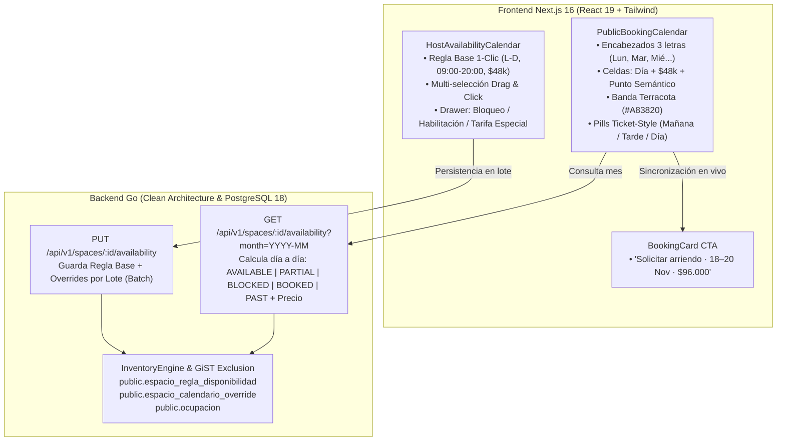

# Plan de Arquitectura e Implementación: Motor de Inventario en Go + Calendario Reactivo en Next.js

**Versión:** 1.0
**Fecha:** 16 de noviembre de 2026
**Estado:** Propuesta de Implementación
**Ambiente:** 100% Soberano y Local (`espacigo-aws`)

---

## 1. Visión y Diagnóstico del Problema

### 1.1 Diagnóstico del Calendario Actual
1. **Colisión de Encabezados:** Los días de la semana utilizan cadenas largas (`"Miércoles"`, `"Domingo"`), provocando desbordamiento y encimamiento (`MiércolesJueves`, `SábadoDomingo`) en pantallas medianas y dentro del layout de tres columnas del marketplace.
2. **Celdas con Texto Truncado Ilegible:** Las celdas inyectan textos de estado extensos (`"Parcialmente disponible"`, `"Fuera del horizonte..."`, `"Sin información"`), truncándose en `Parci...` o `Sin in...` dentro de cajas de ~40px.
3. **Leyenda Plana sin Color:** La leyenda inferior muestra etiquetas `<li>` de texto plano sin indicadores cromáticos ni badges semánticos.
4. **Estado Fantasma de *"Sin información"* y *"Horario no informado"*:** Al crear un espacio comercial, no existe una regla base de operación automática; si el anfitrión no define intervalos manualmente día a día, la API devuelve vacíos y el frontend etiqueta los días futuros válidos como no informados o inactivos.
5. **Desconexión con la Tarjeta de Reserva:** El botón de acción lateral no reacciona con fluidez al rango continuo ni muestra el desglose dinámico en vivo.

### 1.2 Principio Arquitectónico: Dos Capas (Inventario en Go + UI Reactiva en Next.js)


---

## 2. Capa 1: Base de Datos y Motor de Inventario en Go

### 2.1 Modelo Relacional en PostgreSQL (`public`)

1. **Tabla de Regla Base de Disponibilidad (`espacio_regla_disponibilidad`):**
   Garantiza que todo espacio tenga una regla recurrente por defecto sin necesidad de ingresar excepciones individuales:
   ```sql
   CREATE TABLE IF NOT EXISTS public.espacio_regla_disponibilidad (
       espacio_id UUID PRIMARY KEY REFERENCES public.espacio(id) ON DELETE CASCADE,
       dias_operacion SMALLINT[] NOT NULL DEFAULT '{1,2,3,4,5,6,7}', -- 1: Lun .. 7: Dom
       hora_apertura TIME NOT NULL DEFAULT '09:00:00',
       hora_cierre TIME NOT NULL DEFAULT '20:00:00',
       check_in_hora TIME DEFAULT '15:00:00',
       check_out_hora TIME DEFAULT '12:00:00',
       tarifa_base_dia INTEGER NOT NULL CHECK (tarifa_base_dia > 0),
       estadia_minima SMALLINT NOT NULL DEFAULT 1 CHECK (estadia_minima >= 1),
       estadia_maxima SMALLINT NOT NULL DEFAULT 30 CHECK (estadia_maxima >= estadia_minima),
       actualizado_en TIMESTAMPTZ NOT NULL DEFAULT now()
   );
   ```

2. **Tabla de Excepciones y Bloqueos de Calendario (`espacio_calendario_override`):**
   Gestiona cierres por mantenimiento, bloqueos personales del anfitrión y tarifas dinámicas por fecha o rango:
   ```sql
   CREATE TABLE IF NOT EXISTS public.espacio_calendario_override (
       id UUID PRIMARY KEY DEFAULT gen_random_uuid(),
       espacio_id UUID NOT NULL REFERENCES public.espacio(id) ON DELETE CASCADE,
       fecha DATE NOT NULL,
       estado TEXT NOT NULL CHECK (estado IN ('disponible', 'bloqueado', 'mantenimiento')),
       tarifa_personalizada_clp INTEGER CHECK (tarifa_personalizada_clp > 0),
       motivo TEXT,
       creado_en TIMESTAMPTZ NOT NULL DEFAULT now(),
       CONSTRAINT espacio_calendario_override_uk UNIQUE (espacio_id, fecha)
   );
   CREATE INDEX IF NOT EXISTS espacio_calendario_override_fecha_idx
   ON public.espacio_calendario_override (espacio_id, fecha);
   ```

### 2.2 Endpoints en Go (`internal/spaces` y `internal/booking`)

1. **`GET /api/v1/spaces/:id/availability?month=YYYY-MM` (Público):**
   - Valida `month` con expresión `^\d{4}-(0[1-9]|1[0-2])$`.
   - Consulta la regla base del espacio. Si el espacio está `activo`, ningún día futuro válido devuelve `"Sin información"`.
   - Cruza para cada día del mes:
     - Día en el pasado $\rightarrow$ `PAST`.
     - Override de bloqueo o mantenimiento $\rightarrow$ `BLOCKED`.
     - Ocupación activa en `public.ocupacion` $\rightarrow$ `BOOKED` o `PARTIAL` (según horas ocupadas vs disponibles).
     - Día dentro de `dias_operacion` $\rightarrow$ `AVAILABLE` con el precio efectivo (override de tarifa o `tarifa_base_dia`).
     - Genera los bloques horarios / tickets aplicables (`Mañana 09:00–13:00`, `Tarde 14:00–18:00`, `Día Completo`).
   - Retorno JSON:
     ```json
     {
       "month": "2026-11",
       "time_zone": "America/Santiago",
       "rate_unit": "dia",
       "base_price_clp": 48000,
       "days": [
         {
           "date": "2026-11-20",
           "status": "AVAILABLE",
           "price_clp": 48000,
           "slots": [
             {"id": "slot-full", "label": "Día Completo (Check-in 15:00 / Check-out 12:00)", "price_clp": 48000},
             {"id": "slot-morning", "label": "Mañana (09:00 – 13:00)", "price_clp": 25000},
             {"id": "slot-afternoon", "label": "Tarde (14:00 – 19:00)", "price_clp": 28000}
           ]
         }
       ]
     }
     ```

2. **`PUT /api/v1/spaces/:id/availability` (Privado Anfitrión):**
   - Requiere autenticación de anfitrión y verificación de propiedad sobre el espacio.
   - Permite actualizar:
     - Regla base (`dias_operacion`, `hora_apertura`, `hora_cierre`, `tarifa_base_dia`).
     - Lista de excepciones por fecha (`overrides: [{ "fecha": "2026-11-28", "estado": "bloqueado", "motivo": "Mantenimiento quincho" }]`).

---

## 3. Capa 2: Componente de Calendario Público en Next.js (Estilo Reserva de Hotel / Avión)

### 3.1 Diseño Visual y Cero Texto Truncado
- **Encabezados de 3 letras:** `Lun`, `Mar`, `Mié`, `Jue`, `Vie`, `Sáb`, `Dom` con `grid-cols-7`, centrados, `text-xs font-semibold text-neutral-600`.
- **Celdas Estilo Ticket / Aerolínea:**
  - Prohibido renderizar strings descriptivos dentro del botón.
  - La celda muestra únicamente:
    1. Número de día (`font-semibold text-sm`).
    2. Precio abreviado (`$48k`) en `text-[11px] text-neutral-500` si está disponible.
    3. Punto semántico o badge sutil:
       - Blanco / Borde sutil = Disponible.
       - Ámbar (`#D97706`) = Parcialmente ocupado.
       - Gris tachado con guion = Bloqueado o pasado.
- **Banda Continua Terracota (`#A83820`):**
  - Al seleccionar día de entrada y día de salida:
    - Día inicial: Fondo `#A83820`, texto blanco, esquinas izquierdas redondeadas `rounded-l-lg`.
    - Días intermedios: Fondo terracota suave `#F9EBE8`, texto `#A83820`, esquinas rectas `rounded-none`.
    - Día final: Fondo `#A83820`, texto blanco, esquinas derechas redondeadas `rounded-r-lg`.
  - Soporte para píldoras rápidas de estadía: `1 día`, `2 días`, `3 días`, `1 semana` que al tocar una fecha pintan automáticamente el rango correspondiente.

### 3.2 Selector de Horarios Tipo Ticket
- Al hacer clic en un día o rango disponible, se despliegan debajo del calendario tarjetas compactas interactivas (tickets) con borde punteado o sombra sutil:
  - `[● Mañana · 09:00 a 13:00 · $25.000]`
  - `[● Tarde · 14:00 a 19:00 · $28.000]`
  - `[★ Día Completo · Check-in 15:00 / Check-out 12:00 · $48.000]`

### 3.3 Leyenda Visual Cromática
- Reemplaza el listado de texto plano por elementos gráficos circulares:
  - `<span class="h-2.5 w-2.5 rounded-full bg-emerald-500"></span> Disponible`
  - `<span class="h-2.5 w-2.5 rounded-full bg-amber-500"></span> Parcial`
  - `<span class="h-2.5 w-2.5 rounded-full bg-neutral-400"></span> Ocupado / Bloqueado`
  - `<span class="h-2.5 w-2.5 rounded-full bg-[#A83820]"></span> Tu Selección`

### 3.4 Sincronización Reactiva con el Bloque Izquierdo (CTA)
- Al marcar el rango en el calendario, la tarjeta izquierda (`BookingSummaryCard`) se actualiza reactivamente:
  - Fechas: `18 Nov 2026 → 20 Nov 2026 (2 días)`
  - Subtotal: `$48.000 x 2 = $96.000 CLP`
  - Garantía: `$50.000 CLP (reembolsable)`
  - Botón principal pasa de inactivo a: **`Solicitar arriendo · $96.000`** con enlace directo a la confirmación.

---

## 4. Capa 3: Calendario Privado del Anfitrión ("Mi Cuenta" $\rightarrow$ Crear / Editar Espacio)

### 4.1 Configurador Rápido de Horario Base (1 Clic)
- Selector con píldoras de días de la semana: `[L] [M] [X] [J] [V] [S] [D]` (todos seleccionados por defecto).
- Horario de atención: Apertura `09:00` y Cierre `20:00` (o Check-in `15:00` / Check-out `12:00`).
- Tarifa base: campo numérico formateado a CLP ($48.000).
- Botón *"Aplicar regla base a todo el año"*: persiste en `espacio_regla_disponibilidad` y elimina inmediatamente el estado `"Sin información"`.

### 4.2 Calendario de Excepciones y Bloqueos (Drag & Multi-select)
- Calendario mensual del anfitrión que permite seleccionar una o varias fechas simultáneamente.
- Panel de acción flotante / Drawer lateral:
  - **Bloquear fechas:** Para uso propio o mantenimiento (asigna `estado = 'bloqueado'`).
  - **Abrir fechas bloqueadas:** Restaura la regla base (`estado = 'disponible'`).
  - **Tarifa Especial:** Permite ingresar un monto diferente para fines de semana o temporadas altas ($55.000 CLP).

---

## 5. Fases de Ejecución

### Fase 1: Backend Go & PostgreSQL (Inventario y Reglas Base)
1. Crear migración SQL en `espacigo-aws` con las tablas `espacio_regla_disponibilidad` y `espacio_calendario_override`.
2. Poblar automáticamente regla base para los espacios existentes (`9417a1ee...` en Cartagena y `47551091...` en La Serena).
3. Implementar en Go el servicio y repositorio de inventario mensual `GetMonthlyAvailability(ctx, spaceID, month)`.
4. Exponer `GET /api/v1/spaces/{spaceID}/availability?month=YYYY-MM` y `PUT /api/v1/spaces/{spaceID}/availability`.
5. Ejecutar `go test ./...`.

### Fase 2: Frontend Next.js — Calendario Público Hotel/Ticket
1. Crear componente `PublicBookingCalendar` en `frontend/src/features/public-catalog/ui/booking-calendar.tsx`.
2. Implementar encabezados fijos de 3 letras (`Lun`, `Mar`, `Mié`, `Jue`, `Vie`, `Sáb`, `Dom`).
3. Diseñar celdas con número + precio abreviado (`$48k`) + punto de color semántico (cero texto truncado).
4. Implementar selección continua de rango con banda terracota `#A83820` y `#F9EBE8`.
5. Diseñar selector de tickets horarios debajo de la grilla.
6. Agregar leyenda cromática y sincronizar estado con el botón de solicitud de arriendo del bloque izquierdo.
7. Ejecutar `pnpm test` y `pnpm typecheck`.

### Fase 3: Frontend Next.js — Gestor de Horarios y Disponibilidad de Anfitrión
1. Integrar el configurador rápido de regla base en `/anfitrion/espacios/nuevo` y `/anfitrion/espacios/[id]/editar`.
2. Incorporar el calendario mensual con multi-selección de fechas para bloqueos y tarifas especiales.
3. Conectar el guardado en lote con `PUT /api/v1/spaces/{spaceID}/availability`.

---

## 6. Ensayo de Cierre: Simulación Multi-Cuenta de Extremo a Extremo

Al completar las 3 fases técnicas anteriores, se ejecutará el ensayo final con dos cuentas independientes:

1. **Cuenta 1 (Anfitrión - `host.calendar@espacigo.invalid`):**
   - Inicia sesión como anfitrión verificado.
   - Crea un nuevo espacio comercial: *"Loft Panorámico Providencia"*.
   - Configura regla base con múltiples horarios:
     - Lunes a Viernes: 08:30 a 21:00.
     - Sábados y Domingos: 10:00 a 22:00 con tarifa especial de fin de semana ($65.000 CLP vs $52.000 CLP estándar).
     - Bloquea 2 días específicos de fin de mes por mantenimiento.
   - Publica el espacio.

2. **Cuenta 2 (Arrendatario - `renter.calendar@espacigo.invalid`):**
   - Accede a la ficha pública en `/espacios/{id}`.
   - Constata visualmente:
     - Encabezados de 3 letras perfectamente legibles.
     - Días con precios compactos (`$52k` en semana, `$65k` en fin de semana).
     - Días bloqueados con icono/tacha clara sin texto truncado.
     - Cero días con `"Sin información"`.
   - Selecciona un rango de 2 días (ej. 19 al 21 de noviembre) observando la banda terracota continua `#A83820`.
   - Elige el ticket horario correspondiente.
   - Comprueba que la tarjeta izquierda calcule el monto exacto y habilite el botón **`Solicitar arriendo · $104.000`**.
   - Genera la reserva y verifica que el bloqueo atómico se refleje en tiempo real en el motor de inventario.

---

## Addendum de estado real y trazabilidad — 2026-11-16

**Estado vigente posterior:** la sección «Verificación del padre: selección y handoff» de [auditoría trazable](auditoria_arriendos_calendarios_20261116.md) sustituye los bloqueos históricos resueltos. El cuerpo importado de Gemini se conserva como diseño; las tablas iniciales de este addendum son baseline, no la última aceptación.

El contenido importado se conserva intacto como propuesta de arquitectura. Los estados de «propuesta» y las fases futuras no son prueba de implementación. Este addendum corrige el alcance de cualquier claim histórico de 100%: sólo significa aceptación del corte citado en su contexto original, no cierre actual; véase [auditoría trazable](auditoria_arriendos_calendarios_20261116.md).

### Matriz de aceptación actual

| Bloque | Estado actual | Alinear Go / PostgreSQL / Next | Criterio verificable para 100% |
|---|---|---|---|
| Motor / endpoint mensual público | **Con incongruencias/bugs** | Diseño `GET /spaces/:id/availability?month=` no es contrato mensual canónico operativo. El legado responde 200 en Go, pero BFF rechaza query con 400. El código comercial actual tiene endpoint de intervalos por fecha/duración; no asumir que equivale a grilla. Endpoint mensual actual filtra eliminados y oculta errores, según auditoría padre | Contrato OpenAPI, autorización pública minimizada y servicio Go fail-closed que devuelve mes completo con estados/precio derivados de fuentes vigentes; DB fixture de integración confirma occupancy/schedule; BFF y calendario procesan exactamente el DTO |
| Regla base/overrides y persistencia | **Falta construir** como se propone | No añadir tablas propuestas sin demostrar necesidad: las fuentes vigentes incluyen horario semanal/tramos, tarifa y `ocupacion`. Definir primero equivalencia de defaults y excepción/override con el esquema actual y versionado | Edición host autorizada guarda base y excepciones idempotentemente, CAS y zona horaria; readback Postgres y consulta pública convergen. Migración sólo si es necesaria, nueva y probada; no reescritura de SQL aplicado |
| Calendario público/ticket y selección | **Parcial** | No fabricar intervalos en Next al recibir vacío; jamás transformar fecha/hora inexistente en `-03:00`. Selección de slots debe provenir del API y ser revalidada por quote | Vacío/error distinguidos, sin selección inválida, rango/slot/tarifa exactos en UI; quote rechaza slot obsoleto con readback autoritativo |
| Edición host UI | **Parcial** | Integrar schedule real, autorización de dueño y batch con API; regla propuesta 09–20 / precio 48k no debe imponerse como dato comercial por defecto sin decisión y escritura confirmada | UI edita, recibe revisión, actualiza lectura pública y demuestra bloqueos, apertura y tarifa especial tras recarga; navegador con data real local |
| Precio/cotización | **Parcial** | El quote comercial debe compartir schedule, ocupación, tarifa y override con la disponibilidad; tarifa no puede venir sólo del componente/mock. Snapshot inmutable | Quote del mismo rango produce desglose exacto y snapshot persistido; cambio de precio/ocupación entre lectura y quote se detecta; casos CLP y zona revisados |
| Reserva y ocupación | **Parcial (trial separado)** | La ruta por defecto local usa `LOCAL_BOOKING_TRIAL` y adaptador fake; rutas comerciales requieren opt-in independiente `COMMERCIAL_RENTAL_FLOW_ENABLED=1`, runtime local restringido y son incompatibles con trial. No llamar simulación «pago comercial» | prueba de quote→reserva y ocupación atómica con DB/índice/readback en el namespace elegido; pago real requiere proveedor y gate propio. Mock no demuestra DB |
| Ensayo E2E especificado | **Falta construir** | Las cuentas y espacio/horarios del ensayo son guion, no fixtures ni resultado acreditado | navegador en artefacto final cubre host y arrendatario, zona, overrides y ocupación con readback Go+Postgres; repetir tras cambios, sin mocks como prueba de persistencia |

### Próximos tracer bullets
1. Congelar **contrato público mensual** y error semantics en OpenAPI→Go→BFF→Next; fail-closed; diferenciar endpoint heredado, `/rental-availability` y propuesta mensual.
2. Hacer **edición host** con fuente vigente, permiso/propiedad, ETag/CAS y persistencia/readback de regla y override.
3. Unificar **reglas, overrides y precio** entre disponibilidad y quote; snapshot de quote persistente.
4. Cerrar **reserva/ocupación** en un solo modo explícito (trial local o comercial habilitado), idempotencia, exclusión y readback; no declarar pago comercial por outcome simulado.
5. Ejecutar **navegador** con dos cuentas/estado real local, errores/vacíos, rango y recarga; recopilar trazas sin afirmar más que la capa probada.

El modelo SQL de dos tablas aquí descrito es propuesta, no estado de DB ni autorización para migrar. Las antiguas referencias `V000085`/`V000086` del otro plan son numeración histórica propuesta; los 98/98 checksums aplicados verificados permanecen inmutables.

### Addendum de QA del corte mensual — 2026-11-16

**CERRADO únicamente:** contrato mensual canónico de transporte/render y lectura de un día publicado, probado en el artefacto existente contra BFF/API local a 1440 y 390 px. Esto cierra ese corte acotado, no este plan completo: el estado general sigue **PARCIAL**. No se acreditan aquí lectura/selección positiva de intervalos, edición de anfitrión, quote, reserva/ocupación, firma ni pago.

La preparación de controles públicos empty/error sí detectó que la CTA «Selecciona fechas en el calendario» permanece habilitada sin selección cuando el mes llega vacío o falla. Las 2 pruebas controladas fallan por esa razón; ver [auditoría y salida QA](auditoria_arriendos_calendarios_20261116.md). No se corrige producción desde este alcance. El trabajo de GET de intervalos y rango/quote pertenece a escritores concurrentes y queda **PENDIENTE de resultado y revisión del padre**; no trasladar su estado a resuelto. Próximo gate: resolver CTA y repetir empty/error; luego integrar intervalo/quote y demostrar selección positiva con DTO/OpenAPI y ruta real, sin POST ni fixtures inventados. No inferir ocupación ni pago comercial de un calendario legible.

### Actualización posterior: lectura y selección nativas — 2026-11-16

**Avance posterior del anfitrión:** gestor conectado a configuración privada versionada, CAS en transacción y lectura de confirmación. Pruebas UI con gateway simulado: 3/3 dos veces (desktop/móvil y conflicto 412); falta aceptación nativa de escritura y reflejo público. El asistente sin ID no simula persistencia y requiere integración del inventario al alta. Precio variable/quote y solicitud/ocupación siguen abiertos. Evidencia vigente en «Integración visible del calendario anfitrión» de la [auditoría](auditoria_arriendos_calendarios_20261116.md); build y gates frontend pasan (681 pass, 1 skip; 218 operaciones), sin certificar el plan global.

Resueltos los bloqueos anteriores de CTA e intervalos: el runtime trial expone GET público sin habilitar quote comercial. Las restricciones V98 se aplican en `PublicIntervals` e `IntervalAvailable`, con regresiones RED→GREEN y race focal. El navegador pasa 4/4 pruebas mensuales dos veces y 2/2 de selección/handoff real a 1440/390 px, sin POST. Se comprueba la navegación y conservación exacta de inicio/fin/zona, no sólo el href. Vacío/error no habilitan CTA ni inventan tickets; se retiró la garantía fija sin respaldo.

Build aislado exit 0; typecheck/test/lint/api:check finales exit 0. **Plan global: Parcial.** No se acredita todavía equivalencia completa de precios diarios custom con quote/snapshot, recarga y persistencia del editor anfitrión, ni solicitud/ocupación/cancelación reales. No atribuir al filtro de lectura la atomicidad del commit trial. La [matriz y evidencia vigente](auditoria_arriendos_calendarios_20261116.md) registra estos gates y el fallo global de formato fuera del corte.
