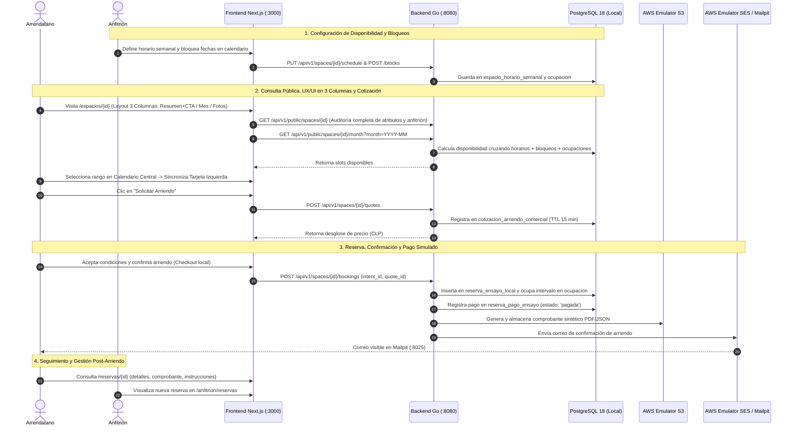

# Plan Maestro: Flujo de Arriendo de Espacios (Local-First en AWS Emulator)

**Repositorio:** `espacigo-aws`  
**Fecha de corte:** Noviembre 2026  
**Entorno:** Local Docker (PostgreSQL 18, AWS Emulator `aws-emulator:9297`, Mailpit `127.0.0.1:8025`, Go API `:8080`, Next.js `:3000`)

---

## 1. Contexto Histórico y Diagnóstico: ¿Por qué quedó incompleto en espaciGo?

En el proyecto original `espaciGo`, el flujo de arriendo se detuvo en una **demostración en memoria efímera (`cmd/rentaldemo`, DEMO-00 a DEMO-05)** debido a severas restricciones de entorno:
1. **Gates de Release y Cloud Build**: Cualquier modificación a la base de datos requería pasar por pipelines de Cloud SQL (`release_main.py`), validaciones de watermark estrictas, preflights de ledger y restricciones de despliegue GCP que impedían iterar ágilmente.
2. **Dependencias Comerciales Bloqueantes**: Se exigía verificación KYC real (Didit), firma electrónica con proveedores externos y pasarelas de pago reales (MercadoPago/Transbank) que bloqueaban el avance de las reservas.
3. **Persistencia Excluida**: Ante la imposibilidad de aplicar migraciones y rutas libremente, el equipo aisló el flujo en un demonio en memoria volátil que se borraba al reiniciar el servidor y no tocaba la base de datos real.

### La Oportunidad en `espacigo-aws`: Desarrollo Local Sin Límites
Con la migración a `espacigo-aws` y su arquitectura local desacoplada:
- **Control total de PostgreSQL 18**: Podemos crear y ejecutar migraciones DDL (`db/migrations/V000085__...`) directamente con `espacigo_schema_owner` y `espacigo_admin`.
- **Backend Go Real**: Se integran los endpoints en el servidor API principal (`cmd/api`) conectado al pool de base de datos, eliminando la necesidad de demonios separados o memoria volátil.
- **AWS Emulator (S3, SES, SQS)**:
  - Almacenamiento de fotos y documentos/comprobantes de reserva en buckets S3 locales (`espacigo-media-local` y `espacigo-documents-local`).
  - Envío de notificaciones y confirmaciones de arriendo vía SES emulado a Mailpit (`http://127.0.0.1:8025`).
- **Frontend Real**: Conexión directa desde la ficha pública del espacio (`/espacios/[id]`), el calendario de anfitrión y el historial de arriendos (`/reservas`).

---

## 2. Alcance Funcional del Flujo de Arriendo Local

El flujo completo comprende 5 etapas interconectadas con persistencia real en PostgreSQL 18:



---

## 3. Modelo de Datos y Persistencia en PostgreSQL

El esquema de base de datos actual ya cuenta con bases sólidas que reactivaremos y completaremos con migraciones dedicadas:

### 3.1. Tablas Reutilizadas y Validadas
1. `espacio` y `tarifa_espacio`: Información del espacio, precios unitarios (`hora`, `dia`, `mes`), moneda (`CLP`) y zona horaria IANA (`America/Santiago`).
2. `espacio_horario_semanal` y `espacio_horario_semanal_tramo`: Reglas de recurrencia horaria semanal por día (0 a 6).
3. `cotizacion_arriendo_comercial`: Registro oficial de cotización con snapshot inmutable de precios, unidades, inicio, término y fecha de expiración (`creada_en + '15 minutes'`).
4. `reserva_ensayo_local`: Registro central de la reserva con control de idempotencia (`arrendatario_id`, `clave_idempotencia`), estados (`pendiente_de_pago`, `pagada`, `aprobada_host`, `en_curso`, `finalizada`, `cancelada_arrendatario`), precios y marcas de auditoría.
5. `ocupacion`: Tabla de exclusión mutua para evitar solapamientos (`espacio_id`, rango de tiempo `tstzrange`, exclusión por GiST index).
6. `reserva_pago_ensayo`: Registro de la transacción y pago simulado con monto, fecha, comprobante y conciliación.

### 3.2. Nuevas Migraciones Requeridas (`db/migrations`)
- **`V000085__rental_calendar_blocks_and_public_occupancy.sql`**:
  - Habilitar creación y liberación de bloqueos manuales de anfitrión tanto en estado `borrador` como `publicada`.
  - Agregar índices GiST optimizados sobre `tstzrange(inicio, termino)` para consultas rápidas de disponibilidad mensual en el marketplace.
- **`V000086__rental_confirmation_documents_s3.sql`**:
  - Agregar columna `comprobante_s3_key` y metadatos de almacenamiento de recibos a `reserva_ensayo_local`.

---

## 4. Capa Backend Go (`cmd/api` & `internal/`)

Reemplazamos el aislamiento volátil de `cmd/rentaldemo` montando los servicios reales directamente en el router de `cmd/api`:

### 4.1. Módulos y Paquetes
1. `internal/rentalflow`:
   - `availability.go`: Algoritmo matemático de cuadrícula mensual. Divide el mes civil según la zona horaria del espacio, cruza tramos recurrentes de `espacio_horario_semanal`, resta bloqueos de anfitrión y resta reservas confirmadas de `ocupacion`.
   - `quote.go`: Validador de cotizaciones contra `tarifa_espacio` y persistencia en `cotizacion_arriendo_comercial`.
   - `service.go`: Orquestador transaccional que crea la reserva, valida idempotencia, bloquea el rango en `ocupacion` y dispara el evento de confirmación.
2. `internal/adapters/s3storage`:
   - Almacenamiento de comprobantes de arriendo y documentos en el bucket `espacigo-documents-local`.
3. `internal/adapters/sesnotifier`:
   - Envío de correos HTML a través del endpoint SES de AWS Emulator (que entrega a Mailpit).

### 4.2. Endpoints Contractuales de la API
| Método | Ruta | Rol | Descripción |
|---|---|---|---|
| `GET` | `/api/v1/public/spaces/{id}` | Público | Detalle extendido auditado (especificaciones, aforo, reglas, perfil anfitrión con KYC, recomendaciones). |
| `GET` | `/api/v1/public/spaces/{id}/month?month=YYYY-MM` | Público | Obtiene la grilla de disponibilidad del mes (días, estados `available`, `partial`, `unavailable`, `outside_horizon` e intervalos). |
| `POST` | `/api/v1/spaces/{id}/quotes` | Arrendatario | Genera y persiste una cotización con vigencia de 15 minutos. |
| `POST` | `/api/v1/spaces/{id}/bookings` | Arrendatario | Confirma la reserva usando una cotización válida, registra el pago simulado y bloquea el calendario. |
| `GET` | `/api/v1/bookings/{id}` | Participante | Detalle de la reserva, estado de pago, fechas y enlace al comprobante. |
| `GET` | `/api/v1/bookings` | Arrendatario | Listado histórico de reservas realizadas. |
| `GET` | `/api/v1/owner/spaces/{id}/calendar?month=YYYY-MM` | Anfitrión | Calendario con detalle de reservas recibidas y bloqueos manuales. |
| `POST` | `/api/v1/owner/spaces/{id}/blocks` | Anfitrión | Bloquear un rango de fechas/horas por mantenimiento o uso propio. |
| `DELETE` | `/api/v1/owner/spaces/{id}/blocks/{blockId}` | Anfitrión | Desbloquear rango. |
| `GET` | `/api/v1/owner/bookings` | Anfitrión | Listado de reservas recibidas en sus espacios. |

---

## 5. Modernización UX/UI de la Ficha Pública del Marketplace (`/espacios/[id]`)

La vista pública del detalle de un espacio se rediseña por completo para subsanar los problemas detectados: falta de atributos publicados, desborde de textos largos, ausencia del perfil del anfitrión, y carencia del botón y flujo interactivo para **"Solicitar Arriendo"**.

### 5.1. Auditoría de Campos: Integración de la Totalidad de Datos Publicados

Se efectúa la auditoría comparativa entre el esquema de base de datos (`espacio`, `espacio_caracteristicas`, `usuario`, `perfil_usuario`, `resena_ensayo_local`), los DTOs de Go y el contrato público:

| Campo / Atributo | Origen en Base de Datos | Estado Anterior en DTO Público | Ajuste en Go API / DTO Público |
|---|---|---|---|
| **Superficie y Aforo** | `espacio.superficie_m2`, `espacio.capacidad_maxima` | `superficie_m2` sí, `capacidad_maxima` omitido | Agregar `capacity: int` al DTO público. |
| **Categoría y Tipo** | `espacio.categoria_codigo`, `categoria_espacio.nombre` | Sí devuelto | Conservar y formatear con badge visual. |
| **Modalidad y Precios** | `tarifa_espacio.modalidad`, `tarifa_espacio.precio_base_clp` | Sí devuelto | Desglosar precio base por hora/día/mes y moneda CLP. |
| **Equipamiento / Amenities** | `espacio_caracteristicas.valores` (JSONB) | Solo filtraba booleanos parciales | Devolver colección completa de características categorizadas (servicios, accesibilidad, estacionamiento, climatización). |
| **Reglas de Uso y Convivencia** | `espacio.reglas_uso` | Sí devuelto | Exponer con contenedor seguro `break-words`. |
| **Política de Cancelación** | `reserva_ensayo_local.politica_cancelacion_version` | No expuesto en ficha | Devolver política de cancelación aplicable (`local_flexible_v1` / Flexible). |
| **Garantía y Depósito** | `reserva_garantia_ensayo_local.garantia_prevista_clp` | No expuesto en ficha | Devolver monto de garantía si aplica (`$50.000 CLP fija`). |
| **Horarios de Operación** | `espacio_horario_semanal` + `tramos` | Devuelto como JSON semanal | Complementar con desglose legible de check-in / check-out. |
| **Perfil del Anfitrión** | `usuario.id`, `perfil_usuario.nombre_visible`, `usuario.creado_en` | Omitido por privacidad estricta | Exponer perfil público minimizado: `host_name`, `host_joined_at`, `spaces_count`. |
| **Sello de Verificación Anfitrión** | `elegibilidad_verificacion_local` / `verification` | Booleano neutro | Exponer badge `identity_verified` (KYC aprobado por EspaciGo). |
| **Evaluaciones y Reseñas** | `resena_ensayo_local` | Omitido en ficha | Exponer resumen público: calificación promedio, conteo y comentarios con badges destacados. |

---

### 5.2. Nueva Arquitectura Visual: 3 Columnas Superiores + Detalle Inferior

La página se reestructura bajo la identidad de diseño de EspaciGo: fondo crema cálido `#FAF7F2`, tarjetas blancas con bordes suaves `#E6E0D6`, tipografía nítida y acento terracota `#A83820`.

```
+---------------------------------------------------------------------------------------------------+
| BREADCRUMB: Inicio / Explorar / Bodegas y Almacenaje / Espacio Bodega Central                      |
+------------------------------------+----------------------------------+---------------------------+
| COLUMNA IZQUIERDA (lg:col-span-4)  | COLUMNA CENTRAL (lg:col-span-4)  | COLUMNA DERECHA (span-4)  |
|                                    |                                  |                           |
| - Título (text-3xl font-bold)      | - CALENDARIO MENSUAL             | - MOSAICO FOTOS 2x2       |
| - Ubicación (Comuna, Región)       |   - Selector de Duración (días)  |   - Foto Principal        |
| - Chips rápidos (m², Aforo, etc.)  |   - Navegación Mes / Botón Hoy   |   - 3 Fotos secundarias   |
| - "Sobre esta publicación" (resumen|   - Grilla interactiva de días   |   - Badge contador (1/N)  |
|   con break-words y "Ver más")     |     (Disponible / Parcial / No)  |   - Tira miniaturas       |
|                                    |                                  |   - Lightbox al clic      |
| - TARJETA CTA "SOLICITAR ARRIENDO" | - Sincroniza rango seleccionado  |                           |
|   - Tarifa ($XX.XXX / día)         |   directamente con la Tarjeta    |                           |
|   - Desglose estimado en vivo      |   Izquierda                      |                           |
|   - Botón Terracota Interactivo    |                                  |                           |
+------------------------------------+----------------------------------+---------------------------+
| SECCIÓN INFERIOR (Ancho Completo - lg:grid-cols-12 gap-8 mt-12)                                   |
|                                                                                                   |
| [BLOQUE 1: ESPECIFICACIONES Y REGLAS]  [BLOQUE 2: PERFIL ANFITRIÓN]  [BLOQUE 3: RESEÑAS / RATING] |
| - Grillas de equipamiento & amenities   - Avatar / Nombre público     - Calificación promedio     |
| - Reglas de uso y convivencia           - Sello KYC Verificado        - Etiquetas destacadas      |
| - Política de cancelación & garantía    - Fecha de registro / Espacios- Tarjetas de comentarios   |
+---------------------------------------------------------------------------------------------------+
| MOBILE ONLY: Barra Inferior Fija Flotante con Precio + Botón Terracota "Solicitar Arriendo"       |
+---------------------------------------------------------------------------------------------------+
```

#### A. Sección Superior en 3 Columnas (`lg:grid-cols-12 gap-6 items-start`)

1. **Columna Izquierda (`lg:col-span-4`) — Resumen Ejecutivo y Tarjeta de Conversión:**
   - **Encabezado:** Breadcrumb accesible; Badge de categoría y modalidad de arriendo (`Por día`); Título del espacio (`text-3xl font-bold text-foreground break-words`); Ubicación (`Comuna, Región`) y superficie (`m²`).
   - **Chips de Resumen Rápido:** Cuadrícula compacta de 4 a 6 píldoras con iconos:
     - 📐 Superficie (`XX m²`)
     - 👥 Capacidad/Aforo (`Hasta X personas` o `Carga X kg`)
     - 🕒 Horario base (`Lun-Vie 08:00 - 20:00`)
     - 🛡️ Cancelación (`Flexible`)
     - ✅ Sello Anfitrión (`Identidad Verificada`)
   - **Resumen "Sobre esta publicación":**
     - Contenedor con `break-words` (`overflow-wrap: anywhere`) para evitar desbordes ante palabras largas o enlaces sin espacios.
     - Texto truncado a 4 líneas con botón interactivo `"Ver más"` / `"Ver menos"`.
   - **Tarjeta de Precio y CTA "Solicitar Arriendo":**
     - Tarifa base destacada (`$XX.XXX / día`).
     - Aclaración de garantía aplicable (`Garantía fija: $50.000 CLP`).
     - **Resumen en vivo del calendario**: Al hacer clic en un rango de fechas en la columna central, la tarjeta se actualiza de forma reactiva mostrando:
       - Rango seleccionado: `15 Nov 2026 - 18 Nov 2026 (3 días)`
       - Subtotal estimado: `$75.000 CLP`
     - **Botón Primario Terracota (`bg-[#A83820] hover:bg-[#8F2F1A] text-white font-semibold py-3 px-6 rounded-xl w-full transition-all shadow-md`)**:
       - *Sin selección*: Texto *"Selecciona fechas en el calendario"* (al hacer clic, scroll o foco suave hacia el calendario central).
       - *Con selección*: Texto *"Solicitar Arriendo — $XX.XXX CLP"* que redirige al flujo de checkout `/reservas/nueva?spaceId=...&start=...&end=...`.

2. **Columna Central (`lg:col-span-4`) — Calendario Mensual Interactivo:**
   - Incorpora el componente reactivo `MonthCalendar`:
     - Selector de duración según modalidad (1, 2, 3 días o semanas).
     - Navegación de mes (`< Mes Anterior`, `Mes Siguiente >`) y botón `"Hoy"`.
     - Celdas con visualización clara de estados:
       - 🟢 *Disponible*: Borde sutil, fondo claro, seleccionable.
       - 🟡 *Parcialmente ocupado*: Franjas horarias específicas.
       - ⚪ *No disponible / Bloqueado*: Gris tenue, deshabilitado.
       - 🟤 *Seleccionado*: Resaltado terracota accesible.
     - Leyenda clara al pie del calendario sin textos truncados.
     - Al seleccionar fecha/rango, emite el evento de selección hacia el estado de la página para sincronizar la Columna Izquierda y la barra móvil.

3. **Columna Derecha (`lg:col-span-4`) — Galería Multimedia del Espacio:**
   - **Mosaico Principal 2x2**:
     - Imagen principal destacada arriba y 2 o 3 imágenes secundarias debajo con `object-cover` y esquinas redondeadas (`rounded-xl`).
     - Badge superior flotante con contador (`1 / 8 fotos`).
     - Tira de miniaturas deslizable horizontalmente.
     - Clic en cualquier foto abre el **Lightbox modal** a pantalla completa con navegación por teclado y botones `<` / `>`.

---

#### B. Sección Inferior en Bloques de Detalle y Confianza (Ancho Completo)

1. **Bloque 1: Especificaciones Completas, Equipamiento y Reglas del Espacio (`lg:col-span-6` o ancho completo tabulado):**
   - **Atributos y Equipamiento:** Grilla de 2 a 3 columnas con iconos temáticos (Servicios incluidos, Electricidad, Agua, Seguridad 24/7, Acceso vehicular, Altura libre, Portón eléctrico, Montacargas).
   - **Reglas de Uso y Condiciones:** Contenedor estilizado con normas informadas por el anfitrión (prohibiciones, horarios de carga y descarga, cuidado de instalaciones).
   - **Políticas de Arriendo:** Política de cancelación detallada, plazo de preaviso y condiciones de devolución de garantía.

2. **Bloque 2: Perfil del Anfitrión / Propietario (`lg:col-span-3`):**
   - Tarjeta de confianza:
     - Avatar con foto o iniciales en círculo terracota suave.
     - Nombre público (`Hernán E.`).
     - **Insignia KYC Destacada**: Escudo verde con check `Identidad Verificada por EspaciGo`.
     - Metadatos: *"Miembro desde Octubre 2026"* · *"2 espacios publicados"*.
     - Botón secundario *"Contactar Anfitrión"* o *"Ver perfil"*.

3. **Bloque 3: Recomendaciones y Evaluaciones (`lg:col-span-3`):**
   - Puntuación promedio con estrellas (`⭐ 4.9 / 5.0 (12 arriendos)`).
   - Etiquetas de reconocimiento: *"Excelente ubicación"*, *"Espacio impecable"*, *"Respuesta inmediata"*.
   - Muestra de comentarios recientes de arrendatarios verificados.
   - Estado vacío elegante para publicaciones nuevas: *"Esta publicación es nueva y aún no registra evaluaciones. ¡Sé el primero en reservar!"*.

---

#### C. Experiencia Móvil (Responsive)
- En dispositivos móviles (`< lg`), el layout se apila verticalmente de forma ordenada:
  1. Galería de fotos (carrusel táctil superior).
  2. Encabezado con título, ubicación y chips rápidos.
  3. Calendario interactivo mensual táctil.
  4. Especificaciones, reglas y perfil de anfitrión.
- **Barra Inferior Flotante Fija (`sticky bottom-0 z-40 bg-white border-t p-4 shadow-lg`)**:
  - Muestra la tarifa `$XX.XXX / día` y el botón terracota **`Solicitar Arriendo`** siempre visible, garantizando la conversión sin importar el scroll.

---

### 5.3. Reglas Técnicas de Renderizado y Estabilidad
- **Protección Anti-Desbordamiento**: Aplicación estricta de `break-words`, `overflow-wrap: anywhere` y `truncate` contextual en títulos, descripciones y comentarios de usuarios para impedir que textos continuos sin espacios rompan el ancho de las columnas.
- **Sincronización Reactiva Unidireccional**: Estado compartido entre `PublicSpaceRentalAvailability` / `MonthCalendar` y el componente de la tarjeta de arriendo mediante un hook cliente o estado elevado (`useSpaceBookingSelection`).
- **Accesibilidad (a11y)**: Navegación de teclado en calendario y galería, atributos `aria-label`, contraste de color validado (ratio > 4.5:1 en botón terracota y textos), y compatibilidad con lectores de pantalla.

---

## 6. Plan de Ejecución por Fases (Roadmap)

### Corte activo autorizado: Fase 1, sub-tareas 1.1–1.4

La instrucción de ejecución amplía el primer corte a cuatro sub-tareas: **1.1 DTO público y auditoría de fuentes**, **1.2 layout superior de tres columnas**, **1.3 bloques inferiores y barra móvil**, y **1.4 selección reactiva/CTA y verificación**. Se inician 1.1 y 1.2 con propiedad de archivos separada; los consumidores del nuevo DTO se integran después de fijar y regenerar el contrato. El roadmap original se conserva debajo como desglose funcional, no como restricción que excluya la UI expresamente autorizada.

Estado, límites de integración y pruebas: [ejecución y matriz de aceptación](marketplace_fase1/ejecucion.md). El entorno es exclusivamente local; no se habilitan nube, pagos reales ni firma por este corte.


### Fase 1: Auditoría de Datos y Extensión del Backend Go
- [x] Incorporar `capacidad_maxima`, atributos completos de `espacio_caracteristicas`, datos públicos de anfitrión y políticas al DTO de `internal/publiccatalog`.
- [x] Validar endpoint `GET /api/v1/public/spaces/{id}` con tests unitarios en Go.

### Fase 2: Reestructuración de la Vista en Next.js (3 Columnas Superiores)
- [x] Construir layout en 3 columnas (`lg:grid-cols-12`) en `frontend/src/app/(marketplace)/espacios/[id]/page.tsx`.
- [x] Implementar la **Columna Izquierda** con chips rápidos, descripción protegida anti-overflow (`break-words`) y tarjeta CTA "Solicitar Arriendo".
- [x] Integrar el **Calendario Central** interactivo conectándolo reactivamente a la tarjeta izquierda.
- [x] Reubicar y optimizar la **Galería Multimedia** en la Columna Derecha con mosaico 2x2 y lightbox modal.

### Fase 3: Bloques Inferiores de Detalle, Anfitrión y Reseñas
- [x] Desarrollar el Bloque 1 de especificaciones y reglas con iconos temáticos.
- [x] Desarrollar el Bloque 2 con la tarjeta del anfitrión y su badge KYC de identidad verificada.
- [x] Desarrollar el Bloque 3 de calificaciones y recomendaciones con estado vacío elegante.
- [x] Agregar la barra inferior flotante de reserva para dispositivos móviles.

### Fase 4: Integración del Flujo "Solicitar Arriendo" y Checkout Local
- [x] Conectar el botón terracota al flujo de reserva y redirigir a `/reservas/nueva`.
- [x] Pre-poblar `<BookingQuoteCard>` con los parámetros del marketplace (`spaceId`, `defaultRateUnit`, `initialStartDate`, `initialDurationUnits`).
- [x] Habilitar cálculo formal de cotización y confirmación de reserva local (`reserva_ensayo_local`) con bloqueo de ocupación.
- [x] Ejecutar suites completas de tests (`playwright.marketplace-phase1`, `public-rental-commercial`, `pnpm test`, `tsc --noEmit`, `go test ./...`).

### Fase 5: Ciclo de Vida Completo de Reserva, Pagos y Contratos (Validado End-to-End)
- [x] **Cotización Real y Snapshot Inmutable**: `POST /api/v1/local/booking-trial/quotes` calcula precio unitario y desglose con TTL de 15 minutos en `cotizacion_reserva_ensayo`.
- [x] **Reserva y Bloqueo Atómico de Ocupación**: `POST /api/v1/local/booking-trial/reservations` bloquea el rango con índice GiST en `public.ocupacion` impidiendo solapamientos.
- [x] **Simulación de Pago y Notificaciones**: `POST /.../payment` con `outcome: "exito"` transiciona a `pagada` y despacha correos automáticos tanto a arrendatario como a anfitrión a través de SES emulado a Mailpit (`:8025`).
- [x] **Garantía y Aprobación de Anfitrión**: `POST /.../guarantee` autoriza el monto de garantía y `POST /.../decision` con `decision: "aprobar"` transiciona el estado a `aprobada_host`.
- [x] **Contratos Sintéticos y Doble Firma**: Generación automática de contrato, firma digital de ambas partes (`POST /.../contracts/{id}/sign`), pasando a `firmado` y la reserva a `lista_para_checkin`.
- [x] **Descarga de PDF y Mensajería**: Generación y descarga directa de `contrato-ensayo-sintetico.pdf` (`GET /.../contracts/{id}/document`) y comunicación bidireccional en `/messages` auditada en PostgreSQL 18.

---

## Addendum de estado real y trazabilidad — 2026-11-16

**Estado vigente posterior:** consultar «Verificación del padre: selección y handoff» en [auditoría trazable](auditoria_arriendos_calendarios_20261116.md). Sustituye los bloqueos históricos de mes/BFF, intervalos no montados y CTA sin selección; conserva los pendientes de precio variable, edición host y ciclo persistido.

Este addendum preserva el roadmap y los checkboxes históricos; no certifica por sí solo cierre end-to-end. Las afirmaciones históricas de «completo», «validado end-to-end» o equivalentes describen el corte/prueba que las originó, no el estado actual de todos los canales. Para el estado contrastado y la evidencia con fecha, véase [auditoría trazable](auditoria_arriendos_calendarios_20261116.md).

### Matriz de aceptación actual

| Bloque | Estado actual | Alinear Go / PostgreSQL / Next | Criterio verificable para 100% |
|---|---|---|---|
| Ficha pública, DTO y CTA | **Parcial** | Alinear contrato público versionado, campos minimizados y selección UI con disponibilidad real; no inventar reseñas/KYC/garantía | GET público del espacio y calendario con contrato, autorización/privacidad, DTO y UI concordantes; navegador comprueba datos reales y estados vacíos |
| Calendario mensual público | **Con incongruencias/bugs** | No confundir el endpoint legado `/spaces/{id}/availability?month=` (Go 200) con el contrato mensual canónico: BFF hoy rechaza la query (400); Go comercial actual expone disponibilidad por fecha/duración, no esta grilla mensual. Aplicar fail-closed al calendario público canónico; asegurar que error/vacío no fabrique horas `-03:00` | Contrato OpenAPI generado, BFF acepta sólo parámetros declarados, respuestas vacías/error no se convierten en slots; prueba HTTP Go→BFF y navegador con disponibilidad, bloqueos, zona y recarga coherentes |
| Edición del anfitrión | **Parcial** | Contrastar schedule/tramos y ocupación existentes con regla base/overrides propuestos; propietario, CAS/ETag, zona horaria y escritura batch deben ser idénticos en API/DB/UI | anfitrión autorizado persiste regla, modifica/revierte override y lee exactamente la misma versión en Postgres y calendario público; conflicto concurrente rechazado |
| Cotización y precio | **Parcial** | El quote comercial debe usar mismos horarios, overrides, tarifa/versionado y zona que disponibilidad; snapshot inmutable; reservar la futura regla de precio a su fuente real | cambios de precio/regla entre selección y quote se rechazan o recalculan de forma explícita; detalle de CLP coincide con snapshot y DB; sin cotización desde tarifa UI fabricada |
| Reserva/ocupación y estados posteriores | **Parcial (ensayo local), no arriendo comercial** | Distinguir flag/namespace `LOCAL_BOOKING_TRIAL` y adaptadores fake del flujo comercial protegido por `COMMERCIAL_RENTAL_FLOW_ENABLED`; trial y comercial son excluyentes | cita con evidencia de store persistente y transacción/ocupación atómica, idempotencia y lectura posterior. Pagos simulados, firmas demo, Mailpit y mocks no se llaman pago/arriendo comercial |
| QA de usuario | **Falta construir** para cierre actual | Conectar navegación pública, edición host, calendario, quote y reserva en una sesión coherente con BFF y Go | Playwright autorizado en builds finales demuestra ambas cuentas, selección→quote→reserva→ocupación y readback; no usar tests mock como sustituto de Postgres |

### Próximos tracer bullets (orden de dependencia)
1. **Contrato público mensual:** corregir OpenAPI y BFF allowlist/query; GET canónico fail-closed, schema válido, errores no vacíos encubiertos; diferenciar endpoint legado y nuevo canónico.
2. **Edición host:** fijar DTO/versionado, autorización de propietario, zona horaria y CAS; persistir regla semanal y overrides de bloqueo/apertura/precio en PostgreSQL, con GET de confirmación.
3. **Quote:** usar esa misma regla/override y tarifa efectiva; congelar unidades, fechas, moneda y precio en snapshot; comparar lectura de DB y rechazo al cambiar inventario.
4. **Reserva/ocupación:** validar quote, exclusión atómica GiST/idempotencia y actualizar lectura pública; dejar pago/firma/comercial fuera hasta gates separados.
5. **Navegador:** journey anfitrión→publicación→calendario→selección→quote→reserva local y readback; separar explícitamente trial local de producto comercial.

Las migraciones `V000085`/`V000086` descritas arriba son **propuesta histórica**. Las secuencias de migración y SQL aplicado deben derivarse del ledger/fuentes vigentes; no renumerar ni reescribir SQL ya aplicado para que coincida con esa propuesta. La auditoría indicada registra 98/98 migraciones en DB Docker local, checksums/nombres coincidentes y cero pendientes (lectura solamente).

### Addendum de QA del corte mensual — 2026-11-16

**CERRADO únicamente:** transporte/render del mes y lectura de día publicado sobre BFF/API en el artefacto existente, desktop 1440 px y móvil 390 px. El flujo de arriendo que describe este plan permanece **PARCIAL** en conjunto: disponibilidad mensual no equivale a quote ni a reserva; no están acreditados selección real de intervalos, edición host, persistencia de quote/reserva/ocupación ni pago comercial.

En los controles de selección pública con mes vacío y error, Playwright confirmó que la CTA «Selecciona fechas en el calendario» sigue habilitada; **2 controles fallan por esa misma causa** y quedan documentados en [auditoría QA](auditoria_arriendos_calendarios_20261116.md). No cambiar producción desde este corte. La lectura de intervalos y el rango/quote están a cargo de escritores concurrentes: **PENDIENTES de resultado/revisión del padre**, no completados. Un próximo corte debe resolver CTA, repetir ambos controles y luego integrar el GET de intervalos/rango/quote bajo OpenAPI antes de preparar una selección positiva sin escrituras. No afirmar ocupación, reserva confirmada ni pago comercial.

### Actualización posterior: selección y preparación verificadas — 2026-11-16

**Avance posterior del anfitrión:** ver «Integración visible del calendario anfitrión» en la [auditoría](auditoria_arriendos_calendarios_20261116.md). Nuevo recurso privado, CAS atómico y gestor con carga/guardado/readback implementados; 3/3 pruebas UI con gateway simulado pasan dos veces. No equivalen a escritura PostgreSQL nativa. El alta de inventario desde el asistente, precio variable y ciclo de solicitud/ocupación siguen pendientes. Resultado frontend posterior: 681 pass, 1 skip; build, typecheck, lint y API check de 218 operaciones pasan.

El bloqueo anterior de CTA queda resuelto: 4/4 pruebas mensuales pasan dos veces, incluidos vacío/error controlados. El GET de intervalos está activo en el runtime local sin activar operación comercial; 2/2 pruebas nativas desktop/móvil seleccionan un intervalo real, conservan timestamps/zona y hacen clic hasta `/reservas/nueva`, con campos de handoff bloqueados. La garantía fija sin respaldo fue retirada. `BookingQuoteCard` conserva el rango recibido y la etiqueta Ensayo; no se ejecutó POST de quote ni solicitud en este gate.

Build aislado exit 0; frontend final typecheck/test/lint/api:check exit 0 (669 pass, 1 skip; 216 operaciones); Go global exit 0 (4.696 pass, 217 skip, live S3 excluido). Formato global sigue fallando en 10 archivos ajenos al corte. Evidencia, matriz vigente y límites están en [auditoría trazable](auditoria_arriendos_calendarios_20261116.md). **Plan global: Parcial.** Próximos gates: precio variable/snapshot, configuración host con readback y solicitud/ocupación/cancelación persistidas. No marcar esas etapas finalizadas por el handoff de lectura.

### Actualización vigente: publicación y persistencia nativa — 2026-11-16

Checkpoint de código publicado en `main`: `00986814fc3fed5f34f4957fbd17e1782ebfe9b6`. Ya se crearon por registro normal un anfitrión y dos arrendatarios sintéticos nuevos, con correo/login/perfil verificados. El anfitrión guardó desde la interfaz la regla 10:00–18:00 para los siete días y el horario semanal, recargó y publicó su espacio nuevo a 12.000 CLP/hora. BFF/Go respondieron 200; PostgreSQL confirmó los registros y el estado activo. PUT con revisión antigua: 412 y lectura sin cambios. El móvil público seleccionó el ticket real de dos horas del 17 de noviembre, preservando timestamps y sin mutaciones.

**Reservas todavía bloqueadas:** quote real devuelve 404 por falta de elegibilidad KYC vigente. No se autorizó por inferencia ni se sembraron aprobaciones: la consulta al usuario para KYC sintético quedó sin respuesta. DB confirma cero cotizaciones, reservas y ocupaciones del espacio de prueba. Faltan solicitudes de A/B en horas distintas del mismo día y días distintos, rechazo de solapamiento y readback. No se probaron períodos diarios/semanales; el contrato no tiene unidad `semana`. Continuar después de una decisión explícita sobre la precondición KYC, sin sustituir las cuentas nuevas por otras existentes. **Plan global: Parcial.** Evidencia, límites y CI (dos workflows verdes, dos fallidos) en «Publicación y aceptación nativa del calendario» de la [auditoría](auditoria_arriendos_calendarios_20261116.md).