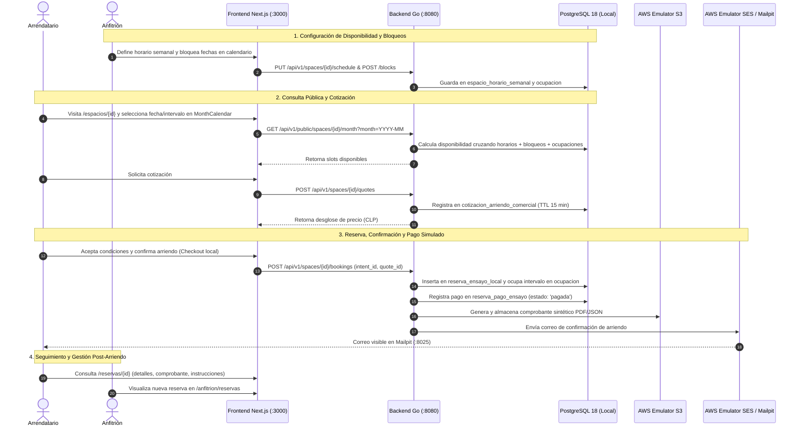

# Plan Maestro: Flujo de Arriendo de Espacios (Local-First en AWS Emulator)

**Repositorio:** `espacigo-aws`  
**Fecha de corte:** Noviembre 2026  
**Entorno:** Local Docker (PostgreSQL 18, AWS Emulator `aws-emulator:9297`, Mailpit `127.0.0.1:8025`, Go API `:8080`, Next.js `:3000`)

---

## 1. Contexto Histórico y Diagnóstico: ¿Por qué quedó incompleto en espaciGo?

En el proyecto original `espaciGo`, el flujo de arriendo se detuvo en una **demostración en memoria efímera (`cmd/rentaldemo`, DEMO-00 a DEMO-05)** debido a severas restricciones de entorno:
1. **Gates de Release y Cloud Build**: Cualquier modificación a la base de datos requería pasar por pipelines de Cloud SQL (`release_main.py`), validaciones de watermark estrictas, preflights de ledger y restricciones de despliegue GCP que impedían iterar ágilmente.
2. **Dependencias Comerciales Bloqueantes**: Se exigía verificación KYC real (Didit), firma electrónica con proveedores externos y pasarelas de pago reales (MercadoPago/Transbank) que bloqueaban el avance de las reservas.
3. **Persistencia Excluida**: Ante la imposibilidad de aplicar migraciones y rutas libremente, el equipo aisló el flujo en un demonio en memoria volátil que se borraba al reiniciar el servidor y no tocaba la base de datos real.

### La Oportunidad en `espacigo-aws`: Desarrollo Local Sin Límites
Con la migración a `espacigo-aws` y su arquitectura local desacoplada:
- **Control total de PostgreSQL 18**: Podemos crear y ejecutar migraciones DDL (`db/migrations/V000085__...`) directamente con `espacigo_schema_owner` y `espacigo_admin`.
- **Backend Go Real**: Se integran los endpoints en el servidor API principal (`cmd/api`) conectado al pool de base de datos, eliminando la necesidad de demonios separados o memoria volátil.
- **AWS Emulator (S3, SES, SQS)**:
  - Almacenamiento de fotos y documentos/comprobantes de reserva en buckets S3 locales (`espacigo-media-local` y `espacigo-documents-local`).
  - Envío de notificaciones y confirmaciones de arriendo vía SES emulado a Mailpit (`http://127.0.0.1:8025`).
- **Frontend Real**: Conexión directa desde la ficha pública del espacio (`/espacios/[id]`), el calendario de anfitrión y el historial de arriendos (`/reservas`).

---

## 2. Alcance Funcional del Flujo de Arriendo Local

El flujo completo comprende 5 etapas interconectadas con persistencia real en PostgreSQL 18:

---

## 3. Modelo de Datos y Persistencia en PostgreSQL

El esquema de base de datos actual ya cuenta con bases sólidas que reactivaremos y completaremos con migraciones dedicadas:

### 3.1. Tablas Reutilizadas y Validadas
1. `espacio` y `tarifa_espacio`: Información del espacio, precios unitarios (`hora`, `dia`, `mes`), moneda (`CLP`) y zona horaria IANA (`America/Santiago`).
2. `espacio_horario_semanal` y `espacio_horario_semanal_tramo`: Reglas de recurrencia horaria semanal por día (0 a 6).
3. `cotizacion_arriendo_comercial`: Registro oficial de cotización con snapshot inmutable de precios, unidades, inicio, término y fecha de expiración (`creada_en + '15 minutes'`).
4. `reserva_ensayo_local`: Registro central de la reserva con control de idempotencia (`arrendatario_id`, `clave_idempotencia`), estados (`pendiente_de_pago`, `pagada`, `aprobada_host`, `en_curso`, `finalizada`, `cancelada_arrendatario`), precios y marcas de auditoría.
5. `ocupacion`: Tabla de exclusión mutua para evitar solapamientos (`espacio_id`, rango de tiempo `tstzrange`, exclusión por GiST index).
6. `reserva_pago_ensayo`: Registro de la transacción y pago simulado con monto, fecha, comprobante y conciliación.

### 3.2. Nuevas Migraciones Requeridas (`db/migrations`)
- **`V000085__rental_calendar_blocks_and_public_occupancy.sql`**:
  - Habilitar creación y liberación de bloqueos manuales de anfitrión tanto en estado `borrador` como `publicada`.
  - Agregar índices GiST optimizados sobre `tstzrange(inicio, termino)` para consultas rápidas de disponibilidad mensual en el marketplace.
- **`V000086__rental_confirmation_documents_s3.sql`**:
  - Agregar columna `comprobante_s3_key` y metadatos de almacenamiento de recibos a `reserva_ensayo_local`.

---

## 4. Capa Backend Go (`cmd/api` & `internal/`)

Reemplazamos el aislamiento volátil de `cmd/rentaldemo` montando los servicios reales directamente en el router de `cmd/api`:

### 4.1. Módulos y Paquetes
1. `internal/rentalflow`:
   - `availability.go`: Algoritmo matemático de cuadrícula mensual. Divide el mes civil según la zona horaria del espacio, cruza tramos recurrentes de `espacio_horario_semanal`, resta bloqueos de anfitrión y resta reservas confirmadas de `ocupacion`.
   - `quote.go`: Validador de cotizaciones contra `tarifa_espacio` y persistencia en `cotizacion_arriendo_comercial`.
   - `service.go`: Orquestador transaccional que crea la reserva, valida idempotencia, bloquea el rango en `ocupacion` y dispara el evento de confirmación.
2. `internal/adapters/s3storage`:
   - Almacenamiento de comprobantes de arriendo y documentos en el bucket `espacigo-documents-local`.
3. `internal/adapters/sesnotifier`:
   - Envío de correos HTML a través del endpoint SES de AWS Emulator (que entrega a Mailpit).

### 4.2. Endpoints Contractuales de la API
| Método | Ruta | Rol | Descripción |
|---|---|---|---|
| `GET` | `/api/v1/public/spaces/{id}/month?month=YYYY-MM` | Público | Obtiene la grilla de disponibilidad del mes (días, estados `available`, `partial`, `unavailable`, `outside_horizon` e intervalos). |
| `POST` | `/api/v1/spaces/{id}/quotes` | Arrendatario | Genera y persiste una cotización con vigencia de 15 minutos. |
| `POST` | `/api/v1/spaces/{id}/bookings` | Arrendatario | Confirma la reserva usando una cotización válida, registra el pago simulado y bloquea el calendario. |
| `GET` | `/api/v1/bookings/{id}` | Participante | Detalle de la reserva, estado de pago, fechas y enlace al comprobante. |
| `GET` | `/api/v1/bookings` | Arrendatario | Listado histórico de reservas realizadas. |
| `GET` | `/api/v1/owner/spaces/{id}/calendar?month=YYYY-MM` | Anfitrión | Calendario con detalle de reservas recibidas y bloqueos manuales. |
| `POST` | `/api/v1/owner/spaces/{id}/blocks` | Anfitrión | Bloquear un rango de fechas/horas por mantenimiento o uso propio. |
| `DELETE` | `/api/v1/owner/spaces/{id}/blocks/{blockId}` | Anfitrión | Desbloquear rango. |
| `GET` | `/api/v1/owner/bookings` | Anfitrión | Listado de reservas recibidas en sus espacios. |

---

## 5. Capa Frontend Next.js (`frontend/src/`)

Aprovechamos los componentes construidos en `rental-demo` y los conectamos a las páginas oficiales de producción:

### 5.1. Componentes Reutilizables
- **`MonthCalendar`**: Componente de cuadrícula mensual interactivo con navegación de meses, localización en español, soporte de zona horaria IANA (`America/Santiago`), indicador «Hoy», selección de rangos y leyenda accesible.
- **`DailyIntervalSelector`**: Selector de tramos horarios (grilla de 30 minutos, duraciones de 1, 2, 4 horas o días completos).
- **`BookingSummaryCard`**: Tarjeta con desglose de precios (subtotal, tarifa unitaria, impuestos/comisiones simuladas, total en CLP).

### 5.2. Vistas Integradas
1. **Ficha Pública de Espacio (`/espacios/[id]`)**:
   - Reemplazar la vista estática por el `MonthCalendar` interactivo.
   - Panel lateral de reserva: selección de fechas -> selección de horas -> cotización en tiempo real -> botón «Continuar a Arrendar».
2. **Flujo de Checkout y Confirmación (`/reservas/nueva?quoteId=...`)**:
   - Resumen del arriendo y espacio.
   - Casilla de confirmación de términos de arriendo.
   - Selector de método de pago simulado («Tarjeta de Débito/Crédito Local (Simulada)»).
   - Botón «Pagar y Confirmar Arriendo».
   - Transición a pantalla de éxito con número de reserva y enlace a Mailpit.
3. **Panel de Arrendatario (`/reservas` y `/reservas/[id]`)**:
   - Listado de arriendos activos, próximos y pasados.
   - Ficha con código QR / identificador de reserva, dirección, datos de contacto del anfitrión e instrucciones de llegada.
4. **Panel de Anfitrión (`/anfitrion/espacios/[id]/calendario` y `/anfitrion/reservas`)**:
   - Visualización de la ocupación en el calendario mensual con nombres de arrendatarios y estados.
   - Botón para añadir bloqueos manuales de fechas.

---

## 6. Plan de Ejecución por Fases (Roadmap)

### Fase 1: Disponibilidad y Calendario Mensual en Backend y Ficha Pública
- [ ] Aplicar migración de consulta rápida de disponibilidad mensual en PostgreSQL.
- [ ] Implementar endpoint `GET /api/v1/public/spaces/{id}/month` en Go calculando cruces reales de `espacio_horario_semanal` y `ocupacion`.
- [ ] Integrar el componente `MonthCalendar` en `frontend/src/app/(marketplace)/espacios/[id]/page.tsx`.

### Fase 2: Cotización y Bloqueo Concurrente
- [ ] Endpoint `POST /api/v1/spaces/{id}/quotes` conectado a `cotizacion_arriendo_comercial`.
- [ ] Integrar selección de intervalo y obtención de cotización con TTL de 15 minutos en el frontend.
- [ ] Validación de límites (antelación mínima, horizonte de 90 días).

### Fase 3: Creación de Reserva y Pago Simulado
- [ ] Endpoint `POST /api/v1/spaces/{id}/bookings` con transacción atómica en `reserva_ensayo_local`, inserción en `ocupacion` y `reserva_pago_ensayo`.
- [ ] Integración con el emulador S3 para guardar comprobante.
- [ ] Disparo de correo de confirmación mediante AWS SES hacia Mailpit.
- [ ] Pantalla de Checkout `/reservas/nueva` y confirmación de pago simulado.

### Fase 4: Gestión de Anfitrión y Dashboards
- [ ] Endpoints de bloqueos manuales de anfitrión (`POST/DELETE /api/v1/owner/spaces/{id}/blocks`).
- [ ] Calendario interactivo de anfitrión en `/anfitrion/espacios/[id]/editar` o subpágina `/calendario`.
- [ ] Historial y detalle de reservas para el usuario en `/reservas` y para el anfitrión en `/anfitrion/reservas`.

---

## 7. Verificación y Criterios de Aceptación End-to-End

1. **Persistencia Real**: Crear una reserva desde el frontend debe reflejarse inmediatamente en la tabla `reserva_ensayo_local` y en `ocupacion` dentro de PostgreSQL 18.
2. **Exclusión Mutua**: Una vez reservado un intervalo, ni el anfitrión ni otro usuario podrán seleccionar ni reservar ese mismo intervalo en el `MonthCalendar`.
3. **Notificación**: Tras la confirmación, debe aparecer un correo de confirmación de arriendo en la interfaz web de Mailpit (`http://127.0.0.1:8025`).
4. **Resistencia a Reinicios**: Al reiniciar el contenedor de Go API o Next.js, las reservas, bloqueos y calendarios se conservan intactos en PostgreSQL.
