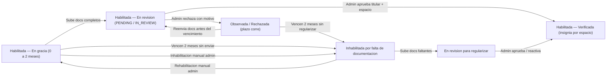
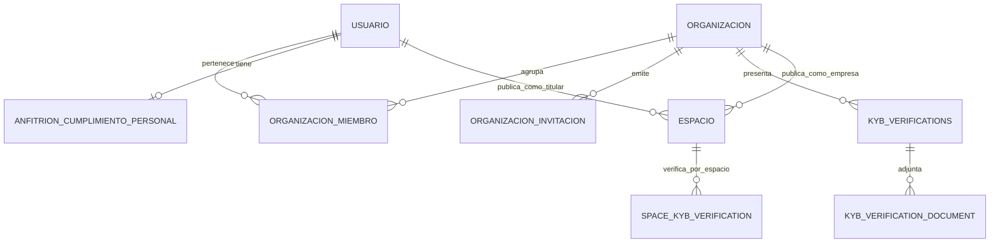

# Plan Maestro: Módulo KYB, Certificado SII, Modo Empresa Multi-usuario, Verificación por Espacio y Plazo de Gracia de 2 Meses

- **Fecha de planificación:** 2026-11-26
- **Worktree base:** `/home/nandev/Documentos/projects/espacigo-aws/.local/worktrees/contratos`
- **Rama base:** `codex/marketplace/feature/contratos-1-modulo-contratos` (commit `18211ea`, sincronizado con `origin/main` y `origin/desarrollo-local`)
- **Rama de referencia KYB base:** `origin/kyb` (commit `b423186`, contribución de Anita / `ShivaAkasha`)
- **Estado actual:** Integración en curso en el worktree de contratos. Consulta el registro de avance para retomar y validar la entrega.

## Registro de avance en el worktree de contratos

| Área | Estado |
| --- | --- |
| Integración KYB | V000011–V000012 incorporan expedientes privados, huellas RUT, equipos de empresa y verificación documental. La empresa conserva un único RUT. Una solicitud de adhesión requiere revisión de un representante y aceptación explícita de la invitación. |
| Política de EspaciGo | Dos meses calendario desde la primera publicación activa de cada titular. V000013 aplica el vencimiento compartido y evalúa el respaldo por espacio. V000014 registra la solicitud de documentos de cada espacio, junto con quien publicó, el titular y la versión de política. La cuenta conserva su acceso como arrendataria y el acceso para regularizar documentos. |
| Términos de evaluación | V000015 registra Términos v2 para el alta local. Las cuentas existentes pueden aceptar la misma versión antes de publicar o administrar espacios. La aceptación es idempotente y conserva el historial de versiones. |
| Avisos y revisión | V000016 añade avisos en la app y una cola persistente para correo. El worker local ejecuta avisos y vencimientos. La revisión administrativa dispone de expedientes privados, estados de cumplimiento y acciones de bloqueo y rehabilitación. |
| Contratos y pagos | V000017 vincula la firma empresarial al representante verificado que consta en la propuesta. El checkout conserva la cuenta de cobro vinculada al titular técnico de la reserva. |
| Verificación | PostgreSQL 18 aislado aplicó V000001–V000017 bajo la identidad migradora. Las pruebas SQL comprobaron el plazo compartido, la carga tardía, la aprobación independiente de un inmueble, la continuidad como arrendatario, la aceptación idempotente de Términos, los avisos de vencimiento y reactivación y la firma exclusiva del representante contractual. Las pruebas integradas HTTP, navegador, Mailpit y los reembolsos contra PostgreSQL necesitan un entorno con sockets. |
| Infraestructura y salida | CloudFormation define el bucket privado y los parámetros KYB, desactivados por defecto. Términos de producción, habilitación en AWS y promoción de la rama siguen pendientes según AGENTS.md. |

---

## 0. Objetivo maestro y principios inamovibles

Integrar el módulo KYB desarrollado en `origin/kyb` sobre la base actualizada de `contratos` sin sobrescribir ni degradar las funcionalidades de contratos comerciales, reservas, cancelaciones y reembolsos ya aprobadas en producción, ampliándolo para cubrir las reglas de negocio y cumplimiento vigentes en Chile:

1. **Base inamovible `contratos`:** Toda integración se hace portando selectivamente KYB sobre `18211ea`; nunca se sobrescriben flujos de `commercialagreements`, `rentalflow`, `payments` o reembolsos.
2. **Separación estricta de commits (`AGENTS.md`):**
   - **Commits de aplicación compartida:** código Go/Next.js, OpenAPI/Scalar, migraciones SQL + `db/release-policy.json` y pruebas.
   - **Commits exclusivos de entorno local (solo `desarrollo-local`, nunca a `main`):** `scripts/local-dev.sh` y `scripts/local-aws-bootstrap.sh`.
   - **Commits de infraestructura AWS (promoción explícita separada):** `infra/cloudformation/network-and-data.yaml` e `infra/cloudformation/app-and-cicd.yaml`.
3. **Separación explícita Persona Natural vs. Modo Empresa (Multi-usuario):**
   - Toda persona ingresa con su cuenta personal (`public.usuario`) y KYC individual; nunca se comparten credenciales.
   - Al publicar o administrar, el anfitrión elige operar como **Persona Natural** con su propio RUT, incluso si desarrolla actividades económicas bajo ese RUT, o bajo **Modo Empresa** (`public.organizacion`) si la entidad tiene RUT propio. El rol de representante legal requiere comprobar su identidad y sus facultades para esa empresa.
   - Cada empresa es **única por RUT** (sin duplicaciones) y puede tener **múltiples usuarios y representantes legales** vinculados con roles diferenciados y auditoría por actor.
   - El perfil público visible en las publicaciones de empresa muestra el perfil corporativo (razón social / nombre comercial), no el usuario privado que administró el anuncio.
4. **Verificación por espacio (`espacio_id`), nunca por cuenta completa:**
   - Aprobar documentación habilita la insignia pública **"Espacio verificado"** únicamente en el espacio específico cuyo respaldo inmueble y perfil titular estén aprobados.
5. **Plazo de gracia de 2 meses calendario (`America/Santiago`):**
   - El titular comercial que está iniciando actividades tiene hasta **2 meses calendario desde su primera publicación activa** para cargar sus documentos y el respaldo de los espacios que publique. Los espacios adicionales durante la gracia comparten la fecha límite original. Pausar, republicar, retirar o agregar espacios no inicia otro plazo.
   - La política se muestra y se acepta al crear la cuenta, y queda disponible en los **Términos y Condiciones** (`/terminos-y-condiciones`). Al seleccionar el modo de anfitrión se registra qué documentación se solicitó, a qué titular y cuándo. En cada publicación se registra además el respaldo solicitado para ese espacio y la fecha límite compartida.
   - Al vencer el plazo compartido, si falta documentación del titular se inhabilita comercialmente el perfil y se impide que publique o administre espacios hasta regularizar. El titular puede seguir arrendando como cliente y subir sus documentos para regularizar. Si falta el respaldo de un inmueble, ese espacio se inhabilita individualmente. Cualquier publicación posterior al vencimiento queda sujeta a revisión documental previa, con protección para los expedientes completos que se presentaron a tiempo y esperan revisión de EspaciGo.

---

## 1. Auditoría de `origin/kyb` (`b423186`) y resolución de conflictos sin pisar `contratos`

La rama `origin/kyb` aporta 43 archivos con cifrado AES-GCM en S3, HMAC de RUT con keyring rotativo, endpoints KYB, visor seguro PDF vía `fetch + URL.createObjectURL(blob)` y panel `/administracion/kyb`. Al compararla con `contratos` (`18211ea`), se detectaron los siguientes puntos que deben resolverse quirúrgicamente:

| Archivo / Área | Hallazgo en `origin/kyb` (`b423186`) | Resolución planificada sobre base `contratos` |
| --- | --- | --- |
| `db/migrations/V000002__business_kyb_verification.sql` | Colisiona con `V000002`–`V000010` existentes en `contratos`; la guardia dice `'V123'`; `UNIQUE (company_rut_fingerprint)` y `kyb_rut_claim` bloquean reenvíos tras `REJECTED`; `organizacion.usuario_id UNIQUE` impide múltiples usuarios en una misma empresa. | Renumerar a `V000011__business_kyb_verification.sql`, corregir mensaje de guardia a `V000011`, registrar SHA-256 en `db/release-policy.json`, permitir reenvíos de la misma organización tras `REJECTED` manteniendo bloqueo entre organizaciones distintas, y evolucionar en `V000012` hacia relación N:M (`organizacion_miembro`). |
| `cmd/api/main.go` | Contiene `log.Printf("DEBUG_WORKER_ERR: %v", workerErr)` sobrante y wiring de rutas KYB sobre una base anterior a PRs #41–#44. | Mantener intacto `cmd/api/main.go` de `contratos`, eliminar el log debug e incorporar únicamente el montaje limpio de rutas KYB, Modo Empresa y el worker periódico del plazo de 2 meses. |
| `cmd/api/production.go` | Llama a `mountKYBRoutes(..., required=true)`, lo que haría fallar el arranque en ECS si aún no están creados el bucket y los 3 secretos en AWS. | Permitir activación controlada mediante variable/configuración hasta desplegar la infraestructura CloudFormation y secretos en producción; una vez aprovisionados, activar modo estricto. |
| `cmd/api/runtime_storage.go` y `runtime_storage_s3_test.go` | Incorporan el almacenamiento S3 cifrado de documentos KYB. | Portar únicamente los constructores y pruebas del store KYB sobre la versión vigente de `contratos`. |
| `internal/spaces/*` e `internal/adapters/postgres/spaces/*` | Bloqueaban de inmediato toda publicación B2B con `409 kyb_approval_required` si no existía `APPROVED` previo. | Reemplazar el bloqueo duro inicial por las reglas del plan: permitir operar durante los **2 meses de gracia** sin insignia pública y bloquear publicación/nuevas reservas únicamente cuando el perfil esté **Inhabilitada por falta de documentación**. |
| `planning/openapi.yaml`, `openapi.d.ts`, `gateway-operations.ts` y `matriz-operaciones-api-fase3.md` | Basados en una versión previa de OpenAPI (sin últimos endpoints de cancelaciones/reembolsos). | Usar `planning/openapi.yaml` de `contratos` como base única, añadir operaciones de Modo Empresa, KYB, SII, cumplimiento y verificación por espacio, y regenerar con `pnpm api:generate` y `pnpm api:check`. |
| `frontend/src/app/(workspace)/mi-cuenta/account-navigation.tsx` y `frontend/src/features/admin/ui/admin-navigation.tsx` | Añaden enlaces de navegación hacia `/anfitrion/kyb` y `/administracion/kyb`. | Integrar enlaces para Modo Empresa (`/anfitrion/empresas`), KYB (`/anfitrion/kyb`) y Administración KYB (`/administracion/kyb`) preservando navegación de contratos, finanzas y disputas. |
| `frontend/next-env.d.ts` | Modificado automáticamente durante builds locales en `origin/kyb`. | Excluir completamente de la integración. |
| `internal/adapters/postgres/kyb/` y tests E2E | La rama de Anita no incluye test de integración en PostgreSQL real ni pruebas E2E Playwright del flujo KYB. | Añadir tests de integración en PostgreSQL real y suite Playwright completa (Natural, Empresa multi-usuario, SII, insignia por espacio y vencimiento de 2 meses). |
| `scripts/local-dev.sh`, `scripts/local-aws-bootstrap.sh` e `infra/cloudformation/*` | Mezclados en la misma rama de feature. | Separarlos estrictamente en commits distintos conforme a `AGENTS.md`. |

---

## 2. Separación de perfiles: Persona Natural vs. Modo Empresa (Multi-usuario)

### 2.1 Autenticación personal e independencia del modo de operación

- **Autenticación siempre individual:** Toda persona entra con su cuenta personal (`public.usuario`) verificada con su correo y su **KYC personal** (cédula, RUT, biometría). Prohibido compartir contraseñas o cuentas de usuario.
- **Selector explícito de modo de operación y sección de Empresas:**
  - En el workspace del anfitrión se habilita una sección dedicada **`Empresas`** (`/anfitrion/empresas`) y un **selector de perfil activo** en el encabezado de anfitrión / creación de espacios:
    - **Modo Persona Natural (Mi perfil):** opera a título personal bajo su propio RUT y cuenta.
    - **Modo Empresa (`[Nombre Comercial / Razón Social]`):** opera en representación de una empresa a la cual pertenece con membresía activa.
  - Al crear un nuevo espacio, el primer paso exige elegir explícitamente:
    > **¿Cómo deseas publicar y administrar este espacio?**
    > 1. **Como Persona Natural** (con tu perfil personal).
    > 2. **Como Empresa** (seleccionando una de tus empresas o registrando una nueva empresa).

### 2.2 Perfil visible en las publicaciones públicas

| Modo del espacio (`espacio.modo_anfitrion`) | ¿Quién administra internamente? | ¿Qué perfil ve el arrendatario en la tarjeta y ficha pública? |
| --- | --- | --- |
| `'personal'` | El usuario titular (`propietario_id`). | **Perfil normal de la cuenta** del anfitrión (nombre público, foto/avatar, antigüedad, KYC). |
| `'empresa'` | Cualquier miembro activo con permiso de la empresa (`representante_legal`, `administrador` u `operador`). | **Perfil público de la empresa** (nombre comercial / razón social pública, logo corporativo, descripción/comuna de operación), sin exponer datos privados del operador empleado que editó el anuncio. |

### 2.3 Empresa única por RUT (anti-duplicación) y múltiples usuarios

Una inmobiliaria o gestor de bienes raíces puede tener **más de un representante legal**, además de administradores comerciales u operadores de calendario/reservas. El sistema garantiza unicidad y colaboración segura así:

1. **Empresa única en base de datos (`public.organizacion`):**
   - Cada empresa tiene un `company_rut_fingerprint` único (HMAC con keyring rotativo). **No se puede duplicar una empresa con el mismo RUT** mientras exista en estado activo/en trámite/aprobada.
2. **Membresías N:M (`public.organizacion_miembro`):**
   - Desacopla la empresa del único `usuario_id` creador, permitiendo asociar múltiples usuarios verificados (`KYC aprobado`) a una misma empresa con rol específico (`representante_legal`, `administrador`, `operador`).
   - **Invariante crítica:** una empresa activa debe mantener **al menos un `representante_legal` activo** en todo momento (no se permite revocar o retirar al último representante legal sin traspasar el rol o suspender la empresa).
3. **Flujos de incorporación de usuarios sin duplicar ni secuestrar empresas:**
   - **Flujo A — Invitación directa por Representante Legal:** Desde `/anfitrion/empresas/[id]/equipo`, un `representante_legal` invita por correo al segundo representante legal, administrador u operador (`public.organizacion_invitacion` con token hasheado de un solo uso y vigencia de 7 días). Al aceptar, el invitado debe tener sesión activa con su cuenta personal y KYC personal aprobado.
   - **Flujo B — Colisión de RUT al intentar registrar empresa ya existente:** Si un segundo representante o socio intenta crear una empresa cuyo RUT ya existe en EspaciGo:
     - El sistema **bloquea la creación duplicada** y **no filtra datos personales** (nombres o correos) de los miembros actuales.
     - Muestra un aviso claro: *"Esta empresa ya se encuentra registrada en EspaciGo"* y ofrece dos vías:
       1. **Enviar solicitud de adhesión** al/los representantes legales actuales (visible dentro de `/anfitrion/empresas` para aprobación interna).
       2. **Solicitar validación por administración (`/administracion/kyb`)** adjuntando Certificado de Vigencia de Poderes actualizado en caso de cambio societario o pérdida de acceso de los representantes anteriores.

### 2.4 Matriz de roles y permisos en Modo Empresa

Toda acción dentro de un espacio de empresa valida membresía activa + rol y registra **`actor_usuario_id`** en auditoría.

| Capacidad / Acción | `representante_legal` | `administrador` | `operador` | Persona Natural (`personal`) |
| --- | :---: | :---: | :---: | :---: |
| Ver panel de espacios, métricas y equipo | Sí | Sí | Sí (solo operación) | Sí (propios) |
| Crear, editar y pausar espacios / calendarios | Sí | Sí | Editar calendario/disponibilidad | Sí |
| Responder mensajes, gestionar check-in/out y disputas | Sí | Sí | Sí | Sí |
| Aceptar/firmar propuestas de contrato a nombre de empresa | **Sí** *(solo representante legal)* | **No** | **No** | Sí |
| Subir documentos del inmueble (`property_or_sublease_authorization`) | Sí | Sí | **No** | Sí |
| Gestionar expediente KYB empresa (e-RUT, SII, Poderes) | Sí | **No** (solo lectura estado) | **No** | SII propio |
| Invitar, cambiar rol o revocar miembros del equipo | Sí | **No** | **No** | N/A |
| Configurar cuenta de cobro Mercado Pago y ejecutar reembolsos | Sí | **No** | **No** | Sí |

> **Regla confirmada para contratos en Modo Empresa:** Únicamente un usuario con rol `representante_legal` activo puede aceptar/firmar contratos comerciales a nombre de la empresa, y el texto/snapshot del contrato debe mencionar expresamente **tanto a la empresa (razón social y RUT) como al representante legal** que ejecuta la publicación y firma.

---

## 3. Documentación obligatoria diferenciada y Verificación por Espacio

### 3.1 Documentos exigidos según perfil

| Documento (`document_kind`) | Perfil Persona Natural | Perfil Empresa (`organizacion`) | Nivel de aplicación |
| --- | :---: | :---: | --- |
| **Identidad personal (KYC Didit / cédula / RUT)** | Obligatorio | Obligatorio para cada usuario miembro/representante | Usuario (`usuario_id`) |
| **e-RUT empresarial (`erut`)** | No aplica | **Obligatorio** | Empresa (`organizacion_id`) |
| **Certificado de Inicio de Actividades SII (`sii_start_activities`) + código de giro (6 dígitos)** | **Obligatorio** | **Obligatorio** | Titular (Persona Natural o Empresa) |
| **Certificado de Vigencia de Poderes (`power_certificate`)** | No aplica | **Obligatorio** | Empresa (`organizacion_id`) |
| **Dominio vigente o autorización de arriendo/subarriendo (`property_or_sublease_authorization`)** | **Obligatorio por cada espacio** | **Obligatorio por cada espacio** | **Espacio (`espacio_id`)** |

> Todos los archivos documentales aceptan PDF, JPG o PNG (máximo 10 MiB por archivo), se validan por firma real de bytes (magic bytes), se cifran en aplicación con AES-GCM (`KYB_DOCUMENT_KEYRING_JSON`) y se almacenan en S3 privado con `SSE-S3` y scope por titular/espacio.

### 3.2 Regla estricta: la verificación es por espacio, no por cuenta

Un anfitrión (Persona Natural o Inmobiliaria/Empresa) puede tener múltiples propiedades en distinta etapa documental. Por ello:

- **Condición exacta para `space_verified = true` en un `espacio_id`:**
  1. **Si el espacio está en modo `'personal'`:**
     - KYC personal del `propietario_id` vigente (`verified = true`), **Y**
     - Certificado de Inicio de Actividades SII del perfil personal en estado `APPROVED`, **Y**
     - Documento del inmueble (`property_or_sublease_authorization`) específico de **ese `espacio_id`** en estado `APPROVED`.
  2. **Si el espacio está en modo `'empresa'`:**
     - Empresa activa (`organizacion.compliance_status <> 'disabled_missing_docs'`), **Y**
     - KYC personal vigente de al menos el representante legal responsable, **Y**
     - Carpeta KYB empresarial (`erut` + `sii_start_activities` + `power_certificate`) en estado `APPROVED`, **Y**
     - Documento del inmueble (`property_or_sublease_authorization`) específico de **ese `espacio_id`** en estado `APPROVED`.

- **Efecto visual en catálogo y publicación (`internal/adapters/postgres/publiccatalog/repository.go`, `frontend/src/components/product-card.tsx`, `frontend/src/features/public-catalog/ui/public-space-summary.tsx`):**
  - Mientras el titular esté dentro de su plazo de gracia compartido de 2 meses (o ese espacio haya presentado a tiempo un expediente completo en revisión), el espacio **se publica y puede recibir reservas normalmente, pero con `space_verified = false` (sin insignia de verificación)**.
  - En cuanto administración aprueba la carpeta del titular + el documento de ese espacio, **solo ese espacio** pasa a `space_verified = true` y muestra la insignia **"Espacio verificado"** en la tarjeta pública del marketplace y su ficha de detalle.
  - Si la empresa publica un segundo o tercer espacio nuevo, estos nacen con `space_verified = false` sin tener que volver a subir `e-RUT`, `SII` o `Poderes` (si siguen vigentes): solo deben subir y aprobar el respaldo del nuevo inmueble para obtener la insignia en ese nuevo espacio.

---

## 4. Plazo de gracia de 2 meses, Cuentas Habilitadas/Inhabilitadas y Notificaciones

### 4.1 Máquina de estados y cumplimiento independiente por perfil

Cada titular comercial (**perfil Persona Natural** o **Empresa**) tiene un solo plazo de gracia. El certificado SII y los demás documentos propios del RUT se vinculan al titular. Cada inmueble tiene su propio expediente ligado a su `espacio_id` y solo recibe la insignia tras aprobar su respaldo y los documentos del titular.

### 4.2 Matriz de permisos por estado de habilitación

| Estado de cumplimiento (`compliance_status`) | Publicar nuevos espacios | Visibilidad en catálogo y nuevas reservas | Insignia en tarjeta pública | Acceso al sistema, contratos activos, devoluciones y carga KYB/SII |
| --- | :---: | :---: | :---: | :---: |
| **`habilitada_en_gracia`** (`grace_active`) | **Sí** | **Sí** | **No** (opera sin insignia) | **Sí** |
| **`habilitada_en_revision`** (`PENDING` / `IN_REVIEW` con docs completos) | **Sí** *(sin penalización mientras EspaciGo revisa)* | **Sí** | **No** (hasta aprobación) | **Sí** |
| **`habilitada_verificada`** (`compliant`) | **Sí** | **Sí** | **Sí, por cada espacio aprobado** | **Sí** |
| **`inhabilitada_falta_documentacion`** (`disabled_missing_docs`) | **No** (`403 account_disabled_missing_documentation`) | **No** (espacios ocultos del catálogo y bloqueadas nuevas reservas/contratos) | **No** | **Puede seguir arrendando como cliente, regularizar documentos y atender obligaciones ya vigentes**. El cierre de cuenta queda sujeto a que esas obligaciones estén resueltas. |

### 4.3 Reglas del reloj de 2 meses calendario y notificaciones progresivas

- **Cálculo de fecha límite:** `grace_started_at` se fija una sola vez al activar la primera publicación del titular comercial. `grace_due_at = (grace_started_at AT TIME ZONE 'America/Santiago' + interval '2 months') AT TIME ZONE 'America/Santiago'`. Los espacios siguientes consultan esa fecha antes de activarse. Una invitación o cambio de representante no renueva el plazo.
- **Protección de cola administrativa:** Un expediente completo ingresado antes de la fecha límite puede seguir en `PENDING` o `IN_REVIEW` sin penalización por la demora interna. La protección se aplica al expediente correspondiente. El respaldo de un espacio no ampara otro, y un envío tardío habilita la revisión para regularizar sin conceder otra gracia.
- **Recordatorios automáticos idempotentes** (notificación in-app en `public.notificacion_usuario` + correo vía Mailpit en local / SES en producción, controlados con `last_reminder_stage` para evitar duplicados):
  1. **Día 0 (primera publicación del titular):** Dejar constancia de la fecha límite y recordar los documentos solicitados para el titular y ese espacio.
  2. **Mes 1 (30 días restantes):** Primer recordatorio formal con enlace a `/anfitrion/kyb`.
  3. **15 días antes del vencimiento:** Aviso preventivo.
  4. **7 días antes del vencimiento:** Alerta prioritaria de cuenta próxima a inhabilitación.
  5. **1 día antes del vencimiento:** Último aviso previo al bloqueo automático.
  6. **Día de vencimiento (Mes 2):** Transición automática a `inhabilitada_falta_documentacion`, registro en bitácora inmutable e email/aviso explicando cómo regularizar.
  7. **Reactivación:** Aviso cuando un perfil inhabilitado recupera el cumplimiento documental. Una aprobación inicial carece de una inhabilitación previa.

---

## 5. Modelo de datos y migraciones SQL (`V000011` a `V000017`)

Toda migración cumplirá estrictamente con `db/release-policy.json` (`espacigo_migrator_login` / `espacigo_schema_owner`), privilegios mínimos sobre `espacigo_runtime` y bitácoras inmutables (append-only con triggers `BEFORE UPDATE OR DELETE OR TRUNCATE`).

### 5.1 `V000011__business_kyb_verification.sql` (base Anita adaptada a `contratos`)

- Renumeración limpia de `V000002__business_kyb_verification.sql` corrigiendo la guardia inicial a `V000011`.
- Crea:
  - `public.organizacion`
  - `public.kyb_verifications`
  - `public.kyb_verification_document`
  - `public.kyb_rut_claim` (ajustando índice único por RUT empresa para permitir reenvíos de la **misma** `organization_id` tras `REJECTED`, bloqueando que otra organización reclame el mismo RUT)
  - `public.kyb_verification_event` (append-only)
- Extiende `public.espacio` conservando compatibilidad total con filas existentes.

### 5.2 `V000012__host_profiles_sii_grace_and_space_verification.sql`

1. **Evolución de `public.organizacion` (Modo Empresa único y perfil público):**
   - Quitar restricción rígida `usuario_id UNIQUE` para permitir múltiples usuarios sin duplicar la empresa (conservando `created_by_usuario_id` histórico).
   - Añadir unicidad fuerte de empresa activa por RUT: `company_rut_fingerprint` único cuando la empresa no está disuelta/rechazada.
   - Campos de perfil público comercial de la empresa: `legal_name`, `trade_name` (nombre comercial visible en publicaciones), `public_summary`, `logo_media_id`, `commune_code`, `region_code`.
   - Campos de cumplimiento y plazo de 2 meses: `compliance_status` (`grace_active`, `compliant`, `disabled_missing_docs`), `grace_started_at`, `grace_due_at`, `disabled_at`, `disabled_reason`, `disabled_by`, `last_reminder_stage`.
2. **Nueva tabla `public.organizacion_miembro`:**
   - Columnas: `id`, `organizacion_id`, `usuario_id`, `rol` (`representante_legal`, `administrador`, `operador`), `estado` (`activo`, `suspendido`, `retirado`), `invited_by`, `joined_at`, `removed_at`, `created_at`, `updated_at`.
   - Índice único parcial `(organizacion_id, usuario_id) WHERE estado = 'activo'`.
   - Trigger/constraint que garantiza que una empresa activa no pierda su último `representante_legal` activo.
3. **Nueva tabla `public.organizacion_invitacion` (invitaciones y solicitudes de adhesión por colisión de RUT):**
   - Columnas: `id`, `organizacion_id`, `tipo` (`invitacion`, `solicitud_adhesion`), `target_email_normalized` / `target_usuario_id`, `rol_propuesto`, `token_sha256`, `estado` (`pendiente`, `aceptada`, `rechazada`, `expirada`, `revocada`), `expires_at`, `created_by`, `resolved_by`, `resolved_at`.
4. **Cumplimiento Persona Natural (`public.anfitrion_cumplimiento_personal`):**
   - Permite a anfitriones en modo `'personal'` gestionar su plazo de gracia de 2 meses (`grace_started_at`, `grace_due_at`, `compliance_status`, `last_reminder_stage`, `disabled_at`, `disabled_reason`), su `sii_giro_code` y su documento `sii_start_activities` cifrado en el mismo almacenamiento privado KYB, sin mezclar estados con sus empresas.
5. **Certificado SII en `public.kyb_verification_document`:**
   - Ampliar `CHECK (document_kind IN ('erut','sii_start_activities','power_certificate','property_or_sublease_authorization'))`.
6. **Verificación por espacio (`public.space_kyb_verification` y evolución de `public.espacio`):**
   - Columnas en `public.espacio`: `modo_anfitrion` (`'personal' | 'empresa'`, default `'personal'`) y coherencia con `organizacion_id` (`(modo_anfitrion = 'empresa' AND organizacion_id IS NOT NULL) OR (modo_anfitrion = 'personal' AND organizacion_id IS NULL)`).
   - Tabla `public.space_kyb_verification`: `id`, `espacio_id`, `host_mode` (`personal | empresa`), `owner_usuario_id`, `organizacion_id`, `kyb_verification_id` (opcional si es empresa), `document_storage_ref`, `mime_type`, `size_bytes`, `content_sha256`, `status` (`PENDING`, `IN_REVIEW`, `APPROVED`, `REJECTED`), `rejection_reason`, `submitted_by` (`actor_usuario_id`), `submitted_at`, `reviewer_id`, `reviewed_at`.
   - Índice único parcial garantizando a lo más un expediente abierto (`PENDING`/`IN_REVIEW`) por `espacio_id` y trazabilidad histórica de aprobaciones/rechazos.
7. **Bitácora unificada de eventos de cumplimiento (`public.host_compliance_event` append-only):**
   - Registra inicio de plazo de 2 meses, recordatorios enviados, inhabilitaciones automáticas o manuales (con motivo), rehabilitaciones y cambios de miembros/roles con `actor_usuario_id`.

---

### 5.3 `V000013__space_compliance_shared_deadline.sql`

Usa la fecha original del perfil comercial para decidir si cada espacio puede publicar o aceptar nuevas reservas. La revisión solo prolonga la disponibilidad de publicaciones activas cuando el expediente correspondiente entró a tiempo. El vencimiento comercial deja la cuenta personal disponible como arrendatario.

### 5.4 `V000014__publication_document_request_audit.sql` y `V000015__local_terms_v2_commercial_documentation.sql`

La primera publicación de cada espacio registra quién publicó, qué respaldos corresponden al titular y al inmueble, la versión de la política y el plazo compartido. El cambio de estado y la constancia se guardan en la misma transacción. La bitácora conserva la primera solicitud cuando el espacio se pausa y se vuelve a publicar. El registro local usa una nueva versión de evaluación de los términos y guarda su aceptación con el mecanismo existente.

### 5.5 `V000016__kyb_grace_reminder_outbox.sql` y `V000017__commercial_company_contract_signatures.sql`

V000016 programa avisos documentales idempotentes y mantiene las entregas de correo en una cola persistente. V000017 vincula de forma consistente el titular, el representante verificado, la propuesta, el contrato y la firma utilizada en checkout.

## 6. Integración sin rupturas con Contratos, Reservas, Mensajería y Mercado Pago

1. **Helper centralizado de autorización (`AuthorizeSpaceAccess`):**
   - Hoy la mayoría de repositorios filtran `WHERE propietario_id = $userID`. Con Modo Empresa multi-usuario, crear/mantener un espacio de empresa o gestionar sus reservas no puede depender de un único `propietario_id`:
   - Se introducirá un servicio/helper SQL + Go (`internal/spaces/authz.go`) que valide:
     - Si `espacio.modo_anfitrion = 'personal'` → `espacio.propietario_id == userID`.
     - Si `espacio.modo_anfitrion = 'empresa'` → existe membresía activa en `organizacion_miembro` para `(espacio.organizacion_id, userID)` con un rol autorizado para la acción solicitada (`manage_calendar`, `manage_messages`, `sign_contract`, `manage_docs`, `manage_payments`).
   - Todos los endpoints de anfitrión (`spaces`, `rentalflow`, `commercialagreements`, `messaging`, `disputes`) seguirán funcionando de forma idéntica para cuentas personales existentes y habilitarán operación colaborativa en espacios de empresa, registrando siempre `actor_usuario_id`.
2. **Contratos comerciales (`internal/commercialagreements`):**
   - Los contratos existentes en modo personal conservan exactamente su estructura, hash canónico y firma.
   - En espacios en modo `'empresa'`, únicamente un `representante_legal` activo puede aceptar la propuesta contractual, y el snapshot del contrato identificará expresamente **tanto a la empresa (razón social, RUT empresa enmascarado/verificado e identificador `organizacion_id`) como al representante legal** que publica y firma en su nombre (`actor_usuario_id`), respetando las restricciones de `terminos_canonicos` existentes.
3. **Cuenta de cobro Mercado Pago (`internal/payments` / `cuenta_pago`):**
   - **Decisión confirmada para esta etapa:** se mantiene **una única cuenta de cobro Mercado Pago** (la cuenta vinculada del titular / `representante_legal`), evitando exigir dos cuentas OAuth separadas que puedan generar confusión operativa cuando una misma persona opera como Persona Natural y/o como representante legal de su empresa.
   - Se conserva intacto el flujo OAuth actual, el **split 1:1 marketplace/vendedor y los reembolsos integrados** ya validados en producción.
   - La eventual separación hacia una cuenta OAuth dedicada exclusivamente por `organizacion_id` queda pospuesta como evolución futura opcional (Fase 8).

---

## 7. Actualización de Términos y Condiciones (`/terminos-y-condiciones`) y Nota Regulatoria SII

### 7.1 Nueva versión de Bases Legales (`v2`)

Actualizar `internal/identity/consentdocs/production_terms.json` y `internal/identity/consentdocs/terms.json` con una nueva versión (`espacigo-terminos-20261126-v2` o fecha de publicación, conservando intactas las versiones previas y su huella SHA-256) que se renderizará automáticamente en `/terminos-y-condiciones`:

- **Acreditación tributaria y documental diferenciada:** Distingue entre Anfitrión **Persona Natural** (KYC vigente + Inicio de Actividades SII + respaldo del inmueble por espacio) y **Anfitrión Empresa / Persona Jurídica** (KYC de representantes + e-RUT + Certificado de Inicio de Actividades SII + Vigencia de Poderes + respaldo por cada espacio).
- **Plazo máximo improrrogable de 2 meses:** Estipula de manera expresa que todo Anfitrión que esté iniciando actividades puede publicar sin insignia durante un máximo de **2 meses calendario desde su primera publicación activa**, obligándose a contar con Inicio de Actividades vigente ante el Servicio de Impuestos Internos (SII) y a cargar toda la documentación requerida dentro de dicho término.
- **Inhabilitación automática por falta de documentación:** Deja establecido que, cumplido el plazo de **2 meses** sin haberse presentado ni aprobado la documentación exigida (salvo demora atribuible a revisión interna de un expediente completo ya enviado), EspaciGo **inhabilitará automáticamente el perfil comercial** si faltan documentos del titular. Si falta el respaldo de un inmueble, inhabilitará **ese espacio** para publicar, administrar y recibir nuevas reservas hasta su regularización. En ese estado la persona puede seguir arrendando espacios como cliente y subir la documentación pendiente. Puede atender reservas, contratos, reembolsos o disputas ya vigentes hasta su cierre. El cierre de cuenta requiere que esas obligaciones estén resueltas.
- **Aceptación de Términos `v2`:** Mostrar la política en el registro y guardar la versión aceptada, cuenta y fecha. Para las cuentas existentes, pedir aceptación de la versión vigente antes de publicar o administrar. Registrar la solicitud documental por separado, con fecha, plazo, versión de la política, actor, titular comercial, modo, espacio cuando corresponda y tipos de respaldo solicitados.
- **Responsabilidad tributaria exclusiva del Anfitrión y mandato en Modo Empresa:** Declara que la emisión de documentos tributarios y el cumplimiento ante el SII corresponden exclusivamente al Anfitrión; y que quien opere en Modo Empresa declara contar con facultades vigentes y poderes suficientes frente a la sociedad que representa.

### 7.2 Nota regulatoria Chile (para registro interno)

- La Circular N.º 38 del SII, sección 5.1, exige acreditar Inicio de Actividades antes de prestar servicios de intermediación para las operaciones a las que aplica. También contempla el caso en que la persona declara que su actividad queda fuera de esa obligación. [Circular N.º 38 del SII](https://www.sii.cl/normativa_legislacion/circulares/2025/circu38.pdf)
- El plazo comercial compartido de dos meses se prueba en el entorno local. Antes de activar reservas reales, define el tratamiento de las operaciones sujetas a acreditación previa y el flujo de declaraciones de excepción que corresponda. [Información de Inicio de Actividades del SII](https://www.sii.cl/destacados/ley_cumplimiento_obligaciones_tributarias/inicio_actividades.html)

---

## 8. Estrategia de despliegue a `main` y Secretos en AWS (SSM / Secrets Manager)

### 8.1 Inventario de recursos AWS requeridos

1. **Bucket S3 privado (`infra/cloudformation/network-and-data.yaml`):**
   - `espacigo-kyb-documents-${Environment}` con versionado activado, bloqueo total de acceso público y `SSE-S3` (`AES256`) adicional al cifrado AES-GCM en aplicación.
   - Exportado en parámetro SSM no secreto `/espacigo/${Environment}/s3/kyb_documents_bucket` (`infra/cloudformation/app-and-cicd.yaml`).
2. **Los 3 secretos independientes de KYB (material distinto por keyring; jamás en Git ni CloudFormation):**
   - `KYB_DOCUMENT_KEYRING_JSON`: formato `{"current_version":"...","keys":{"...":"<32 bytes hex>"}}` (cifrado AES-GCM de documentos PDF/imágenes en S3).
   - `KYB_RUT_ENCRYPTION_KEYRING_JSON`: formato `{"current_version":"...","keys":{"...":"<32 bytes hex>"}}` (cifrado de RUT empresa/representante).
   - `KYB_RUT_HMAC_KEYRING_JSON`: formato `{"active":"...","keys":{"...":"<al menos 16 bytes hex>"}}` (fingerprints anti-duplicación).

### 8.2 Almacenamiento de secretos en SSM Parameter Store (`SecureString` — CONFIRMADO)

Por decisión confirmada, los **3 secretos de keyring KYB** se almacenarán en **AWS Systems Manager (SSM) Parameter Store** como parámetros **`SecureString`** (cifrados con KMS), evitando el costo fijo mensual por secreto de Secrets Manager y manteniendo inyección nativa por ECS Fargate hacia las mismas variables de entorno (`secrets[].valueFrom`):

- **Parámetros `SecureString` en producción:**
  - `/espacigo/${Environment}/kyb/document_keyring_json` → inyectado como `KYB_DOCUMENT_KEYRING_JSON`
  - `/espacigo/${Environment}/kyb/rut_encryption_keyring_json` → inyectado como `KYB_RUT_ENCRYPTION_KEYRING_JSON`
  - `/espacigo/${Environment}/kyb/rut_hmac_keyring_json` → inyectado como `KYB_RUT_HMAC_KEYRING_JSON`
- **Ajuste respecto a `origin/kyb` en `infra/cloudformation/app-and-cicd.yaml`:**
  - Adaptar las referencias planteadas inicialmente para Secrets Manager hacia **SSM Parameter Store `SecureString`**, agregando al `EcsTaskExecutionRole` los permisos acotados `ssm:GetParameters` (y `ssm:GetParameter`) sobre `arn:aws:ssm:${AWS::Region}:${AWS::AccountId}:parameter/espacigo/${Environment}/kyb/*` más `kms:Decrypt` si se usa CMK.
  - Los parámetros `SecureString` se cargan de forma segura fuera de Git y CloudFormation antes de activar la nueva definición de tarea en producción.

### 8.3 Secuencia coordinada para promover a `main` sin caídas

1. **Entorno local (`desarrollo-local`):** `scripts/local-aws-bootstrap.sh` crea `espacigo-kyb-documents-local` y los parámetros bajo `/espacigo/local/s3/kyb_documents_bucket` (y soporte local para `/espacigo/local/kyb/*`); `scripts/local-dev.sh` carga los keyrings locales bajo `.local/secrets/` fuera de Git.
2. **Promoción de infraestructura AWS (antes del código estricto):**
   - Actualizar stacks CloudFormation (`network-and-data` y `app-and-cicd`) mediante commit explícito de infraestructura.
   - Cargar los valores JSON reales de los 3 keyrings como **`SecureString` en SSM Parameter Store** (`/espacigo/prod/kyb/...`) usando AWS CLI v2 con `aws login` en el perfil de producción.
   - Validar que el contenedor `api` arranca saludable leyendo el bucket `espacigo-kyb-documents-prod` y los 3 parámetros `SecureString` de SSM.
3. **Promoción de aplicación a `main`:**
   - Una vez validado todo en `desarrollo-local` y autorizada la promoción por el usuario, abrir PR `desarrollo-local -> main`, confirmar `release-ready`, ejecutar migraciones `V000011` y `V000012` vía pipeline (`espacigo_migrator_login` / `espacigo_schema_owner`) y desplegar nuevas imágenes ECS.

---

## 9. Plan detallado Fase a Fase

### Fase 1 — Integración base del KYB de Anita sobre `contratos` (`V000011`)
**Objetivo:** Traer la base técnica KYB de `origin/kyb` al worktree `contratos` resolviendo todos los conflictos sin tocar lógica de contratos/pagos/reembolsos.
- [x] **1.1** Crear `db/migrations/V000011__business_kyb_verification.sql` (guardia `V000011`, corrección de unicidad para reenvío tras `REJECTED`, registro SHA-256 en `db/release-policy.json`).
- [x] **1.2** Portar `internal/kyb/*`, `internal/adapters/postgres/kyb/*`, `internal/adapters/kybdocuments3/*`, `internal/adapters/documentcodec/*` y `cmd/api/kyb_routes.go`.
- [x] **1.3** Integrar quirúrgicamente `cmd/api/main.go` (sin `DEBUG_WORKER_ERR`), `cmd/api/production.go` (sin fallar si infraestructura no está activada todavía) y `cmd/api/runtime_storage.go`.
- [x] **1.4** Portar vistas base `/anfitrion/kyb` y `/administracion/kyb`, fusionar rutas base KYB en `planning/openapi.yaml` y validar `pnpm api:generate` + `pnpm api:check`.
- [x] **1.5** Escribir test de integración PostgreSQL para `internal/adapters/postgres/kyb` y correr regresión completa de `kyb`, `spaces`, `commercialagreements` y `rentalflow`.

### Fase 2 — Separación Persona Natural vs. Modo Empresa Multi-usuario (`V000012` parte A)
**Objetivo:** Permitir que cada usuario opere como Persona Natural o bajo una o más Empresas únicas por RUT compartidas entre múltiples representantes legales, administradores y operadores.
- [x] **2.1** Diseñar parte societaria de `V000012`: evolución de `public.organizacion` (multi-usuario, perfil comercial público, RUT único activo), `public.organizacion_miembro`, `public.organizacion_invitacion` y `espacio.modo_anfitrion`.
- [x] **2.2** Implementar servicios y endpoints de empresa: crear empresa (con bloqueo anti-duplicación por RUT y flujo de solicitud de adhesión), editar perfil comercial público de empresa, listar empresas del usuario, invitar/aceptar/revocar miembros, y validar invariante de al menos 1 `representante_legal` activo.
- [x] **2.3** Implementar `AuthorizeSpaceAccess(ctx, userID, spaceID, action)` y aplicarlo en `spaces`, `rentalflow`, `commercialagreements`, `messaging` y `disputes`, registrando `actor_usuario_id`.
- [x] **2.4** Actualizar lectura pública en `publiccatalog` para mostrar el perfil comercial de la empresa cuando `espacio.modo_anfitrion = 'empresa'` y el perfil personal cuando sea `'personal'`.

### Fase 3 — Certificado SII (`sii_start_activities`) y Verificación por Espacio (`V000012` parte B)
**Objetivo:** Exigir el Certificado de Inicio de Actividades del SII diferenciado por modo (Natural vs. Empresa) y activar la insignia de verificación **por espacio**.
- [x] **3.1** Incorporar `sii_start_activities`, `public.anfitrion_cumplimiento_personal` y `public.space_kyb_verification` en `V000012` con permisos `espacigo_runtime` y `db/release-policy.json`.
- [x] **3.2** Actualizar backend KYB (`internal/kyb`) para manejar:
  - Carpeta Persona Natural (`sii_start_activities` + giro SII).
  - Carpeta Empresa (`erut` + `sii_start_activities` + `power_certificate` + giro SII).
  - Carpeta Inmueble por espacio (`property_or_sublease_authorization` vinculada a `espacio_id`).
- [x] **3.3** Recibir hasta tres archivos de titular en el expediente empresarial y un respaldo en el expediente del inmueble, con un máximo de 10 MiB por archivo. Los nuevos espacios del mismo titular reutilizan su carpeta empresarial aprobada y presentan su propio respaldo. Esta separación sigue la decisión de verificar cada inmueble mediante su identificador de espacio.
- [x] **3.4** Conectar `space_verified` en `internal/adapters/postgres/publiccatalog/repository.go` para que la insignia **"Espacio verificado"** en `product-card.tsx` y `public-space-summary.tsx` se encienda únicamente en espacios con titular + inmueble aprobados.

### Fase 4 — Plazo de gracia de 2 meses, Cuentas Habilitadas/Inhabilitadas y Worker Automático
**Objetivo:** Hacer cumplir el plazo de 2 meses con avisos progresivos, inhabilitación automática y control administrativo explícito.
- [x] **4.1** Activar reloj `grace_started_at` / `grace_due_at` (`America/Santiago`, `KYB_GRACE_MONTHS=2`) una sola vez por titular comercial al activar su primera publicación. Los espacios siguientes consultan ese mismo plazo.
- [x] **4.2** Aplicar guardas en tiempo real: permitir publicar y recibir reservas durante la gracia (sin insignia) y durante revisión pendiente (`PENDING`/`IN_REVIEW`); bloquear publicación (`403 account_disabled_missing_documentation`), ocultar del catálogo y bloquear nuevas reservas si vence el plazo original y falta documentación del titular o del espacio. Impedir una nueva publicación sin respaldo aprobado después de ese plazo.
- [x] **4.3** Implementar worker periódico idempotente en Go para notificaciones progresivas (Día 0, Mes 1, -15d, -7d, -1d, Mes 2) in-app + correo y transición automática al vencimiento.
- [x] **4.4** Implementar acciones administrativas en backend y auditoría inmutable para listar/filtrar **Habilitadas vs. Inhabilitadas por falta de documentación**, inhabilitar manualmente con motivo y rehabilitar (manual o automáticamente al aprobar documentos).

### Fase 5 — Frontend completo (Modo Empresa, `/anfitrion/kyb`, `/administracion/kyb`) y Términos `v2`
**Objetivo:** Entregar la experiencia completa para Persona Natural, Empresas con equipo, Administradores y respaldo legal en `/terminos-y-condiciones`.
- [x] **5.1** Crear `/anfitrion/empresas` (alta de empresa, flujo anti-duplicación por RUT, perfil comercial público, gestión de equipo/representantes legales e invitaciones) y selector **Persona Natural vs. Empresa** en navegación y wizard de publicación de espacios.
- [x] **5.2** Actualizar `/anfitrion/kyb`: barra de estado con la fecha límite compartida del titular y estado documental de cada espacio, carga diferenciada (SII para Persona Natural vs. e-RUT + SII + Poderes para Empresa), verificación individual por espacio y reenvío tras rechazos. Cuando la cuenta/empresa esté **Inhabilitada por falta de documentación**, restringir la administración comercial y mostrar el acceso a **regularizar documentos** y **arrendar espacios**. La solicitud de cierre usa Privacidad. Administración verifica que estén resueltas las obligaciones comerciales pendientes antes de ejecutar la baja.
- [x] **5.3** Actualizar `/administracion/kyb`: filtros de cuentas/empresas **Habilitadas**, **En gracia / Por vencer** e **Inhabilitadas por falta de documentación**; visor seguro de los 4 PDFs/imágenes (incluyendo SII y respaldo por espacio); aprobación/rechazo granular y botones de Inhabilitar / Rehabilitar.
- [x] **5.4** Publicar versión `v2` en `internal/identity/consentdocs/production_terms.json` y `terms.json` reflejando el SII, plazo improrrogable de 2 meses, inhabilitación por falta de documentación y Modo Empresa en `/terminos-y-condiciones`, con aceptación durante el registro, aceptación de la versión vigente para cuentas existentes antes de publicar o administrar y bitácora de la solicitud documental.
- [x] **5.5** Actualizar `planning/openapi.yaml`, regenerar con `pnpm api:generate`, verificar `pnpm api:check` y revisar vista completa en Scalar local.

### Fase 6 — Contratos empresariales (Empresa + Representante Legal) y compatibilidad de cobro único
**Objetivo:** Reflejar correctamente empresa y representante legal en contratos comerciales y mantener operativa la cuenta única de cobro Mercado Pago sin confusión ni regresiones en el flujo personal actual.
- [x] **6.1** Ampliar snapshot contractual de `commercialagreements` para que, cuando el espacio opere en Modo Empresa, el contrato mencione expresamente **tanto a la empresa (razón social y RUT) como al representante legal** que publica/firma (`actor_usuario_id`), restringiendo la aceptación únicamente al rol `representante_legal`.
- [x] **6.2** Mantener la **cuenta única de cobro Mercado Pago** vinculada al titular / `representante_legal` (usable tanto en modo Persona Natural como en representación de su empresa), preservando intacto el split 1:1 y los reembolsos ya validados en producción.
- [x] **6.3** Tests de regresión de contratos, checkout, split y reembolsos totales/parciales tanto en modo Persona Natural como en Modo Empresa.

### Fase 7 — Verificación integral, separación de commits y despliegue coordinado a AWS
**Objetivo:** Validar todo el sistema de punta a punta en local y preparar commits limpios para `desarrollo-local`, infraestructura AWS y promoción final a `main`.
- [x] **7.1** Ejecutar suite Go completa (`go test`) incluyendo pruebas de integración en PostgreSQL 18 con las migraciones del módulo.
- [x] **7.2** Ejecutar `pnpm api:check`, `pnpm typecheck`, `pnpm lint`, `pnpm build` y nueva suite Playwright E2E cubriendo:
  - Flujo Persona Natural en plazo de gracia (sin insignia) → sube SII + respaldo del espacio → aprobación → muestra insignia en `product-card.tsx`.
  - Flujo Modo Empresa multi-usuario: alta de empresa, bloqueo anti-duplicación por RUT en segundo intento + invitación de segundo representante legal, publicación bajo perfil de empresa, verificación individual Espacio A (con insignia) vs. Espacio B (sin insignia), y contrato mencionando empresa + representante legal.
  - Publicar A e iniciar el plazo. Publicar B a pocos días del vencimiento y comprobar que conserva la fecha de A. Al vencer, comprobar que la falta de documentos del titular bloquea nuevas publicaciones y que, con el titular aprobado, la falta de respaldo de B inhabilita B mientras A sigue operativo.
  - Aceptación obligatoria y visualización de Términos `v2` en `/terminos-y-condiciones` y verificación en Scalar local.
- [x] **7.3** Separar commits limpios:
  1. Commits de aplicación compartida en rama de trabajo e integración en `desarrollo-local`.
  2. Commit exclusivo local (`scripts/local-dev.sh`, `scripts/local-aws-bootstrap.sh`) solo en `desarrollo-local`.
  3. Commit explícito de infraestructura AWS (`infra/cloudformation/*`, `docs/operations/aws-production-deployment.md`).
- [ ] **7.4** Despliegue coordinado cuando autorices el pase a `main`: primero infraestructura (`espacigo-kyb-documents-${Environment}` + parámetros **`SecureString` en SSM Parameter Store** bajo `/espacigo/prod/kyb/*`), verificación de ECS saludable, y luego promoción de la aplicación y las migraciones aprobadas.

### Fase 8 (Evoluciones futuras recomendadas) — API oficial del SII y cuenta Mercado Pago por empresa
- [ ] Solicitar acceso a la **API de Inicio de Actividades del SII** (Resolución Exenta N.º 117/2025) para validar por RUT en línea el inicio de actividades vigente y ejecutar verificaciones semestrales automatizadas conforme a la Ley N.º 21.713 / Circular N.º 38.
- [ ] Evaluar en una segunda etapa soporte opcional de cuenta OAuth Mercado Pago independiente por `organizacion_id` si empresas multi-socio requieren separar tesorería de sus representantes legales.

La institución o su representante legal presenta la solicitud autenticada en la Oficina de Partes Virtual del SII con el tipo **Solicitud API Ley 21.713**. El expediente requiere el RUT de la entidad operadora, contactos administrativo y técnico, descripción de cómo usuarios terceros celebran arrendamientos mediante EspaciGo, IP pública de salida y volumen proyectado en horario normal y de punta. La conexión oficial depende de que el SII apruebe esa solicitud. [Procedimiento oficial del SII](https://www.sii.cl/normativa_legislacion/resoluciones/2025/reso117.pdf)

---

## 10. Decisiones confirmadas (cerradas el 2026-11-26)

| Tema | Decisión confirmada | Alcance e implicancia técnica |
| --- | --- | --- |
| **1. Secretos KYB en AWS** | **SSM Parameter Store (`SecureString`)** | Los 3 keyrings (`document_keyring_json`, `rut_encryption_keyring_json`, `rut_hmac_keyring_json`) vivirán en `/espacigo/${Environment}/kyb/...`, inyectados en ECS con `ssm:GetParameters` + `kms:Decrypt` en `app-and-cicd.yaml`. |
| **2. Firma de contratos en Modo Empresa** | **Exclusiva de `representante_legal`** | Solo un `representante_legal` activo acepta contratos a nombre de la empresa. El contrato menciona explícitamente **tanto a la empresa como al representante legal** que publica/firma. |
| **3. Cuenta de cobro Mercado Pago** | **Cuenta única del representante legal** | En esta etapa se mantiene una sola cuenta OAuth vinculada (válida como Persona Natural y/o representante legal según opere), evitando confusión con dos cuentas. Cuenta independiente por empresa queda para Fase 8. |
| **4. Política de EspaciGo** | **Dos meses desde la primera publicación activa del titular y aceptación de la política en el registro** | Los espacios adicionales comparten el plazo. La falta de documentación del titular inhabilita su operación comercial. La falta del respaldo de un espacio inhabilita ese espacio. Se mantiene la regularización y la atención de obligaciones vigentes. |
