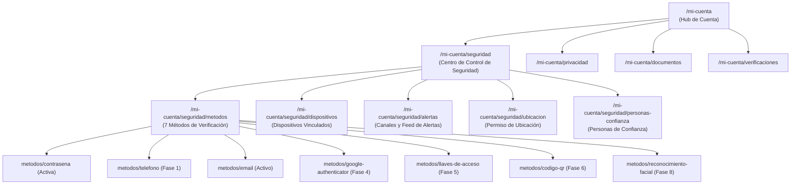
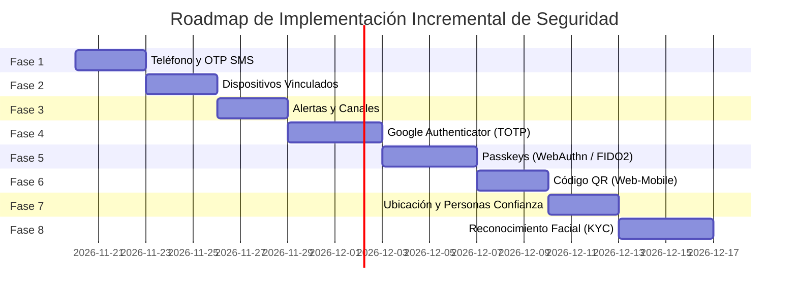
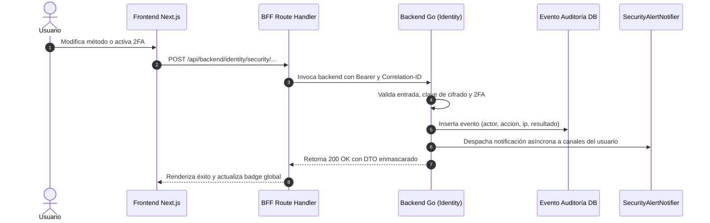

# Plan de Implementación por Fases: Perfil, Seguridad y Métodos de Verificación

**Repositorio:** `espacigo-aws`  
**Fecha de corte:** 19 de noviembre de 2026  
**Rama activa de trabajo:** `desarrollo-local`  
**Entorno de desarrollo:** Local Docker (`aws-emulator:9297`, PostgreSQL 18.6 `:5432`, Mailpit `:8025`/`:1025`, Go API `:8080`, Next.js `:3000`)  
**Entorno de producción:** AWS ECS Fargate, Amazon RDS PostgreSQL 18, Amazon SNS/SES, AWS KMS, AWS Secrets Manager, CloudFront / NLB TLS.

---

## 1. Resumen de la Maqueta Frontend en `/mi-cuenta` y `/mi-cuenta/seguridad/...`

La nueva experiencia de **Perfil y Seguridad** de EspaciGo toma como referencia la ergonomía, claridad visual y arquitectura de información de plataformas líderes de pago y servicios (inspirada en la experiencia de *Mercado Pago*), adaptándola rigurosamente a la **identidad de marca de EspaciGo**:
- **Paleta oficial terracota:** Tonos principales `brand-500` (`#E05A47`), `brand-600` (`#C84332`), acentos claros `brand-50` (`#FFF5F2`) y fondos neutros `slate-50` a `slate-900`.
- **Identidad corporativa:** Logotipo oficial de EspaciGo, tipografía e iconografía consistentes con la biblioteca de componentes del proyecto.
- **Enmascaramiento por defecto (ISO/IEC 27001:2022 control A.8.11):** En ninguna vista de perfil o seguridad se expone información sensible sin enmascarar (emails como `••••@dominio.cl`, RUTs como `••••6785`, teléfonos como `+56 9 •••• 5678`, contraseñas como `••••••••••••`).

### 1.1 Mapa de Rutas de la Interfaz



### 1.2 Componentes Clave de la Maqueta
1. **Banner de Estado Global de Seguridad (`/mi-cuenta/seguridad`):**
   - Indicador de estado con micro-progreso visual terracota/esmeralda.
   - Mensaje de meta: *"Tu cuenta está protegida porque tienes los métodos necesarios"*.
   - Estado activo actual: Contraseña y E-mail activos (base inicial); métodos complementarios en estado configurable.
2. **Lista Centralizada de Métodos (`/mi-cuenta/seguridad/metodos`):**
   - Presentación de 7 filas estructuradas con icono temático, título descriptivo, valor enmascarado/estado y badge (`Activo` en verde esmeralda o `Configurar` / `Pendiente`).
   - Chevrons navegables hacia cada configuración específica.
3. **Página de Alertas de Seguridad (`/mi-cuenta/seguridad/alertas`):**
   - Conmutadores estilo switch con paleta terracota para: `Notificaciones de la app`, `E-mail` (con correo enmascarado y enlace a "Agregar e-mail adicional"), y `WhatsApp`.
   - Línea temporal de eventos de seguridad recientes con iconos diferenciados por severidad.

---

## 2. Regla de Construcción Incremental

Para preservar la estabilidad de la plataforma y cumplir estrictamente con los lineamientos de arquitectura de `AGENTS.md`, cada fase se construirá de manera **estrictamente incremental y autocontenida**:

1. **Un control a la vez (Vertical Slices):** Cada fase aborda su ciclo completo:
   - Esquema DDL en PostgreSQL 18 con roles de mínimo privilegio.
   - Contratos OpenAPI (`planning/openapi.yaml`) y regeneración de cliente BFF Next.js.
   - Lógica de Dominio y Servicios en Go (`internal/identity`).
   - Handlers HTTP y middlewares de rate limiting / auditoría.
   - Vistas y componentes reactivos en Next.js con validaciones locales.
   - Batería de pruebas automatizadas unitarias, de integración y build.
2. **Entorno de Aislamiento (`desarrollo-local`):**
   - Todos los cambios de infraestructura local, migraciones y pruebas se ejecutan primero en `desarrollo-local` utilizando `./scripts/local-dev.sh`.
   - No se tocan ni modifican perfiles ni credenciales de producción de AWS durante el desarrollo.
   - Los servicios externos (SMS, Push, WhatsApp) disponen de **adaptadores simulados/locales** (outbox, Mailpit, log seguro) para operar 100% desconectados y sin costo.
3. **Convenciones de Migraciones SQL:**
   - Cada migración se numera secuencialmente a partir de `V000103__...`.
   - Se ejecutan mediante el usuario operativo `espacigo_migrator_login` asumiendo el rol propietario `espacigo_schema_owner`.
   - Toda migración se clasifica en `db/release-policy.json`.
4. **Criterios de Promoción a `main`:**
   - La rama `main` sólo recibe commits probados tras aprobación explícita.
   - Verificación de CI obligatoria: `go vet`, `go test -count=1`, `pnpm api:check`, `pnpm typecheck`, `pnpm lint`, `pnpm test`, `pnpm build`.

---

## 3. Desglose Detallado por Fases



---

### Fase 1 — Teléfono y Verificación por Mensaje (SMS / OTP)

#### 1. Objetivo y Experiencia de Usuario
Permitir al usuario enrolar y verificar su número de teléfono celular chileno (`+56 9 XXXX XXXX`) para utilizarlo como factor de autenticación seguro, recuperación de cuenta y canal crítico de notificaciones. La interfaz en `/mi-cuenta/seguridad/metodos/telefono` ofrece un flujo en 2 pasos:
1. Ingreso de número con prefijo chileno fijo `+56` y validación de 8-9 dígitos móviles.
2. Ingreso de código OTP de 6 dígitos recibido por SMS con temporizador de reenvío (cooldown de 60 segundos).
Al validarse exitosamente, el método pasa a estado `Activo` con check verde en la lista principal.

#### 2. Componentes Frontend (Next.js)
- `frontend/src/features/account-security/ui/phone-verification-form.tsx`: Formulario reactivo con máscara de entrada de teléfono chileno, validación con Zod, control de estados de carga y manejo de errores de rate limiting.
- `frontend/src/features/account-security/ui/otp-input.tsx`: Componente de 6 cajas numéricas con auto-focus continuo, soporte de pegado rápido (paste) y cuenta regresiva de reintento.

#### 3. Contratos de API (OpenAPI / BFF)
- `POST /api/v1/identity/security/phone/request`: Solicita código OTP.
  - Request: `{ "phone": "+56912345678" }`
  - Response: `{ "status": "code_sent", "masked_phone": "+56 9 •••• 5678", "retry_after_seconds": 60, "expires_in_seconds": 300 }`
- `POST /api/v1/identity/security/phone/verify`: Valida el código ingresado.
  - Request: `{ "code": "492817" }`
  - Response: `{ "status": "verified", "masked_phone": "+56 9 •••• 5678", "verified_at": "2026-11-20T14:30:00Z" }`
- `DELETE /api/v1/identity/security/phone`: Desvincula el teléfono (requiere confirmación con contraseña o 2FA previo).

#### 4. Dominio y Servicios Backend (Go `internal/identity`)
- Entidad `UserPhone`: `UserID uuid.UUID`, `E164Phone string`, `MaskedPhone string`, `Verified bool`, `VerifiedAt *time.Time`.
- Servicio `PhoneVerificationService`:
  - Generación de código criptográfico de 6 dígitos (`crypto/rand`).
  - Hash del OTP con sal (`HMAC-SHA256` o `SHA-256`) antes de almacenar el desafío efímero.
  - Control de reintentos: Máximo 3 intentos de validación por código.
  - Cooldown de emisión: Mínimo 60 segundos entre solicitudes hacia el mismo teléfono o usuario.

#### 5. Base de Datos (PostgreSQL 18 — Migración `V000103`)
```sql
-- V000103__security_phone_verification.sql
CREATE TABLE public.usuario_telefono (
    usuario_id uuid NOT NULL,
    telefono_e164 text NOT NULL,
    telefono_enmascarado text NOT NULL,
    verificado boolean NOT NULL DEFAULT false,
    verificado_en timestamptz,
    creado_en timestamptz NOT NULL DEFAULT now(),
    actualizado_en timestamptz NOT NULL DEFAULT now(),
    CONSTRAINT usuario_telefono_pk PRIMARY KEY (usuario_id),
    CONSTRAINT usuario_telefono_usuario_fk FOREIGN KEY (usuario_id)
        REFERENCES public.usuario (id) ON DELETE RESTRICT,
    CONSTRAINT usuario_telefono_e164_ck CHECK (telefono_e164 ~ '^\+56[0-9]{9}$')
);

CREATE TABLE public.desafio_otp_telefono (
    id uuid NOT NULL DEFAULT gen_random_uuid(),
    usuario_id uuid NOT NULL,
    telefono_e164 text NOT NULL,
    codigo_hash text NOT NULL,
    intentos_fallidos integer NOT NULL DEFAULT 0,
    expira_en timestamptz NOT NULL,
    consumido_en timestamptz,
    creado_en timestamptz NOT NULL DEFAULT now(),
    CONSTRAINT desafio_otp_telefono_pk PRIMARY KEY (id),
    CONSTRAINT desafio_otp_usuario_fk FOREIGN KEY (usuario_id)
        REFERENCES public.usuario (id) ON DELETE CASCADE
);
CREATE INDEX desafio_otp_usuario_idx ON public.desafio_otp_telefono (usuario_id, expira_en)
    WHERE consumido_en IS NULL;
```

#### 6. Adaptadores de Entorno
- **Local (`desarrollo-local`):** `LocalSmsAdapter` escribe el OTP en `public.outbox_evento_local`, en el log estructurado de Go (`logger.Info("OTP SMS emitido", "phone", masked, "code", otp)`) y en bandeja de Mailpit para pruebas manuales y scripts E2E.
- **Producción (`main` AWS):** `AwsSnsSmsAdapter` utiliza AWS SDK v2 con cliente `sns.NewFromConfig(cfg)` publicando mensaje directo con sender ID registrado `EspaciGo` y límites de gasto mensuales configurados en Parameter Store.

---

### Fase 2 — Dispositivos Vinculados

#### 1. Objetivo y Experiencia de Usuario
Permitir al usuario auditar en `/mi-cuenta/seguridad/dispositivos` todas las sesiones activas en su cuenta:
- Identificación clara de **"Este dispositivo"** (sesión en curso).
- Tarjetas de dispositivos con desglose de: Tipo (Móvil / Escritorio), Navegador (Chrome, Safari, Firefox), Sistema Operativo (iOS, Android, macOS, Windows, Linux), IP aproximada enmascarada y fecha/hora de última actividad.
- Botón de acción rápida: *"Cerrar sesión"* en un dispositivo individual.
- Botón de seguridad masivo: *"Cerrar todas las demás sesiones"*.

#### 2. Componentes Frontend (Next.js)
- `frontend/src/features/account-security/ui/linked-devices-list.tsx`: Listado de sesiones activas con iconos representativos de dispositivo y badges contextuales.
- `frontend/src/features/account-security/ui/terminate-session-modal.tsx`: Diálogo de confirmación para revocar sesiones ajenas.

#### 3. Contratos de API (OpenAPI / BFF)
- `GET /api/v1/identity/security/sessions`: Lista de sesiones activas del usuario.
  - Response:
    ```json
    {
      "current_session_id": "9b1deb4d-3b7d-4bad-9bdd-2b0d7b3dcb6d",
      "sessions": [
        {
          "id": "9b1deb4d-3b7d-4bad-9bdd-2b0d7b3dcb6d",
          "is_current": true,
          "device_type": "desktop",
          "browser": "Chrome 122.0",
          "os": "macOS 14.3",
          "approx_ip": "190.160.•••.•••",
          "location": "Santiago, Chile",
          "created_at": "2026-11-19T08:00:00Z",
          "last_activity_at": "2026-11-19T10:15:22Z"
        }
      ]
    }
    ```
- `DELETE /api/v1/identity/security/sessions/{sessionId}`: Revoca una sesión específica.
- `DELETE /api/v1/identity/security/sessions/others`: Revoca todas las sesiones excepto la actual.

#### 4. Dominio y Servicios Backend (Go `internal/identity`)
- Extensión del modelo `Session` en `domain.go` para capturar metadatos del cliente (User-Agent parsing ligero, IP de origen del encabezado confiable `X-Forwarded-For` detrás de ALB/CloudFront).
- Servicio `RevokeSession(ctx, userID, sessionID)` y `RevokeOtherSessions(ctx, userID, currentSessionID)`:
  - Marca `revocada_en = now()` en `public.sesion`.
  - Invalida la sesión inmediatamente en la base de datos (cualquier petición subsecuente recibe `401 Unauthorized`).
  - Emite evento de auditoría `session.revoked` con IP y agente que ejecutó la revocación.

#### 5. Base de Datos (PostgreSQL 18 — Migración `V000104`)
```sql
-- V000104__security_session_metadata.sql
ALTER TABLE public.sesion
    ADD COLUMN IF NOT EXISTS user_agent text,
    ADD COLUMN IF NOT EXISTS ip_origen inet,
    ADD COLUMN IF NOT EXISTS dispositivo_tipo text DEFAULT 'desconocido',
    ADD COLUMN IF NOT EXISTS ubicacion_aproximada text;

CREATE INDEX IF NOT EXISTS sesion_usuario_activas_idx
    ON public.sesion (usuario_id, ultima_actividad_en DESC)
    WHERE revocada_en IS NULL;
```

---

### Fase 3 — Alertas de Seguridad y Canales

#### 1. Objetivo y Experiencia de Usuario
Configurar en `/mi-cuenta/seguridad/alertas` los canales por donde el usuario desea ser advertido ante eventos críticos (inicios de sesión desde nuevos dispositivos, cambios de clave, actualización de métodos 2FA):
- Conmutadores independientes para:
  * **Notificaciones de la app:** Avisos in-app en la campana de notificaciones.
  * **E-mail:** Envío al correo principal enmascarado + opción de registrar un **correo secundario de seguridad verificado**.
  * **WhatsApp:** Mensajes transaccionales al número verificado en la Fase 1.
- **Feed de Alertas Recientes:** Visualización cronológica de eventos de seguridad reales registrados en la bitácora de auditoría de la cuenta.

#### 2. Componentes Frontend (Next.js)
- `frontend/src/features/account-security/ui/alert-channels-preferences.tsx`: Formulario de conmutadores con guardado optimista y feedback visual.
- `frontend/src/features/account-security/ui/security-audit-feed.tsx`: Línea de tiempo paginada con detalle de actividad reciente, dispositivo, fecha y estado.
- `frontend/src/features/account-security/ui/secondary-email-modal.tsx`: Modal para registrar y verificar el correo secundario con token de enlace.

#### 3. Contratos de API (OpenAPI / BFF)
- `GET /api/v1/identity/security/alert-channels`: Obtiene las preferencias activas y estado de verificación de canales.
- `PUT /api/v1/identity/security/alert-channels`: Actualiza preferencias (`app_push`, `email`, `whatsapp`).
- `POST /api/v1/identity/security/secondary-email`: Envía correo con token de verificación al correo secundario.
- `POST /api/v1/identity/security/secondary-email/verify`: Confirma la titularidad del correo adicional.
- `GET /api/v1/identity/security/alerts-feed`: Devuelve la lista paginada de eventos de seguridad del usuario autenticado.

#### 4. Dominio y Servicios Backend (Go `internal/identity`)
- Almacenamiento de preferencias en tabla `seguridad_preferencia_canales`.
- Despacho asíncrono de alertas: El servicio de autenticación emite eventos a un dispatcher (`SecurityAlertNotifier`) que consulta los canales activos del usuario y despacha la alerta sin bloquear el flujo principal.
- Sanitización de auditoría: Los eventos expuestos al feed del usuario sólo contienen datos minimizados (sin hashes, sin tokens, con IPs enmascaradas).

#### 5. Base de Datos (PostgreSQL 18 — Migración `V000105`)
```sql
-- V000105__security_alert_preferences_and_secondary_email.sql
CREATE TABLE public.seguridad_preferencia_canales (
    usuario_id uuid NOT NULL,
    canal_app boolean NOT NULL DEFAULT true,
    canal_email boolean NOT NULL DEFAULT true,
    canal_whatsapp boolean NOT NULL DEFAULT false,
    correo_adicional text,
    correo_adicional_verificado boolean NOT NULL DEFAULT false,
    actualizado_en timestamptz NOT NULL DEFAULT now(),
    CONSTRAINT seguridad_preferencia_canales_pk PRIMARY KEY (usuario_id),
    CONSTRAINT seguridad_preferencia_canales_fk FOREIGN KEY (usuario_id)
        REFERENCES public.usuario (id) ON DELETE CASCADE
);
```

---

### Fase 4 — Google Authenticator (TOTP)

#### 1. Objetivo y Experiencia de Usuario
Ofrecer autenticación de doble factor basada en tiempo (RFC 6238 TOTP) en `/mi-cuenta/seguridad/metodos/google-authenticator`:
- Flujo de enrolamiento guiado:
  1. Generación de clave secreta aleatoria de 160 bits (Base32).
  2. Despliegue de Código QR compatible con Google Authenticator, Authy, 1Password, etc. (`otpauth://totp/EspaciGo:usuario@ejemplo.cl?secret=...&issuer=EspaciGo`).
  3. Visualización de clave en texto plano como alternativa al escaneo.
  4. Confirmación obligatoria con ingreso de código de 6 dígitos para activar.
  5. Entrega de **8 códigos de recuperación (Backup Codes)** de un solo uso que el usuario debe descargar o copiar.

#### 2. Criptografía y Almacenamiento Seguro
- **Cifrado en Reposo de la Llave Maestra TOTP:** La semilla secreta Base32 **nunca** se almacena en texto claro en la base de datos.
- Se cifra con `AES-256-GCM` utilizando el keyring criptográfico versionado de EspaciGo (`keyring.go`):
  * En `desarrollo-local`: Llave derivada de variable de entorno local / secreto local.
  * En producción AWS: Llave de cifrado gestionada en AWS KMS (`kms:Encrypt` / `kms:Decrypt`).
- **Códigos de Recuperación:** Se almacenan únicamente como hashes unidireccionales (`SHA-256` con sal o `bcrypt`).

#### 3. Base de Datos (PostgreSQL 18 — Migración `V000106`)
```sql
-- V000106__security_totp_authenticator.sql
CREATE TABLE public.usuario_totp (
    usuario_id uuid NOT NULL,
    secreto_cifrado bytea NOT NULL,
    key_version integer NOT NULL DEFAULT 1,
    activo boolean NOT NULL DEFAULT false,
    activado_en timestamptz,
    ultimo_paso_consumido bigint NOT NULL DEFAULT 0,
    creado_en timestamptz NOT NULL DEFAULT now(),
    CONSTRAINT usuario_totp_pk PRIMARY KEY (usuario_id),
    CONSTRAINT usuario_totp_usuario_fk FOREIGN KEY (usuario_id)
        REFERENCES public.usuario (id) ON DELETE CASCADE
);

CREATE TABLE public.usuario_totp_backup_codes (
    id uuid NOT NULL DEFAULT gen_random_uuid(),
    usuario_id uuid NOT NULL,
    codigo_hash text NOT NULL,
    consumido boolean NOT NULL DEFAULT false,
    consumido_en timestamptz,
    creado_en timestamptz NOT NULL DEFAULT now(),
    CONSTRAINT usuario_totp_backup_codes_pk PRIMARY KEY (id),
    CONSTRAINT usuario_totp_backup_codes_fk FOREIGN KEY (usuario_id)
        REFERENCES public.usuario (id) ON DELETE CASCADE
);
CREATE INDEX usuario_totp_backup_lookup_idx
    ON public.usuario_totp_backup_codes (usuario_id) WHERE NOT consumido;
```

#### 4. Resiliencia contra Ataques
- **Anti-Replay Window:** Protección estricta contra reuso del mismo código TOTP dentro de la misma ventana de 30 segundos registrando `ultimo_paso_consumido`.
- **Ventana de Deriva de Tiempo:** Margen de tolerancia de máximo $\pm 1$ paso temporal (30s de desfase reloj).

---

### Fase 5 — Llaves de Acceso (Passkeys / WebAuthn)

#### 1. Objetivo y Experiencia de Usuario
Habilitar autenticación biométrica y criptográfica moderna basada en estándares FIDO2 / WebAuthn Level 3 en `/mi-cuenta/seguridad/metodos/llaves-de-acceso`:
- Inicio de sesión y verificación de operaciones críticas con un toque (Touch ID, Face ID, Windows Hello o llave de seguridad física YubiKey).
- Enrolamiento en 1 clic utilizando `navigator.credentials.create()`.
- Gestión de múltiples credenciales vinculadas: visualización del nombre asignado (ej. *"MacBook Pro de Trabajo"*, *"iPhone 15"*), fecha de vinculación y última utilización.

#### 2. Arquitectura WebAuthn en Go
- Uso de librería estándar de servidor WebAuthn (`go-webauthn/webauthn`).
- Generación de desafío de registro (`PublicKeyCredentialCreationOptions`) asociado a la sesión del usuario.
- Verificación criptográfica de la atestación pública y firma en Go.
- Almacenamiento seguro del ID de la credencial, clave pública (`COSE key`), contador de uso (para detección de clones de credencial) y AAGUID.

#### 3. Base de Datos (PostgreSQL 18 — Migración `V000107`)
```sql
-- V000107__security_webauthn_passkeys.sql
CREATE TABLE public.usuario_passkey (
    id uuid NOT NULL DEFAULT gen_random_uuid(),
    usuario_id uuid NOT NULL,
    nombre text NOT NULL,
    credential_id bytea NOT NULL,
    public_key bytea NOT NULL,
    attestation_type text NOT NULL,
    aaguid uuid,
    sign_count bigint NOT NULL DEFAULT 0,
    creado_en timestamptz NOT NULL DEFAULT now(),
    ultimo_uso_en timestamptz,
    CONSTRAINT usuario_passkey_pk PRIMARY KEY (id),
    CONSTRAINT usuario_passkey_usuario_fk FOREIGN KEY (usuario_id)
        REFERENCES public.usuario (id) ON DELETE CASCADE,
    CONSTRAINT usuario_passkey_credential_id_uk UNIQUE (credential_id)
);
CREATE INDEX usuario_passkey_user_idx ON public.usuario_passkey (usuario_id);
```

---

### Fase 6 — Código QR (Autorización de Acceso Web-Móvil)

#### 1. Objetivo y Experiencia de Usuario
Facilitar el inicio de sesión rápido en navegadores de escritorio o quioscos mediante el escaneo de un código QR desde un dispositivo móvil previamente autenticado (`/mi-cuenta/seguridad/metodos/codigo-qr`):
- La pantalla web de escritorio solicita un canal de autenticación efímero y muestra un código QR dinámico.
- La aplicación móvil autenticada escanea el QR, verifica la solicitud con biometría o PIN, y autoriza el inicio de sesión del navegador de escritorio.
- El navegador web detecta la autorización en tiempo real y completa la autenticación sin escribir contraseñas.

#### 2. Mecanismo de Seguridad y Emparejamiento
- **Ticket de Desafío Efímero:** Nonce de 256 bits generado criptográficamente con vida útil estricta de **120 segundos**.
- **Canal de Sincronización:** En `desarrollo-local` y producción se utiliza un modelo de polling seguro con backoff (o SSE / Server-Sent Events) hacia un endpoint de estado (`GET /api/v1/identity/security/qr-session/{ticketId}/status`).
- Una vez autorizada en el móvil, la sesión web se crea inmediatamente y el ticket se marca como consumido de forma atómica.

#### 3. Base de Datos (PostgreSQL 18 — Migración `V000108`)
```sql
-- V000108__security_qr_login_channels.sql
CREATE TABLE public.canal_login_qr (
    id uuid NOT NULL DEFAULT gen_random_uuid(),
    ticket_hash text NOT NULL,
    ip_origen inet NOT NULL,
    user_agent text NOT NULL,
    estado text NOT NULL DEFAULT 'pendiente',
    usuario_id uuid,
    sesion_generada_id uuid,
    expira_en timestamptz NOT NULL,
    consumido_en timestamptz,
    creado_en timestamptz NOT NULL DEFAULT now(),
    CONSTRAINT canal_login_qr_pk PRIMARY KEY (id),
    CONSTRAINT canal_login_qr_ticket_uk UNIQUE (ticket_hash),
    CONSTRAINT canal_login_qr_estado_ck CHECK (estado IN ('pendiente', 'escaneado', 'autorizado', 'rechazado', 'expirado'))
);
CREATE INDEX canal_login_qr_expira_idx ON public.canal_login_qr (expira_en) WHERE consumido_en IS NULL;
```

---

### Fase 7 — Permiso de Ubicación y Personas de Confianza

#### 1. Permiso de Ubicación (`/mi-cuenta/seguridad/ubicacion`)
- **Propósito:** Registro explícito y revocable de consentimiento para cotejo de geolocalización aproximada durante accesos o pagos, orientado a la prevención de fraude (detección de "viajes imposibles" o accesos desde países no autorizados).
- **Cumplimiento Normativo (Ley 19.628 / RGPD):**
  * Principio de minimización: No se rastrea ubicación en segundo plano de manera continua.
  * Se almacena únicamente la preferencia de consentimiento del usuario y la última región/país inferido.
  * Botón explícito de revocación inmediata que elimina los registros históricos de geolocalización.

#### 2. Personas de Confianza (`/mi-cuenta/seguridad/personas-confianza`)
- **Propósito:** Designación de hasta 3 contactos de emergencia (familiares, administradores o colegas).
- **Casos de Uso:**
  * Recuperación asistida ante bloqueo total de credenciales o extravío de factores 2FA.
  * Notificación automática en caso de incidentes graves de seguridad o reclamos contractuales de arrendamiento.
- **Datos requeridos y enmascaramiento:** Nombre completo, relación/parentesco, teléfono y correo electrónico. Todos los datos de contacto se muestran enmascarados en la interfaz para evitar recolección visual no autorizada.

#### 3. Base de Datos (PostgreSQL 18 — Migración `V000109`)
```sql
-- V000109__security_location_and_trusted_contacts.sql
CREATE TABLE public.seguridad_consentimiento_ubicacion (
    usuario_id uuid NOT NULL,
    permitido boolean NOT NULL DEFAULT false,
    otorgado_en timestamptz,
    revocado_en timestamptz,
    CONSTRAINT seguridad_ubicacion_pk PRIMARY KEY (usuario_id),
    CONSTRAINT seguridad_ubicacion_usuario_fk FOREIGN KEY (usuario_id)
        REFERENCES public.usuario (id) ON DELETE CASCADE
);

CREATE TABLE public.usuario_contacto_confianza (
    id uuid NOT NULL DEFAULT gen_random_uuid(),
    usuario_id uuid NOT NULL,
    nombre_contacto text NOT NULL,
    relacion text NOT NULL,
    telefono_contacto text NOT NULL,
    email_contacto text NOT NULL,
    verificado boolean NOT NULL DEFAULT false,
    creado_en timestamptz NOT NULL DEFAULT now(),
    CONSTRAINT usuario_contacto_confianza_pk PRIMARY KEY (id),
    CONSTRAINT usuario_contacto_confianza_usuario_fk FOREIGN KEY (usuario_id)
        REFERENCES public.usuario (id) ON DELETE CASCADE
);
CREATE INDEX usuario_contacto_confianza_user_idx ON public.usuario_contacto_confianza (usuario_id);
```

---

### Fase 8 — Reconocimiento Facial (Integración con Módulo KYC)

#### 1. Objetivo y Regla de Separación
Ofrecer la opción de verificación biométrica facial en `/mi-cuenta/seguridad/metodos/reconocimiento-facial` para autorizaciones de máxima seguridad (ej. desembolsos financieros, cambio de correo principal o disputas de propiedad).

> [!IMPORTANT]
> **Aislamiento Arquitectónico Estricto:** La interfaz y lógica de Perfil/Seguridad **no deben acoplarse directamente a librerías de terceros de biometría ni a SDKs de KYC**.
> - El método se mantiene en estado "Enrolamiento a través de Verificación de Identidad" mientras el módulo KYC esté en fase de preparación.
> - Cuando el usuario pulsa en el método, la aplicación consulta el estado documental/KYC existente (`/api/v1/verifications/status`).
> - Si el KYC ya fue aprobado y cuenta con vector biométrico validado, el check de seguridad se activa automáticamente.
> - Si no está verificado, se presenta un botón que redirige al flujo oficial `/verificacion` respetando los contratos y políticas vigentes de privacidad de datos personales.

---

## 4. Criterio de Estado Global y Matriz de Seguridad

### 4.1 Criterio de Evaluación de Salud de la Cuenta
El banner superior del Centro de Seguridad evalúa la salud de protección del usuario según la siguiente regla:

$$\text{Puntaje de Protección} = \sum (\text{Métodos Activos}) + \text{Factores Críticos}$$

| Nivel de Seguridad | Condición Requerida | Estado Visual | Mensaje al Usuario |
|---|---|---|---|
| **Básico** | Contraseña + Email verificado | Amarillo / Ámbar | *"Te recomendamos activar un método de verificación en dos pasos (SMS, TOTP o Passkey) para proteger tu cuenta."* |
| **Protegido** (Óptimo) | Contraseña + Email + (Teléfono SMS O TOTP O Passkey activo) | Verde Esmeralda / Terracota | **"Tu cuenta está protegida porque tienes los métodos necesarios."** |
| **Avanzado** | $\ge 2$ métodos 2FA activos + Canales de alerta configurados + Sin sesiones anómalas | Verde Esmeralda con Escudo Brillante | *"Tu cuenta cuenta con el máximo nivel de protección y respaldo de seguridad."* |

---

### 4.2 Matriz de Enmascaramiento de Datos (ISO/IEC 27001:2022 A.8.11)

| Campo de Información | Almacenamiento en DB | DTO API / BFF | Renderizado en UI | Prevención de Fugas |
|---|---|---|---|---|
| **Correo Electrónico** | `correo_original` encriptado/restringido; `correo_normalizado` para login | `masked_email` (ej. `j••••@dominio.cl`) | Componente `<RevealEmail />` con máscara por defecto | Ausente de atributos `title`, `alt`, tooltips y DOM no revelado |
| **Teléfono Celular** | `telefono_e164` en tabla restringida con acceso de migrator | `masked_phone` (ej. `+56 9 •••• 5678`) | `+56 9 •••• 5678` | Prohibido enviar el E.164 plano en respuestas públicas o de lista |
| **Contraseña** | Hash Argon2id / bcrypt (`hash_clave`) | Nunca se envía por API | `••••••••••••••••` | Prohibido registrar contraseñas en logs estructurados o trazas |
| **Secreto TOTP** | `bytea` cifrado con AES-256-GCM + IV | Expuesto en Base32 **una sola vez** al momento del enrolamiento | QR dinámico en canvas/SVG + botón copiar | El secreto cifrado no se descifra salvo durante el handshake de validación |
| **Códigos de Respaldo**| Hash SHA-256 individual por código | Expuestos en texto plano **una sola vez** al generarse | Tarjeta de descarga de backup con advertencia | No se pueden volver a consultar; sólo se pueden regenerar invalidando los anteriores |
| **RUT Chileno** | Llavero HMAC / Cifrado según módulo | `masked_rut` (ej. `••••6785`) | `••••6785` | Conforme a la implementación en `internal/identity/masking.go` |
| **Dirección IP** | Tipo `inet` en PostgreSQL | `approx_ip` (ej. `190.160.•••.•••`) | `190.160.•••.•••` con geolocalización aproximada | Anonimización del último octeto/segmento para no persistir trazado invasivo |

---

### 4.3 Matriz de Rate Limiting y Cooldowns

| Operación | Límite por Usuario / Cuenta | Límite por Dirección IP | Ventana / Cooldown | Acción ante Incumplimiento |
|---|---|---|---|---|
| **Envío de OTP SMS** | 1 intento cada 60 s; máx 5 por hora | Máximo 10 solicitudes por hora | 60 segundos fijos / 3600 segundos | HTTP 429 con cabecera `Retry-After: 60` |
| **Validación de OTP SMS** | Máximo 3 intentos fallidos consecutivos | Máximo 15 intentos por hora | Invalida el desafío al tercer fallo | Requiere emitir un nuevo código OTP |
| **Verificación de TOTP** | Máximo 5 intentos fallidos consecutivos | Máximo 20 intentos por 15 min | Bloqueo temporal de 900 s (15 min) | HTTP 429 y registro en bitácora de auditoría |
| **Revocación de Sesiones** | 10 llamadas por minuto | 30 llamadas por minuto | 60 segundos | HTTP 429 |
| **Generación QR Login** | 3 tickets activos simultáneos | 10 tickets por 5 minutos | 120 segundos por ticket (TTL estricto)| Expiración automática sin consumo |

---

### 4.4 Matriz de Auditoría y Trazabilidad Inmutable

Todos los eventos de seguridad se canalizan a través de `public.evento_auditoria_local` (en desarrollo local) y la tabla de auditoría inmutable de producción:



Eventos mínimos auditados con no repudio:
1. `security.phone.registered` / `security.phone.verified` / `security.phone.removed`
2. `security.session.revoked` / `security.session.revoke_all_others`
3. `security.totp.enrolled` / `security.totp.deactivated` / `security.totp.backup_code_used`
4. `security.passkey.registered` / `security.passkey.revoked`
5. `security.password.changed`
6. `security.alert_channel.updated`
7. `security.trusted_contact.added` / `security.trusted_contact.removed`

---

## 5. Procedimiento de Verificación y Promoción

Para cada una de las 8 fases, el procedimiento estándar de desarrollo y verificación consiste en:

```bash
# 1. Comprobar salud del entorno local desacoplado
./scripts/local-dev.sh status

# 2. Aplicar y verificar la migración SQL de la fase correspondiente
./scripts/local-dev.sh migrate

# 3. Ejecutar suite de pruebas unitarias y de integración de Go
go vet ./...
go test -count=1 ./internal/identity/... ./cmd/api

# 4. En frontend/, verificar tipos, linter, tests y build de producción
cd frontend
pnpm api:generate
pnpm api:check
pnpm typecheck
pnpm lint
pnpm test
pnpm build
```

Una vez cumplido el protocolo en `desarrollo-local`, se genera un commit convencional (ej. `feat(identity): implement phase 1 phone sms verification and masking`) y se presenta la evidencia al usuario para su autorización formal antes de promover a `main`.
