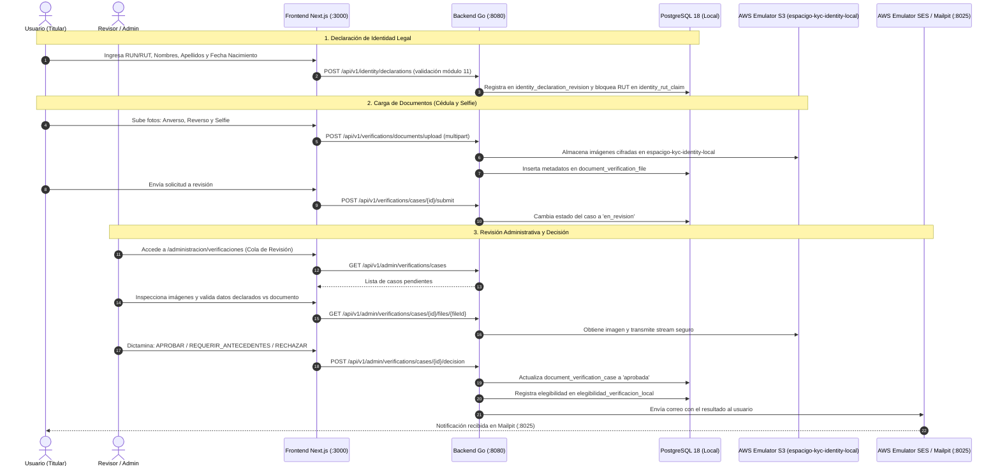

# Plan Maestro: Verificación de Identidad KYC Soberana (Local-First en AWS Emulator)

**Repositorio:** `espacigo-aws`  
**Fecha de corte:** Noviembre 2026  
**Entorno:** Local Docker (PostgreSQL 18, AWS Emulator `aws-emulator:9297`, Mailpit `127.0.0.1:8025`, Go API `:8080`, Next.js `:3000`)

---

## 1. Contexto Histórico: Evolución y Brechas en espaciGo

En el desarrollo de `espaciGo`, el sistema de verificación de identidad atravesó dos etapas clave:

1. **Intento Inicial (Proveedor Externo Didit)**:
   - Se evaluó externalizar la biometría y OCR a Didit (`Compliance workflow`, `OCR + Liveness + Face Match`).
   - **Problemas**: Dependencia de suscripciones de pago en dólares (USD 0.33 por intento), cuotas mensuales reducidas, y la imposibilidad de recibir webhooks HTTPS en entornos de desarrollo local sin configurar túneles externos (ngrok) o gastar créditos.
2. **Decisión Estratégica: Sistema de Verificación Propio (Soberano)**:
   - El equipo decidió internalizar la verificación con un modelo de **declaración legal + carga de cédula física chilena (anverso, reverso, selfie) + revisión administrativa humana (`reviewer-queue`)**.
   - Se construyeron migraciones avanzadas en PostgreSQL (hasta `V000096`), incluyendo hashing HMAC de RUN/RUT (`identity_rut_claim`) para evitar identidades duplicadas, auditoría de observaciones de revisores (`identity_reviewer_observation_audit`) y esquemas de retención y purga de documentos.

### ¿Por qué quedó incompleto y qué faltó?
- **Bloqueo por Pipelines de Cloud SQL y GCP**: La base de datos viva requería pasar por jobs de Cloud Build y chequeos estrictos de watermark (`release_main.py`). La aplicación de migraciones V84-V96 se volvió un cuello de botella.
- **Acoplamiento de Storage a Google Cloud Storage**: El adaptador de archivos en Go esperaba GCS. Al no haber GCS en local, la carga de fotos de identidad fallaba o recurría a mocks en memoria.
- **Desconexión entre el Frontend y el Storage S3**: En Next.js (`/mi-cuenta/verificaciones` y `/administracion/verificaciones`), las llamadas hacia el BFF y la subida de blobs no estaban enlazadas al bucket S3 local de AWS Emulator.
- **Falta de Herramientas de Desarrollo Local**: No existía una vía ágil en el entorno local para simular la aprobación de un revisor sin tener que cambiar de cuenta y contexto manualmente.

---

## 2. Arquitectura de Verificación de Identidad en espacigo-aws

---

## 3. Modelo de Datos en PostgreSQL 18

Las tablas ya están aplicadas hasta la migración `V000096` en `espacigo_aws_local`:

### 3.1. Tablas Centrales de Identidad
1. **`identity_declaration_revision`**:
   - `id`: UUID.
   - `account_id`: Clave foránea a `usuario(id)`.
   - `declared_first_name`, `declared_last_name`.
   - `declared_date_of_birth`: Fecha civil `YYYY-MM-DD`.
   - `declared_rut_normalized`: RUN/RUT chileno en formato `12345678-K` (validado mediante algoritmo módulo 11).
   - `consent_version`, `consent_given_at`: Registro inmutable del consentimiento legal del usuario.
2. **`identity_rut_claim`**:
   - `fingerprint`: Hash HMAC secreto del RUN/RUT para garantizar unicidad global.
   - `account_id`, `declaration_id`.
   - Previene que dos cuentas diferentes registren o verifiquen la misma persona física.
3. **`document_verification_case`**:
   - Caso de verificación documental asociado a la cuenta.
   - `state`: `borrador`, `enviada`, `en_revision`, `aprobada`, `requiere_antecedentes`, `rechazada`, `revocada`.
   - `format_declared`: Formato de cédula declarado (`anterior` pre-16 dic 2024, `nuevo` post-16 dic 2024, o `no_estoy_seguro`).
   - `observed_expiration_date`: Fecha de vencimiento visible registrada por el revisor.
4. **`document_verification_file`**:
   - Archivos vinculados al caso con roles únicos:
     - `identity_front` (Anverso de cédula)
     - `identity_back` (Reverso de cédula con chip/código)
     - `identity_selfie` (Fotografía de rostro del titular)
   - `storage_path`: Clave del objeto en S3 (`espacigo-kyc-identity-local`).
   - `sha256`: Hash del contenido para verificar integridad.
5. **`identity_reviewer_observation_audit`**:
   - Registro inmutable de cada observación, nota y decisión tomada por el revisor administrativo.
6. **`elegibilidad_verificacion_local`**:
   - Tabla consultada por el motor de arriendos y publicaciones para validar que el usuario cuenta con el sello de identidad activa.

---

## 4. Almacenamiento en AWS Emulator S3

En lugar de depender de Google Cloud Storage:
- **Bucket**: `espacigo-kyc-identity-local` (creado mediante Terraform y `scripts/local-dev.sh`).
- **Adaptador**: `internal/adapters/s3storage` configurado en `DOCUMENT_VERIFICATION_STORAGE_BACKEND="s3"`.
- **Privacidad y Acceso**:
  - Los archivos de identidad **nunca** son públicos.
  - La API Go actúa como guardián: únicamente el titular de la cuenta o un usuario con rol de revisor administrativo asignado puede descargar o visualizar las imágenes.

---

## 5. Notificaciones Vía AWS SES y Mailpit

Cada cambio de estado en la verificación emite una plantilla de correo a través de AWS SES local:
1. **Identidad Aprobada**:
   - Asunto: `Tu identidad ha sido verificada en EspaciGo`.
   - Mensaje: Confirmación del sello de identidad y habilitación completa para arrendar y publicar espacios.
2. **Documentos Rechazados o Requiere Antecedentes**:
   - Asunto: `Actualización sobre tu verificación de identidad`.
   - Mensaje: Explicación segura del motivo (ej. foto borrosa, fecha ilegible, RUT no coincide con documento) y botón con enlace directo para corregir y reintentar en `/mi-cuenta/verificaciones`.

---

## 6. Frontend: Pantallas y Experiencia de Usuario (Next.js)

### 6.1. Portal del Usuario (`/mi-cuenta/verificaciones`)
- **Paso 1: Datos Personales**: Formulario con validación visual en tiempo real de RUN/RUT, nombres y fecha de nacimiento.
- **Paso 2: Subida Guiada**: Selector de formato de cédula física (con instrucciones visuales para la versión anterior y la nueva de 2024). Carga interactiva de tres imágenes (anverso, reverso, selfie).
- **Paso 3: Estado y Trazabilidad**:
  - `en_revision`: Indicador de espera con reloj ámbar.
  - `aprobada`: Escudo verde con check «Identidad Verificada».
  - `requiere_antecedentes`: Cuadro de aviso con las notas del revisor y opción de reemplazar solo los archivos observados.

### 6.2. Portal de Administración (`/administracion/verificaciones`)
- Lista de casos pendientes con ordenamiento cronológico.
- Vista de detalle con comparación lado a lado:
  - Columna izquierda: Datos declarados por el usuario.
  - Columna derecha: Visor seguro de imágenes en alta resolución (rotación, zoom).
  - Panel inferior: Checklist de validación (coincidencia de nombres, vigencia de cédula, foto consistente) y selector de resolución (Aprobar, Solicitar antecedentes, Rechazar).

### 6.3. Herramienta Local para Desarrollador (`Dev Bypass`)
- Para facilitar el desarrollo y testing sin fricciones, en entorno local se habilita una acción administrativa en la interfaz o vía endpoint (`POST /api/v1/local/dev/verify-identity`) que aprueba la identidad del usuario actual en un clic, grabando la elegibilidad en PostgreSQL.

---

## 7. Plan de Ejecución por Fases (Roadmap)

### Fase 1: Conexión de Declaración y Subida S3
- [ ] Conectar endpoint `POST /api/v1/identity/declarations` a la tabla `identity_declaration_revision` y `identity_rut_claim`.
- [ ] Integrar el adaptador S3 en `internal/documentverification/upload.go` apuntando al bucket `espacigo-kyc-identity-local`.
- [ ] Probar subida real de cédula y selfie desde `/mi-cuenta/verificaciones`.

### Fase 2: Envío y Transición de Estados
- [ ] Implementar endpoint `POST /api/v1/verifications/cases/{id}/submit` que valide la presencia de los 3 archivos y pase el caso a `en_revision`.
- [ ] Disparar notificación por correo de confirmación de recepción en Mailpit.

### Fase 3: Cola de Revisión de Administración
- [ ] Habilitar endpoint `GET /api/v1/admin/verifications/cases` para listar solicitudes en espera.
- [ ] Conectar visor de imágenes en `/administracion/verificaciones` transmitiendo blobs directamente desde S3.
- [ ] Implementar endpoint `POST /api/v1/admin/verifications/cases/{id}/decision` que actualice la base de datos, inserte en `identity_reviewer_observation_audit` y actualice `elegibilidad_verificacion_local`.

### Fase 4: Sello Visual y Desbloqueo en el Ecosistema
- [ ] Mostrar insignia de identidad verificada en el navbar, perfil (`/mi-cuenta`) y en la ficha de anfitrión de espacios.
- [ ] Integrar el chequeo de elegibilidad en el flujo de publicación de espacios y arriendos.
